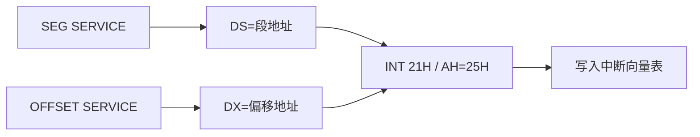

# 汇编语言常用运算符（OFFSET、SEG、TYPE、LENGTH、SIZE等）

## 为什么需要它们

在 8086/80286 实模式里，一个内存地址要写成“段地址 : 偏移地址”，比如 `1234H:0056H`。

如果让你每次都手算 `SERVICE` 这个过程放在哪个段、从第几个字节开始，既麻烦又容易错。于是汇编器给了几个**地址回送运算符**，让你直接拿变量的段值、偏移值，不用硬编码。

先把这几个运算符是什么说清楚：

- `SEG`：取变量/标号的**段地址**（就是它所在段的基址高 16 位）
- `OFFSET`：取变量/标号的**偏移地址**（在段内离段首多少字节）
- `TYPE`：回送变量或标号的一个“单位”占多少字节；对变量是 `DB=1`、`DW=2`、`DD=4`；对标号是 `NEAR=-1`、`FAR=-2`
- `LENGTH`：用 `DUP` 定义重复数据时，回送最外层 `DUP` 前面的重复次数；对非 `DUP` 数据，回送 1
- `SIZE`：==`SIZE = LENGTH × TYPE`==，也就是这个变量一共占了几个字节
- `$`：当前位置计数器的值，常用来算“从某个数据开始到现在一共写了多少字节”

## 它们怎么用

看课件里设置中断向量这段核心代码：

```asm
MOV AX, SEG SERVICE   ; AX = SERVICE 所在段的段地址
MOV DS, AX            ; 入口参数：DS = 中断服务子程序入口段地址
MOV DX, OFFSET SERVICE; DX = SERVICE 在段内的偏移地址
MOV AX, 251CH         ; DOS 25H 功能：置新中断向量
INT 21H
```

这里 `SEG SERVICE` 和 `OFFSET SERVICE` 分别填进了 `DS` 和 `DX`，正好对应 DOS `25H` 的入口参数。为什么不直接写 `MOV DX, 1234H`？因为 `SERVICE` 的位置由汇编器和连接器决定，写死地址一改代码就错，用 `SEG` / `OFFSET` 是让汇编器替你填真值。

再看 `$` 运算符的用法，下面这道题考过：

```asm
DAT1 DW 1234H, 5678H, 'AB', 'CD', '2'
DAT2 DB 4 DUP(?)
DAT3 DD ?
CN   EQU $-DAT1
```

一步步问：

1. `DAT1` 里每一项占多少字节？`DW` 是 2 字节，一共 5 项，所以 `DAT1` 共 $5 \times 2 = 10$ 字节。
2. `DAT2` 是 `DB 4 DUP(?)`，占 4 字节。
3. `DAT3` 是 `DD ?`，占 4 字节。
4. 从 `DAT1` 开始到 `CN` 定义处，总共 $10 + 4 + 4 = 18$ 字节。

所以 ==`CN = 18`（十进制）==。这里 `$` 就是“当前地址”，减 `DAT1` 得到从 `DAT1` 起算的字节长度。

再看 `DAT1+5` 字节单元：`1234H` 占 0~1 字节，`5678H` 占 2~3 字节，`'AB'` 占 4~5 字节（低位在前，`'A'` 在 4，`'B'` 在 5），所以第 5 个字节是 `'B'`。

## 相近运算符怎么区分

用一张表压住易混点：

| 运算符 | 回送内容 | 典型结果 |
|---|---|---|
| `SEG` | 段地址 | 某个段值，如 `CODE` 段址 |
| `OFFSET` | 偏移地址 | 变量在段内 EA |
| `TYPE` | 单项字节数 / 标号类型 | `DW` 得 2 |
| `LENGTH` | DUP 重复次数（最外层） | `4 DUP` 得 4 |
| `SIZE` | `LENGTH × TYPE` | 总字节数 |
| `$` | 当前位置计数器值 | 常用于算长度 |

> [!WARNING]
> 最常见坑：`LENGTH` 只对 `DUP` 有效，不是所有变量的“总个数”。  
> `DAT1 DW 1234H, 5678H` 没用 `DUP`，`LENGTH DAT1` 是 1，不是 2。

> [!NOTE]
> 课件里还提到 `PTR` 运算符，比如 `MOV AX, BUF` 中 `BUF` 是 `DB` 定义，但你要当字读，就要写 `MOV AX, WORD PTR BUF`。它不改内存，只临时改类型，常和上面几个回送运算符一起考。

> [!TIP]
> 记设置中断向量就三件事：  
> `DS ← SEG 子程序`、`DX ← OFFSET 子程序`、`AX ← 25xxH`（`xx` 是向量号），再 `INT 21H`。

## 和设置中断向量的关系

用 mermaid 把 DOS `25H` 调用流程捋一下：



节点文字都压到 10 字内，对应课件里 `WRITE1C PROC` 那段：`MOV DX, OFFSET SERVICE` 就是取 `SERVICE` 的偏移，交给 DOS 功能号 `25H`，把入口地址塞进 `1CH` 型中断向量。

## 小结

这五个里 `SEG` 和 `OFFSET` 是南邮这门课最常考的，因为它们直接出现在“用 DOS `25H` 置新中断向量”的程序里；`$` 常配 `EQU` 算数据区长度；`TYPE`/`LENGTH`/`SIZE` 多在数据定义伪指令题里出现。记住 `SIZE = LENGTH × TYPE`，以及 `LENGTH` 只对 `DUP` 计数，这类题基本就稳了。
