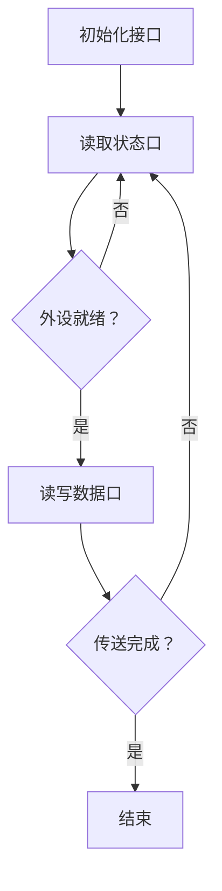

# 查询方式输入输出编程模式与流程

## 查询方式 I/O 的基本思想

查询方式是 CPU 主动、反复读取 I/O 接口的**状态寄存器**，根据状态位判断外设是否就绪，再决定是否进行数据传送。其基本结构是：



==查询方式的核心是“先查状态，后传数据；未就绪就等待”==。它不需要中断控制器参与，程序结构简单、时序容易掌握，但 CPU 在等待期间不断执行查询循环，效率较低。

## 输入与输出的编程模式

查询输入和查询输出的程序骨架相同，区别主要在于**就绪条件**和**数据传送方向**。

| 操作 | 查询的状态含义 | 就绪后的操作 | 数据方向 |
|---|---|---|---|
| 查询输入 | 输入缓冲已有有效数据 | `IN` 读取数据口 | 外设 → CPU |
| 查询输出 | 输出缓冲可以接收新数据 | `OUT` 写数据口 | CPU → 外设 |

典型输入程序为：

```assembly
WAIT_IN:
    MOV DX, STATUS_PORT
    IN  AL, DX          ; 读状态口
    TEST AL, READY_MASK ; 检查输入就绪位
    JZ  WAIT_IN         ; 未就绪，继续查询
    MOV DX, DATA_PORT
    IN  AL, DX          ; 从数据口读入数据
```

典型输出程序为：

```assembly
WAIT_OUT:
    MOV DX, STATUS_PORT
    IN  AL, DX
    TEST AL, READY_MASK ; 检查输出空闲位
    JZ  WAIT_OUT
    MOV DX, DATA_PORT
    MOV AL, DATA
    OUT DX, AL          ; 向数据口输出数据
```

这里的 `JZ` 并非固定答案，它取决于题目规定：**就绪位为 1 有效**时，常用 `TEST` 后 `JZ` 等待；若状态位为 0 有效，或需要测试多个状态位，则应相应改变判断方法。

## 8250 查询收发数据

8250 串行接口中，发送和接收都先读取**通信线状态寄存器 LSR**，主串口地址为 `3FDH`。

| 操作 | 状态标志 | LSR 位 | 测试值 | 就绪后的数据口 |
|---|---|---:|---:|---|
| 发送 | 发送保持寄存器空 THRE | $D_5$ | `20H` | `3F8H`，写发送保持寄存器 |
| 接收 | 接收数据就绪 DR | $D_0$ | `01H` | `3F8H`，读接收缓冲寄存器 |

发送字符 `A` 的完整程序段如下：

```assembly
RSCAN:
    MOV DX, 3FDH       ; LSR
    IN  AL, DX
    TEST AL, 20H       ; 检查 THRE
    JZ  RSCAN          ; THRE=0，继续等待
    MOV AL, 'A'
    MOV DX, 3F8H       ; 发送保持寄存器
    OUT DX, AL
```

这段程序对应考试填空的五个要点：`3FDH`、`20H`、`JZ RSCAN`、`3F8H`、`OUT DX,AL`。

接收一个字符则写成：

```assembly
RECV:
    MOV DX, 3FDH
    IN  AL, DX
    TEST AL, 01H       ; 检查 DR
    JZ  RECV
    MOV DX, 3F8H
    IN  AL, DX         ; AL 中得到接收字符
```

> [!IMPORTANT]
> ==发送看 THRE（$D_5$），接收看 DR（$D_0$）==；状态口都是 `3FDH`，数据口都是 `3F8H`，但发送用 `OUT`，接收用 `IN`。

## 与相近传送方式的区别

| 方式 | CPU 如何得知可以传送 | 主要特点 |
|---|---|---|
| 无条件传送 | 不判断，直接读写 | 最简单，要求外设始终准备好 |
| 查询方式 | CPU 循环读状态 | 程序简单，等待时占用 CPU |
| 中断方式 | 外设就绪后提出中断请求 | CPU 可先做其他工作，程序较复杂 |
| DMA 方式 | 由 DMA 控制器协调传送 | 适合成块高速传送，CPU 干预少 |

查询方式虽然也要先初始化 8250，但==应将中断允许寄存器 IER 置 0，禁止相关中断==，避免把查询通信与中断通信混写。

> [!WARNING]
> 常见错误有：把 `20H` 与 `01H` 对调；未就绪时仍执行数据传送；把状态口误写成 `3F8H`；发送时误用 `IN`；以及认为查询一次状态就足够。只要外设未就绪，程序就必须返回继续查询。

> [!TIP]
> 记忆口诀：**“先状态，后数据；发查空，收查有；发送 OUT，接收 IN。”**
