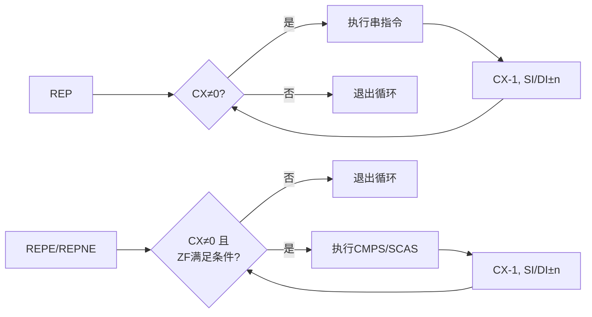

# 串处理指令（MOVS、CMPS、SCAS、LODS、STOS及REP前缀）

## 串处理指令的本质与准备

如果要在内存中搬运或搜索一大块连续数据，难道必须手写循环、逐条修改指针吗？x86 架构提供了专门的==串处理指令==，将“取指-修改地址-判断结束”封装为单条指令。但在使用前，你是否清楚 CPU 如何知道源在哪、目的在哪、传多少、向哪个方向传？

> [!IMPORTANT]
> 串操作指令隐式使用固定寄存器：==源串地址必须是 `DS:SI`，目的串地址必须是 `ES:DI`==，计数必须用 `CX`。这是硬件规定，不可更改。

执行 `REP MOVSB` 等指令前，必须完成以下四步准备，缺一不可：

1.  **置源地址**：`LEA SI, SRC` 或 `MOV SI, OFFSET SRC`（默认段为 `DS`）。
2.  **置目的地址**：`LEA DI, DST` 或 `MOV DI, OFFSET DST`（==强制使用 `ES` 段，禁止段超越==）。
3.  **置计数器**：`MOV CX, LENGTH`（以字节/字/双字为单位）。
4.  **置方向标志**：`CLD`（DF=0，地址递增）或 `STD`（DF=1，地址递减）。

> [!WARNING]
> 若忘记执行 `CLD`，且 DF 恰好为 1，指针将反向移动，导致数据覆盖或越界访问。这是实验中最常见的“玄学”错误。

## 五类指令与重复前缀辨析

串指令按功能分为五类，后缀 `B/W/D` 分别对应字节、字、双字操作：

| 指令 | 操作数流向 | 核心作用 | 常用重复前缀 |
| :--- | :--- | :--- | :--- |
| `MOVS` | `(DS):[SI]→(ES):[DI]` | 内存块复制 | `REP` |
| `STOS` | `AL/AX/EAX→(ES):[DI]` | 内存填充/初始化 | `REP` |
| `LODS` | `(DS):[SI]→AL/AX/EAX` | 读取单个元素 | 通常不用 REP |
| `CMPS` | `(DS):[SI] vs (ES):[DI]` | 两串比较 | `REPE` / `REPNE` |
| `SCAS` | `AL/AX/EAX vs (ES):[DI]` | 在串中搜索关键字 | `REPE` / `REPNE` |

> [!TIP]
> 记忆口诀：==M搬S存L读C比S扫==。`LODS` 和 `STOS` 只涉及累加器与一个内存操作数，而 `MOVS`、`CMPS` 涉及两个内存操作数。



注意区分 `REPE`（相等时继续）与 `REPNE`（不相等时继续）。`CMPS` 和 `SCAS` 会根据比较结果设置 `ZF`，==只有条件重复前缀才会检查 `ZF`==，普通 `REP` 仅看 `CX`。

## 真题实战与易错点

针对简答题“执行 `REP MOVSB` 前需做哪些准备”，标准答案即为前述四步。下面通过一个完整示例验证：

```asm
; 将 DATA1 中 100 字节复制到 DATA2
    LEA SI, DATA1      ; 源串偏移 → SI
    LEA DI, DATA2      ; 目的串偏移 → DI
    MOV CX, 100        ; 字节数 → CX
    CLD                ; DF=0，地址递增
    REP MOVSB          ; 循环复制 100 字节
```

> [!CAUTION]
> 目的串段寄存器 ==只能是 `ES`==，即使 `ASSUME ES:DATA_SEG` 已声明，也必须在代码中显式加载 `ES` 的值（如 `MOV AX, DATA_SEG` / `MOV ES, AX`），否则 `ES` 可能指向未知区域。源串虽默认为 `DS`，但允许段超越；目的串==绝对禁止段超越==。

掌握串指令的关键在于理解其==隐式寄存器约定==与==方向标志的协同机制==。只要准备工作规范，一条 `REP MOVS` 即可替代数十行循环代码，这正是汇编高效性的体现。
