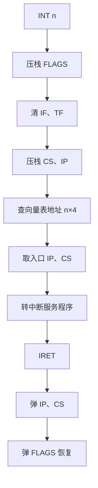

# 处理器控制指令（STI、CLI、HLT、NOP等）

## 处理器控制指令：STI、CLI、HLT、NOP

### 这些指令是干什么的？

处理器控制指令不搬运数据，也不做算术运算，它们==直接操纵 CPU 的工作状态==。在《微型计算机接口技术》里最常打交道的是两类：

| 指令 | 作用 | 对哪个标志位 |
|---|---|---|
| `CLI` | 关中断 | IF ← 0 |
| `STI` | 开中断 | IF ← 1 |
| `HLT` | 暂停，等待中断唤醒 | — |
| `NOP` | 空操作，占 3 个时钟周期 | — |

其中 `CLI` 和 `STI` 是中断程序设计的“闸门”，而 `HLT`、`NOP` 更多出现在延时与等待场景。

> [!IMPORTANT]
> `STI` 与 `CLI` ==只对可屏蔽中断请求（INTR）有效==，对 NMI（非屏蔽中断）、软件中断（`INT n`）、内部异常（除法错、单步等）一概不起作用。

### 为什么需要 CLI 和 STI？

设想一个场景：你正在修改中断向量表，刚写入偏移地址，还没写入段地址，此时外部设备恰好发出可屏蔽中断请求。CPU 若响应，就会从一张“半新半旧”的向量表里取入口地址，程序必然飞掉。

解决办法很直接：**在临界操作开始前 `CLI` 关中断，操作结束后 `STI` 开中断。**

```assembly
CLI                 ; 关中断，防止修改向量表过程中被打断
MOV AX, SEG SUBP
MOV DS, AX
MOV DX, OFFSET SUBP
MOV AL, 50H
MOV AH, 25H
INT 21H             ; 设置 50H 号中断向量
STI                 ; 开中断，恢复可屏蔽中断响应
```

> [!TIP]
> 记忆口诀：**“改表先关门，改完再开门”**。凡是涉及中断向量表修改、共享变量保护、初始化外设等不可打断的操作，都用 `CLI`/`STI` 包起来。

### 为什么要有 HLT？

CPU 在等待中断时，如果写一个死循环 `JMP $`，CPU 仍会全速执行，白白耗电。用 `HLT` 能让 CPU 进入暂停状态，直到外部中断（含 INTR、NMI）或复位信号到来才继续执行。中断服务程序末尾的 `STI` 配合主程序里的 `HLT`，是低功耗等待的常见组合：

```assembly
WAIT_LOOP:
    STI             ; 确保开中断
    HLT             ; 暂停，等中断唤醒
    JMP WAIT_LOOP
```

### CPU 执行中断指令后完成哪些操作？

以 `INT n` 为例（n 为中断类型号）：



`IRET` 是中断服务程序的“返回车票”，它从栈中依次弹出 IP、CS、FLAGS，使 CPU 回到断点继续执行。==中断服务程序最后一条可执行指令必须是 IRET==，不能是 `RET`。

`NOP` 看起来很没用，但它在延时程序里能精确“凑时间”——8086 中一条 `NOP` 固定占 3 个时钟周期，比用其他指令估算时间简单得多。

### 常见的坑

> [!WARNING]
> `CLI` 以后如果忘了 `STI`，CPU 将一直“装聋”——后续所有可屏蔽中断全部丢失。中断服务程序进入时，CPU 硬件会自动执行“清 IF”，所以若希望实现中断嵌套，必须在服务程序内主动 `STI` 开中断，否则同级中断无法打断当前服务。

> [!CAUTION]
> `HLT` 之后的 CPU 只等中断或复位。如果你的中断控制器（如 8259A）没配置好、或 INTR 线没连对，`HLT` 让程序看起来像“死机”了。排查时先确认中断源是否真的能产生请求。
