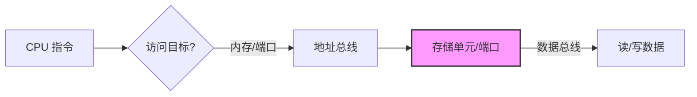

# 存储单元和存储器地址的概念

## 存储单元与地址的本质

存储器由无数个**存储单元**组成，每个单元存放 **1 字节（8 bit）** 信息。为了区分这些单元，系统为每个单元分配唯一的**地址号**（即存储器地址）。

> [!IMPORTANT]
> ==核心定义==：地址是单元的“门牌号”，内容是单元里存的“货物”。二者严格区分，不可混淆。

容量单位采用二进制倍数：$1K=2^{10}=1024$，$1M=2^{20}$，$1G=2^{30}$，$1T=2^{40}$。存储器容量由**地址线宽度**决定。例如，20 根地址线可寻址 $2^{20}=1M$ 个单元，地址范围 $00000H \sim FFFFFH$。

## 统一编址与读写操作

在 x86 体系结构（如 80486）中，常采用**统一编址**方式，将 I/O 端口视为特殊的存储单元。

> [!NOTE]
> **统一编址特点**：
> 1. 凡访问存储单元的指令均可访问 I/O 端口。
> 2. 无需专门 I/O 指令。
> 3. **代价**：端口地址占用存储空间，导致可用内存容量减少。

读写过程本质是电信号传送：
- **读**：CPU 发出地址 -> 选中单元 -> 数据送至数据总线 -> CPU 接收。
- **写**：CPU 发出地址和数据 -> 选中单元 -> 数据写入。

## 实模式下的物理地址计算

在 80486 **实地址模式**下，物理地址由**段基址**和**偏移地址**合成。公式如下：

$$
\text{物理地址} = \text{段基址} \times 16 + \text{偏移地址}
$$

即：段寄存器值左移 4 位（十六进制后补 0）加上偏移量。

> [!TIP]
> **计算技巧**：直接将段基址末尾补一个 `0`，再与偏移地址做十六进制加法。

### 典型例题解析

**题目**：设某存储单元段基址为 `FEFFH`，偏移地址为 `1000H`，求物理地址。

**推导**：
1. 段基址左移 4 位：$FEFFH \times 10H = FEFF0H$
2. 加上偏移地址：$FEFF0H + 1000H$

$$
\begin{array}{r}
   FEFF0H \\
+\ 1000H \\
\hline
   FFFF0H
\end{array}
$$

==答案==：`FFFF0H`

> [!WARNING]
> **常见坑**：
> 1. 忘记段基址要左移 4 位（即乘 16）。
> 2. 混淆逻辑地址（段:偏移）与物理地址。
> 3. 实模式下最大寻址空间为 1MB ($00000H \sim FFFFFH$)，若计算结果超过 20 位，高位截断（但在 80486 实模式下通常直接产生 20 位地址）。

## 概念辨析

| 概念 | 含义 | 决定因素 |
| :--- | :--- | :--- |
| **存储单元** | 存储数据的最小单位 | 字长（通常为 1 字节） |
| **存储器地址** | 单元的唯一标识 | 地址线宽度 |
| **存储器容量** | 单元总数 $\times$ 单元大小 | 地址线数量 |

掌握地址计算是理解中断向量表（位于内存最低端 $00000H$ 起）及后续保护模式分段机制的基础。
