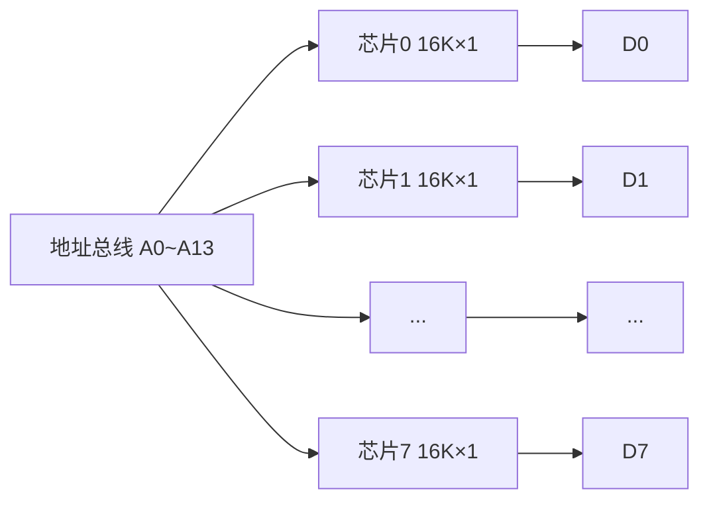
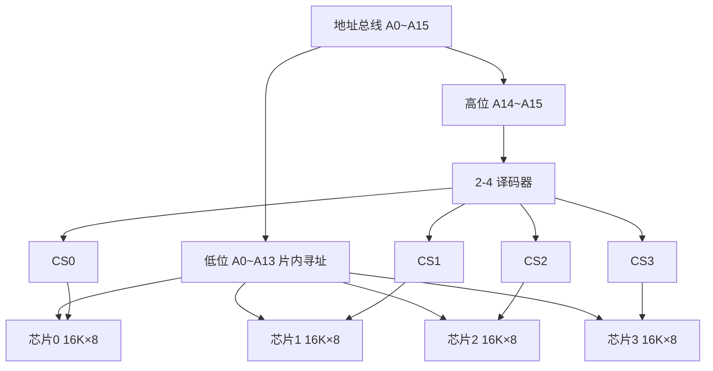

# 存储器的扩展方法（位扩展法、字扩展法）

## 存储器的扩展方法

当你手头只有小容量的存储芯片，而系统需要更大的存储空间时，就必须把多片芯片组合起来。组合的本质，是回答两个问题：**数据线怎么并？地址线怎么分？**

---

## 位扩展法：让“窄”芯片变“宽”

假设你有一片 **16K×1** 的 SRAM——它有 16K 个存储单元，但每个单元只存 1 位。而 CPU 的数据总线是 8 位的，每次要读写一个字节。怎么办？

那就把 **8 片 16K×1** 的芯片“并列”起来：所有芯片共享同一组地址线和控制线，但每片芯片的数据线分别接到数据总线的 `D0`～`D7` 上。

这样，同一个地址对应 8 片芯片中各 1 位，合起来就是一个完整的 8 位字节。**位扩展不改变存储单元的个数，只改变每个单元的数据位数。**

> [!TIP]
> 记忆口诀：**“片数翻倍，数据线变宽；地址不变，容量位数涨”**。需要多少片，就看目标位数除以单片位数。

---

## 字扩展法：让“小”容量变“大”

如果芯片的位数已经够用（比如 16K×8），但总容量不够，想组成 64K×8，就需要 **4 片**。这 4 片不能简单地共享地址线——否则它们会同时被选中，导致数据冲突。

正确做法是：用**高位地址线**经过译码器产生片选信号 `CS`，决定哪一片芯片被选中。低位地址线仍然直接接到所有芯片上，负责片内寻址。

> [!IMPORTANT]
> 字扩展**增加的是存储单元的数量**，每片的位数不变。区分不同芯片靠的是**片选信号**，而片选信号来自**高位地址线的译码**。

---

## 字位同时扩展：实战中最常见

实际题目往往两个维度都要扩。看这道南邮真题：

> 现有 **16K×1** 的静态 RAM，欲组成 **128K×8** 位的存储器。

**第一步：算位数方向。** 单片是 1 位，目标 8 位，所以 **8 片为一组**，组成一个 16K×8 的“芯片组”。

**第二步：算字数方向。** 目标 128K，每组只有 16K，需要 $128\text{K} \div 16\text{K} = 8$ 个芯片组。

**第三步：算总数。** $8 \text{ 片/组} \times 8 \text{ 组} = 64$ 片。

**第四步：分地址线。** 16K 片内寻址需要 $14$ 根地址线（$2^{14} = 16\text{K}$，即 `A0~A13`）。8 个芯片组需要 $3$ 根高位地址线进行 3-8 译码（$2^3 = 8$，即 `A14~A16`）。

> [!WARNING]
> 最常见的坑：**把位数扩展和字数扩展的乘法关系搞反**。先问自己——需要几片才能凑够数据位数？这就是一个“组”的大小；再问自己——需要几组才能凑够容量？两者相乘才是总片数。

---

## 完整解题示例

**题目**：用 16K×1 的 SRAM 芯片组成 64K×8 的存储器，需要多少片？地址线如何分配？

**解**：

每 8 片组成一个 16K×8 的芯片组（位扩展）；需要 $64\text{K} \div 16\text{K} = 4$ 组（字扩展）。

- 总片数：$8 \times 4 = 32$ 片
- 片内寻址：$2^{14} = 16\text{K}$，需要 `A0~A13` 共 14 根
- 片选译码：$4$ 组需要 $2$ 根高位地址线 `A14`、`A15`，经 2-4 译码器产生 4 个片选信号

==先定“组内位数”，再定“组数”==，这个顺序永远不会错。
