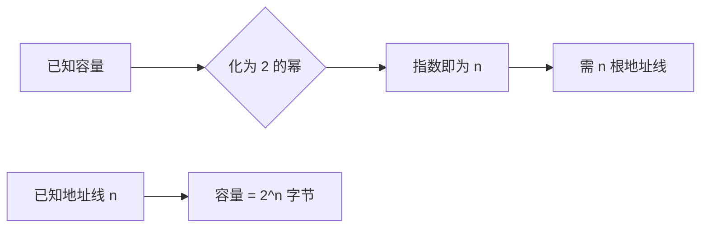

# 存储器容量的表示方法

存储器由若干“存储单元”组成，每一单元存放一个“字节”（8 位）的信息。系统为每一单元编排一个地址，地址码为二进制数，习惯上写成 16 进制。

那么，如何衡量一块存储器到底能存多少数据？这就引出了存储器容量的表示方法。

## 容量是什么与为什么需要它

> [!IMPORTANT]
> 存储器容量由==地址线宽度==决定。若地址线有 $n$ 根，则可寻址的存储单元数为 $2^n$ 个，总容量为 $2^n \times 8$ 位（即 $2^n$ 字节）。

在微型计算机接口设计中，无论是 CPU 访问内存，还是后续进行存储器扩展，都必须先明确芯片或系统的容量。只有知道容量，才能确定需要多少根地址线、如何进行片选译码。

## 容量单位换算

容量计算的基础是单位换算，考试中常在此处设坑：

| 单位 | 缩写 | 对应字节数 | 对应地址线条数 $n$ |
| :---: | :---: | :---: | :---: |
| 1K | KB | $2^{10} = 1024$ | 10 |
| 1M | MB | $2^{20}$ | 20 |
| 1G | GB | $2^{30}$ | 30 |

> [!WARNING]
> 在存储器系统中，$1\text{K} = 1024 = 2^{10}$，**绝不是**十进制的 $1000$！这是做所有容量计算题的前提。

## 地址线与容量的互推

思考一个问题：如果给你一块 $16\text{K}$ 容量的芯片，你需要用几根地址线去选中它内部的每一个单元？

反过来想：$16\text{K} = 16 \times 1024 = 2^4 \times 2^{10} = 2^{14}$，因此需要 ==14 根==地址线（A0～A13）。

> [!TIP]
> 解题口诀：“==容量化 2 幂，指数即线数==”。例如看到 $64\text{K}$，立刻反应出 $64 = 2^6$，加上 $\text{K} = 2^{10}$，总共 $2^{16}$，即 16 根地址线。

## 相近概念辨析：字节容量与字容量

课件中常出现两种写法，容易混淆：

| 表示法 | 含义 | 举例说明 |
| :--- | :--- | :--- |
| **字节容量** | 仅强调有多少个存储单元（每单元 1 字节） | “1M 容量的存储器”指 $2^{20}$ 个字节 |
| **字容量** | 格式为“字数 $\times$ 位数” | $16\text{K} \times 1$ 表示有 $16\text{K}$ 个单元，每单元 1 位 |

> [!NOTE]
> 当题目写“$128\text{K} \times 8$ 位的存储器”时，$128\text{K}$ 是字数（单元数），$\times 8$ 是位宽（每个单元 8 位，即 1 字节）。其总地址线需求依然只由字数 $128\text{K}$ 决定。

## 算对了的例子

结合课件中存储器扩展的经典例题来验证：

**题目**：现有 $16\text{K} \times 1$ 的静态 RAM 芯片，欲组成 $128\text{K} \times 8$ 位的存储器。求所需芯片数及地址线分配。

**第一步：算芯片总数**
$$ \frac{128\text{K} \times 8}{16\text{K} \times 1} = 8 \times 8 = 64 \text{ 片} $$
这属于**字位同时扩展**。

**第二步：算片内地址线**
单片容量为 $16\text{K}$。因为 $16\text{K} = 2^{14}$，所以每片内部需要 ==14 根==地址线（A0～A13）。

**第三步：算片选地址线**
需要将 64 片分为若干组。每组 8 片并联以扩展位宽至 8 位，故共有 $64 \div 8 = 8$ 个芯片组。
要选中 8 个组中的 1 个，需要 $\log_2 8 = 3$ 根高位地址线（如 A14～A16）通过 3-8 译码器实现片选。

> [!CAUTION]
> 千万不要把片内地址线和片选地址线混在一起算！必须先根据**单片芯片的字数**定片内线，再根据**组数**定片选线。
