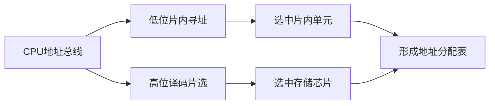

# 微型计算机系统中的存储器组织与地址空间分配表

## 地址空间分配表是什么

存储器扩展时，CPU 的高位地址线经译码电路产生片选信号，决定“哪一片芯片被选中”；低位地址线接芯片内部，决定“选中片内哪一个单元”。**地址空间分配表**就是把每片芯片的容量、片选条件、起始地址、结束地址和地址范围列成表，用来检查译码设计是否正确。

> [!IMPORTANT]
> 地址范围必须满足：==末地址 $=$ 首地址 $+$ 容量 $-1$==。这里的“容量”要换算成字节数，且首、末地址都包含在实际范围内。

## 为什么要画这张表

只写“几片芯片并联”并不能说明存储器已经接对。地址空间分配表可以同时检查三件事：

- **容量是否够**：各芯片容量之和是否等于要求容量。
- **地址是否连续**：前一片末地址加 1，是否等于后一片首地址。
- **是否发生重叠**：同一个 CPU 地址是否可能选中两片芯片。

例如，用 $128\text{ KB}$ SRAM 芯片组成 $512\text{ KB}$ 存储器，需要

$$
N=\frac{512\text{ KB}}{128\text{ KB}}=4\text{ 片}
$$

若起始地址为 `10000H`，则总容量为 $512\text{ KB}=80000\text{H}$，所以

$$
\text{末地址}=10000\text{H}+80000\text{H}-1=8\text{FFFFH}
$$

整体地址范围为 `10000H～8FFFFH`。按每片 $128\text{ KB}=20000\text{H}$ 分配如下：

| 芯片 | 容量 | 起始地址 | 结束地址 | 地址范围 |
|---|---:|---:|---:|---|
| 0 号 | $128\text{ KB}$ | `10000H` | `2FFFFH` | `10000H～2FFFFH` |
| 1 号 | $128\text{ KB}$ | `30000H` | `4FFFFH` | `30000H～4FFFFH` |
| 2 号 | $128\text{ KB}$ | `50000H` | `6FFFFH` | `50000H～6FFFFH` |
| 3 号 | $128\text{ KB}$ | `70000H` | `8FFFFH` | `70000H～8FFFFH` |

## 与三种译码方式的关系

| 译码方式 | 高位地址线使用情况 | 特点 | 地址问题 |
|---|---|---|---|
| 全译码 | 全部参与译码 | 每片地址唯一 | 通常无重叠，便于连续分配 |
| 部分译码 | 只使用部分高位线 | 电路较简单 | 未参与译码的位可变化，易产生地址重叠 |
| 线选法 | 某根高位线直接片选 | 电路最简单 | 地址常不连续，也可能重叠 |

> [!WARNING]
> “地址重叠”不是两片芯片同时占用一个唯一地址这么简单，而是==同一片芯片对应多个 CPU 地址==。部分译码中，未参加译码的高位地址无论取 0 还是 1，都可能选中同一片。

## 常见坑与解题顺序

先算芯片数，再把每片容量换成十六进制，最后逐片写“首地址、末地址、下一片首地址”。不要直接用“首地址＋容量”作为末地址，否则会多算一个单元。

另一道题中，地址范围为 `A0000H～EFFFFH`，其容量为

$$
\text{EFFFFH}-\text{A0000H}+1=50000\text{H}=320\text{ KB}
$$

若采用 $32\text{ K}\times8$ 芯片，即每片 $32\text{ KB}$，则需

$$
N=\frac{320\text{ KB}}{32\text{ KB}}=10\text{ 片}
$$

> [!TIP]
> 记口诀：==先减后加一，容量除单片；末址加容量，还要再减一。== 其中 $32\text{ K}\times8$ 表示 $32\text{ K}$ 个单元、每单元 8 位，因此每片就是 $32\text{ KB}$，不要再乘 8。
