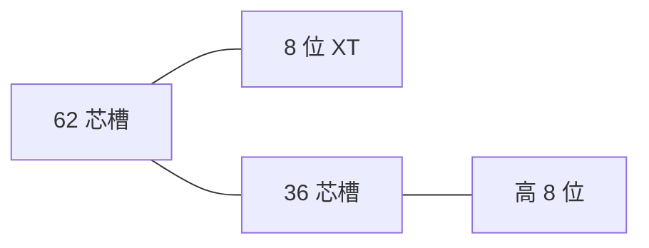

# 典型总线标准（ISA/AT总线、PCI总线引脚与特点）

## 总线的定义与分类

总线（Bus）是微型计算机中==CPU、存储器、I/O 接口之间共享的公共数据通道==，是一组信号线的集合。为什么需要总线？想象一下如果 CPU 和每个设备之间都拉一套独立的连线，布线会爆炸；引入总线后，所有设备"挂"在同一组线上，通过仲裁分时共享，大幅降低成本和复杂度。

按功能可分为三组：

| 类别 | 作用 | 举例 |
|------|------|------|
| 地址总线 AB | 指出要访问的地址 | 386 起 32 根 |
| 数据总线 DB | 传输数据 | 16/32 位 |
| 控制总线 CB | 传输读写/中断等控制信号 | $\overline{RD}$、$\overline{WR}$ |

按层次又分为：CPU 总线（芯片级）、系统总线（ISA/PCI，板级）、外总线（USB/RS-232，设备级）。

## AT（ISA）总线

ISA = Industry Standard Architecture，工业标准结构，是 IBM PC/AT 机确定的==标准兼容总线==，始于 286 机型，386～奔腾机上仍保留。



- 物理插槽：==62 芯 + 36 芯==两段组成，合计 98 引脚（其中 62 芯段与 XT 的 8 位总线兼容）。
- 数据宽度 16 位，工作频率 8 MHz，最高传输率
  $$\text{带宽} = 16\text{ bit} \times 8\text{ MHz} / 8 = 16\text{ MB/s（理论峰值）；实际约 } 8\text{ MB/s}$$
- 典型引脚：$D_0 \sim D_{15}$、$A_0 \sim A_{19}$（及 $LA_{17} \sim LA_{23}$ 非锁存地址）、$\overline{MEMR}$、$\overline{MEMW}$、$\overline{IOR}$、$\overline{IOW}$、$\overline{DRQ}_n / \overline{DACK}_n$（DMA 请求/应答）、IRQ 线。

[!NOTE]
> ISA 的中断请求线 IRQ 是考试常客。在 PC/AT 上采用主从两片 8259A，用户中断常从 ISA 总线 **B4 端子（IRQ9）** 引入，经从 8259 → 主 8259 两级级联才能送到 CPU（对用户呈现 INT 71H）。

ISA 的主要特性可归纳为：16 位数据、8 MHz、同步传输、非多路复用、集中仲裁、单主结构（CPU/DMA 控制器为主设备）。

## PCI 总线

PCI = Peripheral Component Interconnect，由 Intel 等公司于 1992 年提出，用于解决 ISA 带宽不足的问题。

```mermaid
flowchart TD
    CPU --- MCH
    MCH --- AGP
    MCH --- PCI桥
    PCI桥 --- ISA桥
    PCI桥 --- "PCI 插槽"
```

PCI 引脚按功能分组（32/64 位数据与地址**多路复用**在 $AD_0 \sim AD_{31}$）：

| 引脚组 | 代表信号 | 作用 |
|--------|----------|------|
| 系统 | CLK、RST | 33/66 MHz 同步时钟、复位 |
| 地址/数据 | $AD_0\sim AD_{31}$、$C/ \overline{BE}$ | 多路复用，$C/ \overline{BE}$ 区分命令与字节使能 |
| 仲裁 | REQ、GNT | 总线请求/授权，==多主控== |
| 接口控制 | FRAME、IRDY、TRDY、STOP、DEVSEL | 握手应答，==突发传输== |
| 中断/错误 | INTA、PERR、SERR | 中断与校验 |

PCI 主要特点：

- ==数据/地址引脚复用==，引脚少、易扩展到 64 位；
- 支持**突发（Burst）传输**，一次寻址连续传多数据，效率高；
- ==多主控仲裁==（REQ/GNT），CPU 不参与也可传数据；
- 支持即插即用（PnP），配置空间 256 B 自动分配资源；
- 同步于 CLK，33 MHz 时峰值 $32 \times 33 / 8 = 132\text{ MB/s}$；66 MHz 下 $264\text{ MB/s}$。

## ISA vs PCI 速查

| 项目 | ISA | PCI |
|------|-----|-----|
| 数据位 | 16 | 32/64 |
| 时钟 | 8 MHz | 33/66 MHz |
| 带宽 | ≈8 MB/s | 132/264 MB/s |
| 寻址 | 分离 | 复用 |
| 仲裁 | 单主 | 多主 |
| 即插即用 | 无 | 有 |

[!TIP]
> 记忆口诀：**ISA 16 位 8MHz 简单稳；PCI 复用 + 突发 + 多主快**。带宽公式统一按 $\text{位宽} \times \text{频率} / 8$ 计算即可。

[!WARNING]
> 易错：ISA 实际传速率常写 8 MB/s（对 8 位段）或 16 MB/s（对 16 位峰值），以课件的 ==8 MB/s== 为准；PCI 的 AD 引脚是**多路复用**，不叫"地址线+数据线分离"。

## 例：一次 ISA 写周期

CPU 执行 `OUT DX, AL` 写 ISA 卡，DX=200H：CPU 在地址总线上送出 200H → 片选译码使外设 $\overline{CS}=0$ → $\overline{IOW}$ 有效 → 外设锁存数据 → 1 个总线周期完成。这就是 ISA 的 I/O 写时序，也是后面做 ISA 扩展卡编程的基础。
