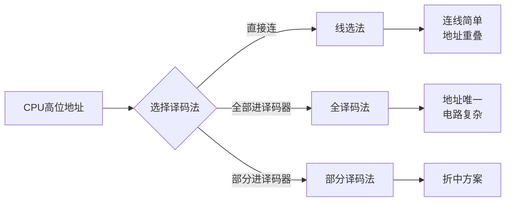
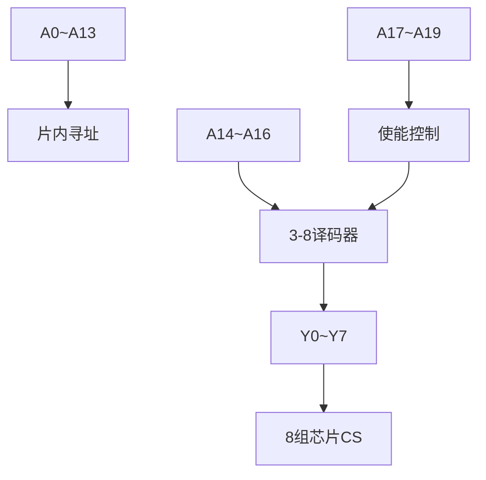

# 存储器地址译码电路设计（线选法、全译码法、部分译码法）

> [!IMPORTANT]
> CPU 发出的地址总线位数往往多于单片存储器的地址引脚数，多出来的高位地址线如何决定“选中哪一片芯片”？这就是==存储器地址译码电路设计==要解决的核心问题。

## 为什么需要译码

假设用 $16\text{K} \times 8$ 的芯片组成 $64\text{K} \times 8$ 的存储器，共需 4 片。每片内部寻址只需 14 根线（A0~A13），但 CPU 有 16 根地址线（A0~A15）。高位的 A14、A15 必须通过某种逻辑产生==片选信号 $\overline{CS}$==，否则 CPU 无法区分该访问哪一片。

## 三种译码方法对比

| 方法 | 做法 | 优点 | 缺点 |
| :--- | :--- | :--- | :--- |
| **线选法** | 高位地址线==直接连==各芯片 $\overline{CS}$ | 连线最简单，无需译码器 | ==地址重叠==，浪费地址空间 |
| **全译码法** | 低位接芯片地址线，==剩余高位全部==接入译码器 | 地址唯一，无重叠 | 译码电路最复杂 |
| **部分译码法** | 高位地址线中==取一部分==进行译码 | 介于两者之间，适合不需要全部寻址能力的场景 | 仍存在少量地址重叠 |

> [!NOTE]
> **线选法的地址重叠**：如 A15、A14 分别直连两片 RAM 的 $\overline{CS}$（低电平有效）。当 A15=0, A14=1 时选中第一片；若未使用的更高位（如 A19~A16）取值不同，会映射出多个物理上相同的地址段，即地址重叠。

## 怎么做：设计步骤与实例

> [!TIP]
> 解题口诀：**算芯片 → 分内外 → 定译码**。先算总数和组数，再分片内地址线与片选地址线，最后选定译码方式。

以课件经典题为例：现有 $16\text{K} \times 1$ SRAM，欲组成 $128\text{K} \times 8$ 存储器。

**第一步：算芯片与扩展类型**
$$ \text{芯片数} = \frac{128\text{K} \times 8}{16\text{K} \times 1} = 8 \times 8 = 64 \text{ 片} $$
分为 8 组，每组 8 片并联（位扩展），组间串联（字扩展），属于==字位同时扩展==。

**第二步：分片内与片选地址线**
- 片内寻址：$16\text{K} = 2^{14}$，故每片需 14 根地址线（A0~A13）。
- 片选寻址：共 8 个芯片组，需 $\log_2 8 = 3$ 根地址线译码。

**第三步：定译码方式（全译码法）**
若系统地址总线为 20 位（A0~A19）：
- A0~A13：直接连所有芯片的地址引脚。
- A14~A16：接入 ==3-8 译码器==（如 74LS138），输出 $\overline{Y_0}$~$\overline{Y_7}$ 分别接 8 个芯片组的 $\overline{CS}$。
- A17~A19：若采用全译码法，需通过门电路参与使能控制，确保地址唯一。

> [!WARNING]
> 综合应用题常将译码与 I/O 接口（如 8255A、8254）结合考查。计算端口地址时，务必看清图中哪些地址线接了译码器输入端、哪些接了芯片本身的 A0/A1。==控制口地址通常是基地址 + 偏移量==，切勿漏加。

> [!CAUTION]
> 考试中最易错的坑：混淆“片内地址线数”与“片选地址线数”。记住公式：$2^{\text{片内线数}} = \text{单片容量（字数）}$，$2^{\text{片选线数}} = \text{芯片组数}$。
