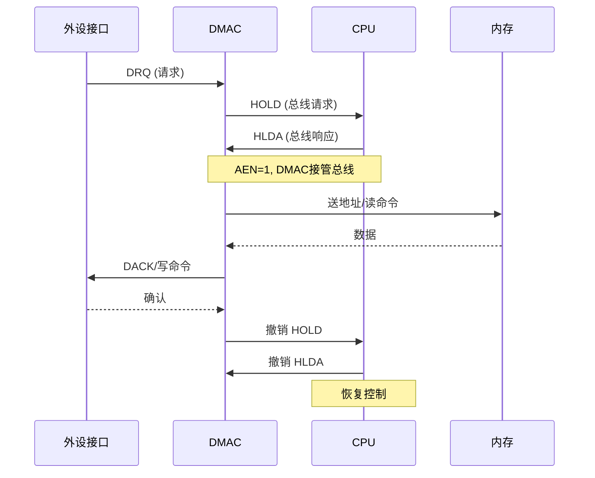

# 直接存储器存取（DMA）方式及其与中断方式的比较

## 什么是 DMA？

==直接存储器存取（DMA）== 是一种由硬件控制器（DMAC）直接接管系统总线，在高速外设与内存之间进行大批量数据交换的方式。在此过程中，CPU 仅需在初始化和结束时介入，数据传输阶段完全无需 CPU 参与。

> [!IMPORTANT]
> **核心定义**：DMA 传送利用硬件完成高速外设与系统 RAM 之间的信息交换，不经过 CPU，不需要保护现场。

## 为什么需要 DMA？

试想一下，如果让 CPU 逐个字节地搬运硬盘中的大文件到内存，CPU 将陷入繁琐的 I/O 操作中无法执行其他任务。中断方式虽然提高了效率，但每次传输仍需保存/恢复现场，开销巨大。DMA 的出现正是为了解决==高速数据块传输==与==CPU 效率==之间的矛盾。

## DMA 是如何工作的？

DMA 的核心是 DMAC（如 8237A）。当外设准备好数据后，通过 `DRQ` 信号向 DMAC 发出请求，DMAC 再向 CPU 发出总线保持请求（`HOLD`）。CPU 在当前总线周期结束后释放总线控制权，并发出响应信号（`HLDA`）。此时，`AEN=1`，表明 DMAC 控制系统三总线。

## DMA 与中断方式的比较

这是考试的高频考点，两者在响应机制和速度上有本质区别：

| 比较维度 | 中断控制方式 | DMA 方式 |
| :--- | :--- | :--- |
| **响应时机** | 当前**指令**执行完毕 | 当前**总线周期**执行完毕 |
| **数据粒度** | 字节/字为单位 | 数据块为单位 |
| **CPU 干预** | 需保存/恢复现场 | 无需保护现场 |
| **传送速度** | 较慢（软件开销大） | ==极快==（硬件直达） |
| **硬件复杂度** | 简单 | 复杂（需 DMAC 芯片） |

> [!TIP]
> **记忆口诀**：中断等指令，DMA 等周期；中断保现场，DMA 不操心。

## 常见误区与实例

**误区 1**：认为 DMA 完全不需要 CPU。
**纠正**：CPU 负责初始化 DMAC（设置源/目的地址、计数值、控制字），并在传输结束后处理后续逻辑。

**误区 2**：混淆 DMA 优先级。
**注意**：在 8086 系统中，DMA 请求的优先级高于可屏蔽中断（INTR）和非屏蔽中断（NMI）。即：`DMA > NMI > INTR`。

**计算实例**：
若使用 8237A 进行 DMA 传送，其一次 DMA 传送的最大字节数是 $64\text{KB}$。这是因为 8237A 的地址寄存器通常为 16 位，$2^{16} = 65536 = 64\text{K}$。若需传输超过 64KB 的数据，需通过软件分段或级联多个 8237A 实现。

> [!WARNING]
> **易错点**：8237A 一片有 4 个 DMA 通道，但 PC 机中通常使用两片级联，共提供 7 个可用通道（通道 4 用于级联）。
