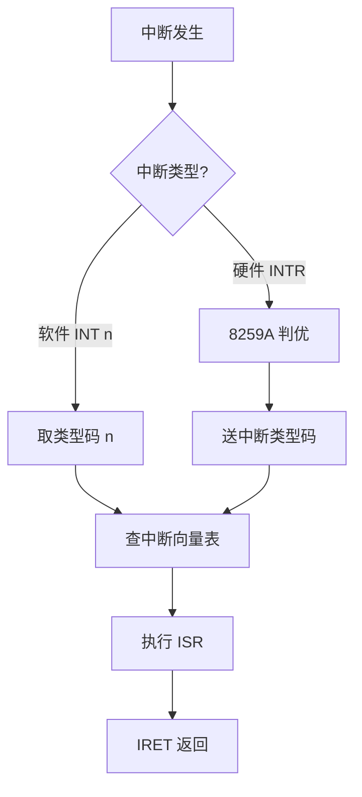

# DOS功能调用与BIOS中断功能调用（INT 21H、INT 10H等）

## 中断调用机制与分类

在微机系统中，CPU 如何高效响应外部事件或执行系统功能？核心在于**中断**。中断分为**硬件中断**（如外设请求）和**软件中断**（如 `INT n` 指令）。

*   **硬件中断**：通过 8259A 控制器连接至 CPU 的 `INTR` 引脚。需经过“请求→响应→送类型码→执行服务程序”的过程。
*   **软件中断**：由指令 `INT n` 触发，常用于调用 DOS (`INT 21H`) 或 BIOS (`INT 10H`, `INT 16H`) 功能。



> [!IMPORTANT]
> ==核心区别==：硬件中断类型码由 8259A 自动送上数据总线；软件中断类型码包含在指令操作数中。

## DOS 与 BIOS 功能调用

汇编程序中常需借助操作系统或底层固件完成 I/O 操作，主要通过 `INT 21H` (DOS) 和 `INT 10H/16H` (BIOS) 实现。

| 中断号 | 功能号 (AH/AL) | 功能描述 | 关键寄存器 |
| :--- | :--- | :--- | :--- |
| `INT 21H` | `09H` | 显示 `$` 结尾字符串 | `DS:DX`=串地址 |
| `INT 21H` | `0AH` | 键盘输入字符串 | `DS:DX`=缓冲区 |
| `INT 21H` | `4CH` | 返回 DOS | `AL`=返回码 |
| `INT 21H` | `25H` | **设置中断向量** | `AL`=类型码, `DS:DX`=入口 |
| `INT 10H` | `02H/09H` | 光标定位/显示字符 | `DH, DL`, `BH` |
| `INT 16H` | `00H/01H` | 键盘读入/检测 | `AH`=扫描码, `AL`=ASCII |

> [!TIP]
> 调用格式固定：先置 `AH` (或 `AL`) 为功能号，再置其他参数，最后执行 `INT n`。

## 中断向量表的修改

用户自定义中断服务程序（ISR）前，必须将 ISR 入口地址写入**中断向量表**。向量表位于内存 `00000H` 起始处，每个中断占 4 字节（偏移地址 IP + 段地址 CS）。

**计算规则**：若中断类型码为 $n$，则其向量地址为 $4 \times n$。
例如：`71H` 型中断，向量地址 = $71H \times 4 = 1C4H$。

**设置方法**：
1.  **直接写内存**：计算物理地址，使用 `MOV` 指令写入 IP 和 CS。
2.  **DOS 功能调用**：使用 `INT 21H` 的 `25H` 号功能。
    ```assembly
    MOV AH, 25H       ; 功能号：设置中断向量
    MOV AL, 71H       ; 中断类型码
    LDS DX, ISPIP     ; DS:DX 指向新的 ISR 入口 (IP, CS)
    INT 21H
    ```

> [!WARNING]
> 修改向量表前，建议先用 `35H` 号功能保存旧向量，以便程序结束时恢复，防止系统崩溃。

## 8259A 中断屏蔽与控制

可屏蔽中断受 8259A 的**中断屏蔽寄存器 (IMR)** 控制。
*   **主片端口**：`20H` (命令), `21H` (数据/IMR)。
*   **从片端口**：`A0H` (命令), `A1H` (数据/IMR)。

**开放/屏蔽特定中断**：
需遵循“读-改-写”原则，避免影响其他中断位。
```assembly
IN AL, 21H          ; 读主片 IMR
AND AL, 11110111B   ; 将 IR3 对应位清零 (0=开放, 1=屏蔽)
OUT 21H, AL         ; 写回 IMR
```

> [!CAUTION]
> 常见误区：认为 `STI` 指令能开放具体外设中断。`STI` 仅置位 CPU 的 `IF` 标志，允许响应 `INTR` 引脚请求；具体哪个外设能触发 `INTR`，仍由 8259A 的 IMR 决定。

## 典型例题解析

**题目**：将数据段中 `ISPIP` (偏移) 和 `ISPCS` (段基址) 指定的 `71H` 型中断服务程序入口写入向量表。

**解析**：
1.  **确定功能**：写入向量表使用 `INT 21H` 的 `25H` 功能。
2.  **准备参数**：
    *   `AL` = `71H` (中断类型码)。
    *   `DS:DX` = 新 ISR 的入口地址。由于地址在数据段，需先将数据段地址送入 `DS`，偏移地址送入 `DX`。
3.  **代码填空**：
    ```assembly
    MOV AX, DATA      ; 获取数据段地址
    MOV DS, AX        ; 初始化 DS
    MOV DX, OFFSET ISPIP ; DX 指向偏移地址单元 (假设 ISPIP 是双字或分别处理)
    ; 注意：若 ISPIP/ISPCS 是分开的字单元，需组合或使用 LDS
    ; 更通用的写法是直接加载地址：
    LDS DX, DWORD PTR [ISPIP] ; 假设 ISPIP 处存放的是 DWORD (IP:CS)
    MOV AH, 25H
    MOV AL, 71H
    INT 21H
    ```

此过程实现了用户中断的动态挂接，是微机接口编程中实现异步事件处理的基础。
