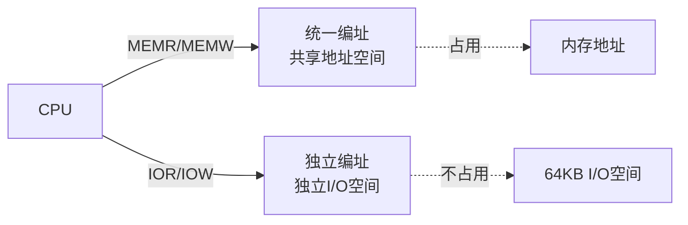

# 端口的编址方式（统一编址与独立编址）

CPU 要和外设交换数据，必须通过 I/O 端口。但内存和端口都是“地址”，CPU 如何区分自己访问的是内存单元还是外设端口？这就引出了两种编址方式：==统一编址==与==独立编址==。

## 两种编址方式的本质区别

想象 CPU 的地址总线是一条公路，如果内存和外设共用这条路，就是统一编址；如果给外设单独修一条专用通道，就是独立编址。



| 对比维度 | 统一编址 (Memory Mapped) | 独立编址 (Isolated I/O) |
| :--- | :--- | :--- |
| **地址空间** | 与内存统一，占用内存地址 | ==独立 I/O 空间==，不占内存 |
| **访问指令** | 所有访存指令（MOV 等） | ==专用 I/O 指令==（IN/OUT） |
| **控制信号** | MEMR / MEMW | IOR / IOW |
| **寻址范围** | 受内存地址线宽度限制 | PC 机仅 16 位（0~FFFFH） |
| **典型代表** | ARM、MIPS 等嵌入式系统 | ==PC 系列机（x86）== |

> [!IMPORTANT]
> 南邮《微机接口》考试默认背景为 PC 系列机，因此必须牢记：==PC 机采用端口独立编址==。凡涉及 8254、8255A、8250 等芯片的编程题，一律使用 `IN`/`OUT` 指令，绝不能用 `MOV` 直接访问端口。

## 为什么 PC 机选择独立编址

独立编址虽然需要额外指令，但优势明显：I/O 端口地址短（仅 16 位），译码电路简单；且不侵占宝贵的内存空间。在早期 PC 内存仅有 1MB 的时代，这至关重要。而统一编址虽无需专用指令，却会“吃掉”一部分内存地址，且 I/O 操作无法利用专用的 I/O 控制信号进行硬件隔离。

## 实战中的端口地址确定

独立编址下，外设芯片的端口地址由==片选信号+片内寄存器选择==共同决定。这是综合设计题的高频考点。

以课件中“外扩 8254”实验为例：若译码电路使 8254 的 $\overline{CS}$ 有效地址范围为 210H~213H，且 A1、A0 接 8254 的寄存器选择端，则四个端口地址分别为：

-   计数器 0：210H
-   计数器 1：211H
-   计数器 2：212H
-   控制口：==213H==

初始化时，必须先向控制口（213H）写方式字，再向对应计数器口写初值：

```assembly
MOV DX, 213H       ; 控制口地址
MOV AL, 00110110B  ; 计数器0,方式3,二进制
OUT DX, AL         ; ← 必须用 OUT，不能用 MOV
MOV DX, 210H       ; 计数器0数据口
MOV AX, 2000
OUT DX, AL         ; 先写低字节
MOV AL, AH
OUT DX, AL         ; 再写高字节
```

> [!WARNING]
> 常见坑点：混淆端口地址与内存地址。在独立编址下，`MOV AX, [210H]` 访问的是==内存 210H 单元==，而非 8254 计数器 0。只有 `IN AX, 210H` 才访问 I/O 端口。审题时务必确认是“端口操作”还是“内存操作”。

> [!TIP]
> 记忆口诀：“==PC 独立编，IN/OUT 专管；MOV 只访存，别把端口串==。” 做 8255A、8250 等芯片题目时，先画出地址译码图确定各端口号，再套模板写初始化代码，可避免地址写错导致全盘失分。
