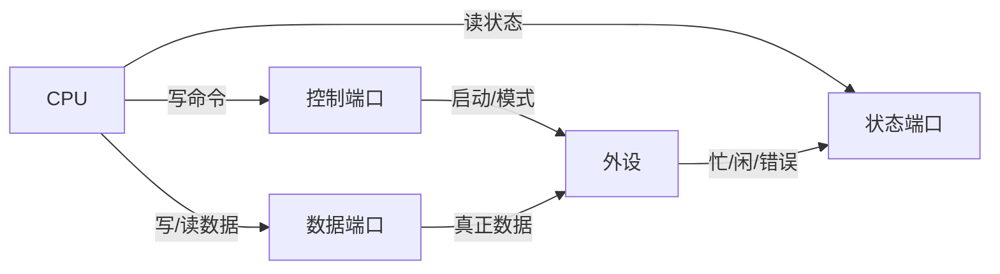
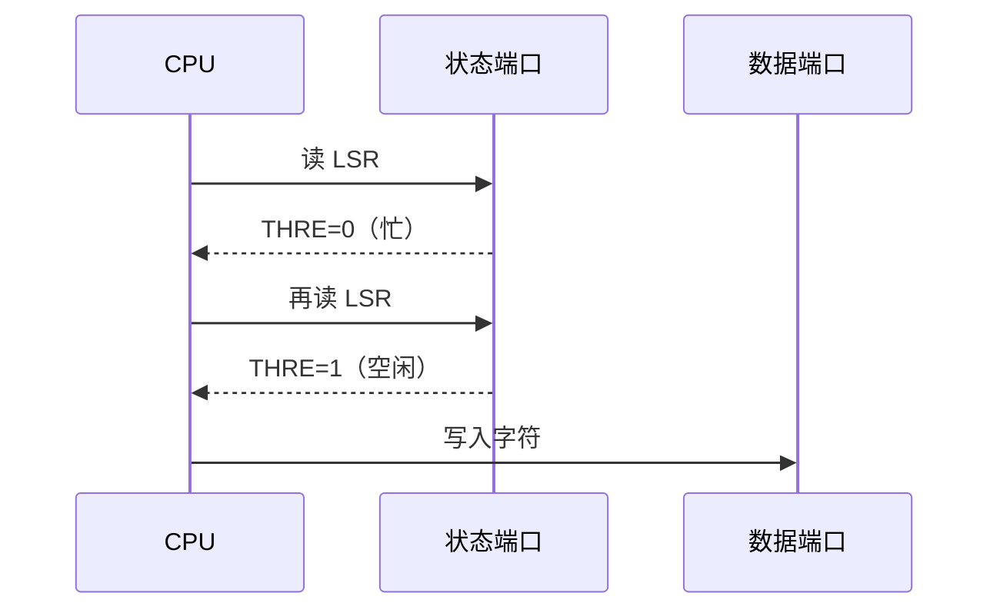

# 端口的概念与分类（数据端口、状态端口、控制端口）

在微机系统中，CPU 要与键盘、硬盘、串口等外设交换数据，但 CPU 不能直接“碰”外设本身，而是通过**接口电路**中的寄存器来完成通信。这些能被 CPU 直接访问的寄存器，就是**端口**。

## 端口是什么

可以把接口电路想象成一个小型“邮局柜面”：

- **数据端口**像“包裹交接窗口”——真正传递的数据从这里进出；
- **状态端口**像“营业状态牌”——告诉 CPU 此刻外设是忙是闲、有没有出错；
- **控制端口**像“指令登记处”——CPU 把工作模式、启动命令写在这里。

> [!IMPORTANT]
> 端口是接口电路内部、==可被 CPU 直接寻址访问的寄存器==。端口不是外设本身，而是 CPU 与外设之间的“窗口”。

## 为什么要分成三类

考虑一个实际问题：CPU 想从打印机输出一个字符。它需要知道：

1. 打印机现在空闲吗？（查**状态**）
2. 如果不空闲，就得等；空闲了，才能把字符送出去。（写**数据**）
3. 打印机要设置成什么模式、是否允许中断。（发**控制命令**）

如果这些信息全部挤在一个端口里，CPU 就很难区分“读回来的是数据还是状态”，硬件设计也会混乱。==把功能不同的寄存器分成三类端口，是接口电路的通用做法==。

## 三类端口各管什么

| 端口类型 | 方向（相对 CPU） | 存放内容 | 典型例子 |
|---------|----------------|---------|---------|
| 数据端口 | 可读可写 | 正在传输的数据 | 8250 的接收/发送缓冲寄存器 |
| 状态端口 | 只读 | 外设的忙闲、错误标志 | 8250 的通信线状态寄存器（LSR） |
| 控制端口 | 只写 | CPU 发出的控制命令 | 8250 的线路控制寄存器（LCR） |

> [!TIP]
> 记忆口诀：**“数据走数据口，问状态读状态口，下命令写控制口。”**

## 一个查询式收发的例子

8250 串口以查询方式收发数据时，正是靠“状态口 + 数据口”配合完成的：

**发送流程：**
1. CPU 读**通信线状态寄存器（状态端口）**，检查 D5 位（THRE：发送保持寄存器空）；
2. 若 THRE = 1，说明发送寄存器空闲，可以接收新数据；
3. CPU 把字符写入**发送保持寄存器（数据端口）**；
4. 若 THRE = 0，说明还在忙，CPU 继续查询等待。

**接收流程：**
1. CPU 读**通信线状态寄存器（状态端口）**，检查 D0 位（DR：接收数据就绪）；
2. 若 DR = 1，说明接收缓冲寄存器中已收到完整一帧；
3. CPU 从**接收缓冲寄存器（数据端口）**读出数据；
4. 若 DR = 0，继续查询。

> [!WARNING]
> **常见坑**：拿到数据端口就写，不先查状态端口。如果外设还在忙，新的数据可能覆盖旧数据或被丢弃。查询方式下，==读写数据前必须先确认状态==。

## 与“编址方式”不要混淆

端口有三种分类（数据、状态、控制），但它们的“地址”如何安排是另一个问题——**端口的编址方式**：

- **独立编址（I/O 端口独立编址）**：端口使用专门的 I/O 地址空间和 I/O 指令（如 `IN` / `OUT`），PC 系列机就采用这种方式。
- **统一编址（存储器映像编址）**：端口与存储器共用地址空间，用普通访存指令（如 `MOV`）访问。

> [!NOTE]
> 端口分类回答的是“这个端口是干什么的”；端口编址回答的是“CPU 怎么找到这个端口”。两者常一起考，但别答串。
