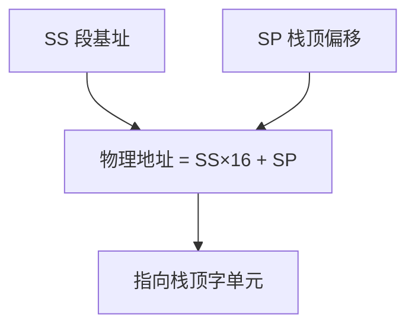
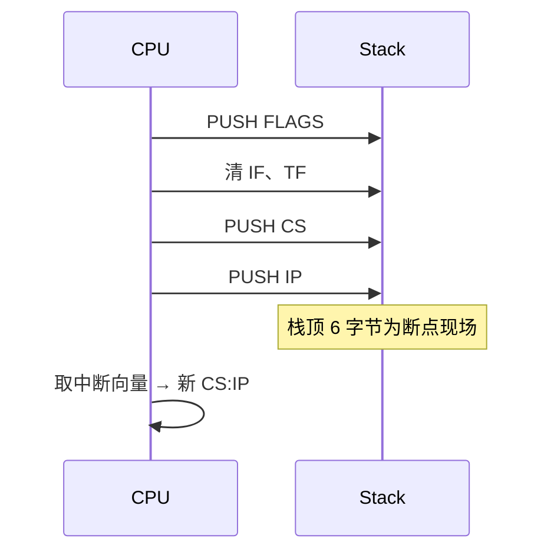

# 堆栈的概念及SP指针操作

## 堆栈的概念与 SP 指针操作

堆栈（Stack）是一段按“==先进后出==”（FILO）规则访问的内存区域，用于暂存断点地址、寄存器内容等现场信息。CPU 通过两个寄存器定位堆栈：`SS`（堆栈段寄存器）给出段基址，`SP`（堆栈指针）给出栈顶的**偏移地址**。物理地址由 `SS × 16 + SP` 形成。

### 为什么需要堆栈

微处理器在执行 `CALL`、`INT n` 时需要保存返回地址；进入中断服务程序前还要保存现场寄存器。若没有统一的后进先出存储区，嵌套中断或子程序调用将无法正确返回。堆栈让每一层调用/中断都按“→ 压入现场 → 弹出现场 →”的对称顺序进行。

### 压栈与出栈的 SP 变化

8086 堆栈以 ==WORD（2 字节）== 为单位操作，`SP` 始终指向**当前栈顶字单元的最低地址**：

| 操作 | SP 变化 | 数据存放位置 |
|---|---|---|
| `PUSH AX` | `SP ← SP - 2` | 高字节 → `[SP+1]`，低字节 → `[SP]` |
| `POP AX` | 低字节从 `[SP]` 取出，高字节从 `[SP+1]` 取出，然后 `SP ← SP + 2` |

栈底在高地址端，压栈时 SP 向低地址生长。

> [!IMPORTANT]
> 8086 压栈时先减 SP 再存数据；出栈时先取数据再加 SP。`SP` 始终指刚压入（或即将弹出）的字单元低位地址。

### 中断响应与 IRET 的堆栈操作

CPU 响应可屏蔽中断 `INTR` 时，硬件自动完成：

压栈顺序为 `FLAGS` → `CS` → `IP`。执行 `IRET` 时，CPU 按相反顺序弹出：

1. 弹出 2 字节 → `IP`
2. 再弹出 2 字节 → `CS`
3. 再弹出 2 字节 → `FLAGS`

> [!TIP]
> 记“入栈 F-C-I，出栈 I-C-F”：入栈先压 FLAGS，出栈先弹 IP。共弹出 **6 字节**。

例题：CPU 执行 `IRET` 指令后，从栈顶弹出 **6** 字节数据，分别赋给 **IP**、**CS** 和 **FLAGS**。

### 常见的坑

> [!WARNING]
> `PUSH` 是字操作，不能只压 1 字节。`SP` 永远是偶数（对齐字边界）。若程序中手动修改 SP 后未保持偶对齐，后续 `PUSH/POP` 可能跨越非对齐地址，8086 虽不报错但效率下降，后续 CPU 可能产生异常。

> [!CAUTION]
> `STI` / `CLI` 只对**可屏蔽中断请求 `INTR`** 有效，不影响非屏蔽中断 `NMI` 和内部中断。在中断服务程序中通常需先 `STI` 开放中断，实现中断嵌套；而在读取/修改关键共享数据前需 `CLI` 关中断。

### 与普通数据段的区别

| 项目 | 堆栈（SS:SP） | 普通数据段（DS:OFFSET） |
|---|---|---|
| 访问方向 | 压栈向低地址，出栈向高地址 | 地址可任意递增/递减 |
| 数据组织 | 先进后出 | 随机访问 |
| 主要用途 | 断点、现场保护 | 程序变量、缓冲区 |
| 典型指令 | `PUSH` / `POP` / `CALL` / `INT` / `IRET` | `MOV` / 运算指令 |

==核心结论==：堆栈是内存中靠 `SS:SP` 管理的 FILO 区域；8086 压栈时 `SP ← SP-2` 后存字，出栈时先取字再 `SP ← SP+2`；中断响应压入 `FLAGS、CS、IP` 共 6 字节，`IRET` 逆序弹出并恢复执行现场。
