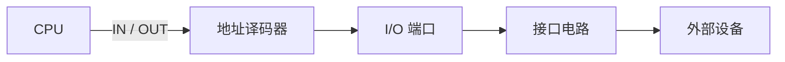

# 最常用的I/O指令（IN、OUT的直接寻址与DX间址）

## 基本概念

在 8086 系统中，CPU 与外设之间的信息交换通常要经过**接口电路**。接口中能够由 CPU 使用 `IN`、`OUT` 指令读写的寄存器称为==I/O 端口==。端口既可以保存数据，也可以保存状态信息或控制信息。



执行 `IN` 前，外设的数据通常应已准备好；执行 `OUT` 时，CPU 将数据送入端口，再由接口送往外设。

## 直接寻址

当端口地址可用一个 8 位立即数表示时，可采用直接寻址：

```asm
IN  AL, 61H       ; 从端口 61H 读一个字节到 AL
IN  AX, 61H       ; 从端口 61H、62H 读一个字到 AX
OUT 61H, AL       ; 将 AL 写入端口 61H
OUT 61H, AX       ; 将 AX 写入端口 61H、62H
```

其地址范围为 $00H\sim FFH$。对于字操作，地址按**低字节在前、高字节在后**的顺序传送：

$$
(AL)\leftarrow(port),\qquad (AH)\leftarrow(port+1)
$$

因此，`IN AX, 61H` 读取的是端口 $61H$ 和 $62H$，而不是从 $61H$ 一次读出完整字。

## DX 间接寻址

当端口地址超过 8 位时，先把端口号送入 `DX`，再执行输入、输出指令：

```asm
MOV DX, 3F8H
IN  AL, DX         ; 从端口 3F8H 读入 AL

MOV DX, 3F8H
OUT DX, AL         ; 向端口 3F8H 写入 AL
```

`DX` 可提供 $0000H\sim FFFFH$ 的端口地址。字操作同样连续占用两个端口：

```asm
MOV DX, 3F8H
IN  AX, DX         ; AL←端口3F8H，AH←端口3F9H
```

> [!IMPORTANT]
> `DX` 是寄存器间接寻址，汇编指令中不能加方括号。正确写法是 `IN AL, DX`，不是 `IN AL, [DX]`。

## 两种方式对比

| 项目 | 直接寻址 | `DX` 间接寻址 |
|---|---|---|
| 端口地址 | 8 位立即数 | `DX` 中的 16 位地址 |
| 地址范围 | $00H\sim FFH$ | $0000H\sim FFFFH$ |
| 指令示例 | `IN AL, 61H` | `MOV DX,3F8H`；`IN AL,DX` |
| 适用场合 | 端口较少、地址固定 | 端口较多或需运行时改变地址 |
| 是否写方括号 | 不需要 | ==不能写方括号== |

## 查询传送示例

查询方式下，应先读取状态端口，再决定是否进行数据传送。例如，从 $200H$ 端口查询某状态位：

```asm
TSCAN:
    MOV  DX, 200H
    IN   AL, DX
    TEST AL, 01H
    JNZ  TSCAN          ; 状态位为1，继续查询
```

若 $200H$ 是“数据就绪”状态端口，则状态位为 1 后，可从 $201H$ 读取数据：

```asm
    MOV  DX, 201H
    IN   AL, DX
```

> [!WARNING]
> `TEST` 只影响标志位，不保存比较结果；`AND AL,01H` 后若要判断结果，应使用 `JZ`、`JNZ` 等条件转移指令。

## 常见易错点

- `IN` 的累加器只能是 `AL` 或 `AX`；`OUT` 的累加器也只能是 `AL` 或 `AX`。
- `IN` 的数据方向是“端口 → 累加器”，`OUT` 是“累加器 → 端口”。
- 直接寻址用立即数，`DX` 间接寻址必须先给 `DX` 赋值。
- `IN AL,DX` 与 `MOV AL,[DX]` 不同：前者访问 I/O 端口，后者访问存储器。
- `IN` 不能读取内存；若把 `DX` 写成 `[DX]`，会产生语法错误。
- 对 8255A 查询传送，输入口通常先查 `IBF`，输出口通常先查 `OBF`，状态满足后再用 `IN`、`OUT` 读写数据端口。
