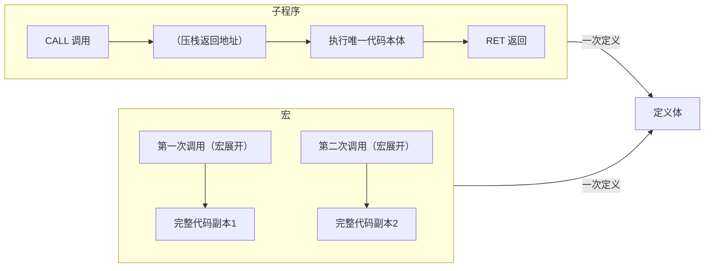

# 基本的汇编语言程序设计与程序控制结构

好的，我们直接来看汇编语言程序设计的核心。

你可以把汇编语言程序设计想象成：**用最贴近计算机“母语”的方式，精确指挥CPU完成每一项微小操作。** 它不像C或Python那样有`if-else`、`for`循环等现成的控制流语句，所有的程序控制结构，都需要我们用底层的指令组合来实现。

---

## 程序控制结构的汇编实现

任何程序逻辑都由三种基本结构组成：顺序、分支、循环。在汇编中，它们主要依赖**无条件/条件跳转指令**和**标志寄存器**。

### 顺序结构
程序按指令书写顺序，逐条执行。这是默认的基础。

### 分支结构
实现“如果满足条件，则执行A，否则执行B”。核心是`CMP`与`Jcc`指令组合。

- **`CMP dest， src`** : 执行 `dest - src`，结果**只影响标志位**，不保存差值。
- **`Jcc label`** : 根据一个或多个标志位的状态，决定是否跳转到标号处执行。

我们先来认识几个最常用的条件跳转指令，它们都是根据 `CMP` 比较**无符号数**的结果来判断的，这也是初学者最容易出错的地方。

| 指令 | 含义 | 等价判断 (无符号数) |
| :--- | :--- | :--- |
| `JE` / `JZ` | 等于/为零跳转 | `ZF=1` |
| `JNE` / `JNZ`| 不等于/非零跳转 | `ZF=0` |
| `JA` / `JNBE`| 高于跳转 | `CF=0` 且 `ZF=0` |
| `JB` / `JNAE`| 低于跳转 | `CF=1` |
| `JAE` / `JNB`| 高于或等于跳转 | `CF=0` |

分支逻辑的本质，就是**用`CMP`设置“路标（标志位）”，然后用`Jcc`来“选路”**。

> [!NOTE]
> **无符号数与带符号数的跳转指令绝不能混用！**
> 无符号数：高于 (`JA`)、低于 (`JB`)；带符号数：大于 (`JG`)、小于 (`JL`)。错误的根源在于，无符号数用`CF`判断越过`0`的“水位线”，带符号数用`SF`和`OF`共同判断数的“正负”。

**例题分析：** 假设 `AL = 80H`, `BL = 7FH`。
- 若当作无符号数，`80H(128) > 7FH(127)`，执行 `CMP AL， BL` 后，应使用 `JA` 指令实现分支。
- 若当作带符号数，`80H(-128) < 7FH(127)`，则必须使用 `JL` 指令。
一个简单的 `CMP` 后，选错了跳转指令，程序逻辑就完全错了。

### 循环结构
当一段代码需要反复执行时，就是循环。汇编中有多种实现方式。

**1. 条件跳转法（最灵活）**
模拟 `do-while` 或 `while` 循环。
```assembly
    MOV CX, 10       ; 循环计数器
LOP:
    ...              ; <-- 循环体 -- 未写
    DEC CX           ; 计数器减1
    JNZ LOP          ; 如果CX≠0，跳回LOP
```
**核心三要素**：初始化部分(`MOV CX,10`)、循环体、控制部分(`DEC CX`, `JNZ LOP`)。任何一个缺失都会导致无限循环。

**2. LOOP指令法（硬件支持）**
专门用于计数型循环。
```assembly
    MOV CX, 10
AGAIN:
    ...              ; <-- 循环体 -- 未写
    LOOP AGAIN       ; 等效于 'DEC CX' 然后 'JNZ AGAIN'
```
`LOOP` 指令==**默认使用CX作为计数器**==，功能等于 `DEC CX` 加上 `JNZ`，效率更高。要注意，如果在循环体内修改了`CX`值，循环次数就变了。

> [!WARNING]  
> **比较与跳转的时空坑**
> 1.  **先执行后判断**：`LOOP` 指令是先`DEC CX`，再判断是否为0。因此，如果 `CX` 初值为0，`LOOP` 会将其减为 `0FFFFH`，然后**循环65536次**，这通常不是我们想要的。解决方案是在 `LOOP` 前加上 `JCXZ label` （若CX为0则跳转）。
> 2.  **指令影响标志位**：`DEC`、`INC` 指令会修改 `ZF` 等标志位，但 `LOOP` **不会**影响任何标志位。而 `MOV`、`PUSH`、`POP` 等数据传送指令也**不影响**标志位。因此，==`CMP` 和条件跳转指令之间不能插入会改变相关标志位的指令==。

## 子程序与宏：复用的艺术

当一段有明确功能的代码需要被多次调用时，我们有两种选择：**子程序**和**宏**。

- **子程序（PROC/ENDP， CALL/RET）** :
  - **工作原理**：代码只保存一份。`CALL` 时，`IP`（及可能`CS`）**压栈**，跳转执行子程序；遇到 `RET` 指令，**出栈**恢复现场，返回主程序。
  - **特点**：节省内存，适合较长的功能块，但调用和返回有微小开销。

- **宏（MACRO/ENDM）** :
  - **工作原理**：在**汇编阶段**进行文本替换。每次调用宏，它的全部代码都会被直接“粘贴”到调用位置。
  - **特点**：执行速度快，无调用开销，但会大量占用内存，适合简短、频繁调用的代码。



选择哪一种？追求省内存用子程序，追求快用宏。在中断服务程序中，为了减少中断延迟，常用宏。

---

## 一个完整的例子

让我们回到你题目中的**综合1**，它是一个典型的利用中断的程序框架，完美融合了我们讲的顺序、分支（`JZ SCAN`）、子程序（`WRITE0A`等）概念。我们简化它，聚焦于最为核心的数据定义和中断服务，并突出一个常见错误。

**题目分析**：外扩单脉冲发生器接从8259的`IR1`。每按一次开关，产生一个中断，屏幕显示"Welcome!"。核心数据段定义和中断服务程序如下：

```assembly
.486
DATA SEGMENT USE16
    MESG DB 'Welcome!$'     ; 定义要显示的字符串，'$'是DOS 9号功能结束符
    ICONT DB 0              ; 可在此定义计数变量等
DATA ENDS

CODE SEGMENT USE16
    ASSUME CS:CODE, DS:DATA
; ... (主程序部分：设置中断向量、开放中断、循环等待按键) ...
    
SERVICE PROC FAR            ; 注意：硬件中断服务程序必须是FAR类型
    PUSHA                   ; 保存所有通用寄存器
    PUSH DS                 ; 保存DS
    MOV AX, DATA
    MOV DS, AX              ; ！！！最重要的一步：让DS指向自己的数据段！！！
    
    ; --- 中断处理核心：显示字符串 ---
    MOV AH, 9
    MOV DX, OFFSET MESG
    INT 21H
    
    ; --- 中断结束处理 ---
    MOV AL, 20H
    OUT 20H, AL             ; 向主8259发EOI
    ; 由于外扩设备接从片，此处必须也向从片发EOI，否则从片中断被屏蔽
    ; OUT 0A0H, AL

    POP DS
    POPA
    IRET
SERVICE ENDP
CODE ENDS
```

> [!IMPORTANT]
> **中断服务程序的“开篇三件事”**
> 1.  **保护现场**：`PUSHA`， `PUSH DS` 等，把所有可能会被修改的寄存器入栈。
> 2.  **重建数据基址**：用 `MOV AX, DATA` 和 `MOV DS, AX` 显式地为DS赋值。==这是初学者最常忘记的一步！== 中断发生时，`DS` 值是随机的，若不重设，后续对变量（如 `MESG`）的访问将指向错误的内存地址，导致死机或乱码。
> 3.  **设置自己的栈**（可选）：如果子程序很深，可能会切换栈，但这门课一般不考虑。

> [!CAUTION]
> **EOI（中断结束）命令的坑**
> - **只给主8259发EOI**：`MOV AL, 20H` 然后 `OUT 20H, AL`。若中断来自从片，必须**先给从片发EOI，再给主片发EOI**。即：
>   ```assembly
>   MOV AL, 20H
>   OUT 0A0H, AL   ; 先给从片 8259 (口地址0A0H)
>   OUT 20H, AL    ; 再给主片 8259 (口地址20H)
>   ```
> 遗漏任一环节，都会导致该中断只响应一次就失效了。
