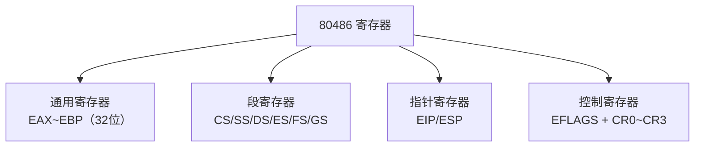
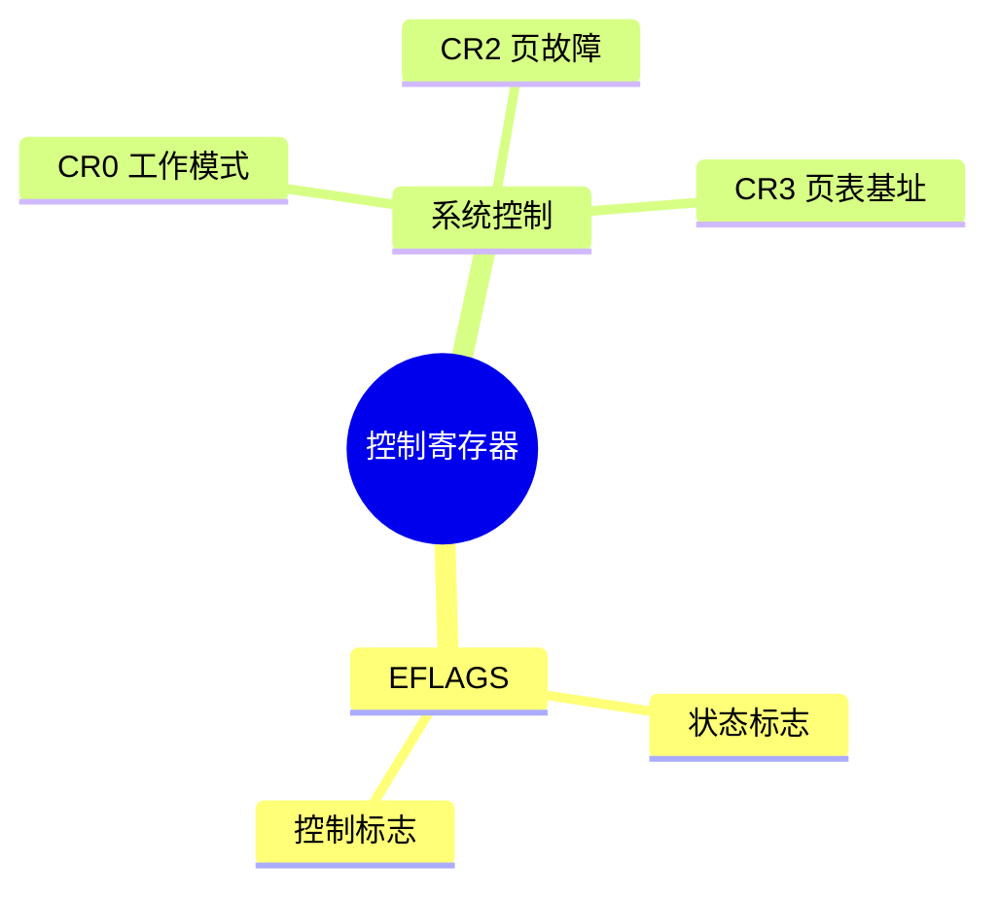

# 80486/8086基本结构寄存器（通用、段、控制寄存器）

寄存器是 CPU 内部的"高速暂存单元"。程序想做加减、想跳转、想访问内存，都得先把数据和地址放进去。==8086 是 16 位 CPU，寄存器基本是 16 位；80486 是 32 位 CPU，寄存器扩到 32 位==，在 8086 名字前加 `E`（如 `AX → EAX`）。

> [!IMPORTANT]
> 8086 是 80486 的"子集"：把 80486 的 `E` 前缀去掉、高位砍掉，就得到 8086 的寄存器结构。==考试问位长，先判断是 8086 还是 80486==。

## 通用寄存器

80486 有 8 个：`EAX, EBX, ECX, EDX, ESI, EDI, EBP, ESP`，每个 ==32 位==，但可按 16 位（`AX` 等）或 8 位（`AL/AH` 等）访问。它们的"分工"：

| 寄存器 | 传统用途 | 记忆 |
|---|---|---|
| `EAX` | 累加、算术结果 | **A**ccumulator |
| `EBX` | 基址 | **B**ase |
| `ECX` | 计数 | **C**ount |
| `EDX` | 乘除余数、I/O 端口 | **D**ata |
| `ESI/EDI` | 串操作源/目的指针 | **S**ource/**D**estination **I**ndex |
| `EBP` | 栈帧基址 | **B**ase **P**ointer |
| `ESP` | 栈顶指针 | **S**tack **P**ointer |

## 段寄存器与指针寄存器

段寄存器 `CS, SS, DS, ES, FS, GS` 共 6 个，每个 ==16 位==，存的是段基址（实模式）或段选择子（保护模式），负责"搬到哪一段"。

指针寄存器有两个：

- `EIP`（==32 位==）：指令指针，CPU 下一条要执行指令的偏移地址。
- `ESP`（==32 位==）：栈顶偏移地址。

> [!TIP]
> 考题爱抠 `SP`/`ESP` 位长。==80486 里 `ESP`/`SP` 是 32 位寄存器的两种访问宽度==，题干写 `SP` 仍按 80486 上下文作答 → 选 32 位（D）。8086 的 `SP` 才是 16 位。

## 控制寄存器

控制寄存器分两组：

- **`EFLAGS` 标志寄存器**（==32 位==）：低 15 位常用，含 ==6 个状态标志== `CF、OF、ZF、PF、AF、SF` 与方向/中断等控制标志。
- **系统控制寄存器 `CR0, CR1, CR2, CR3`**（80486 特有）：控制工作模式、页故障地址、页表基址等。

> [!WARNING]
> ==`CR0~CR3` 是 80486/保护模式概念，8086 没有==；而 `EFLAGS` 中 `TF/IF/DF` 属控制标志，不算状态标志，别混进 6 个状态标志里。

## 一个例子

题：*80486 CPU 中的 `SP` 寄存器是一个（　）位的寄存器？*

思路：先判 CPU → 80486（32 位）→ `SP` 是 `ESP` 的 16 位"别名"但寄存器本体按 32 位归类 → ==选 D（32 位）==。

> [!NOTE]
> 8086 只有 14 个寄存器（8 通用 + 4 段 + 2 指针），80486 通过加宽 + 增加 `FS/GS` + 增设 `CR0~CR3` 实现向下兼容与保护模式支持。
