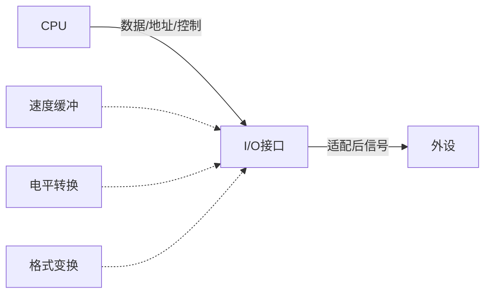

# 接口电路的作用和基本功能

## 接口电路的作用与基本功能

CPU 速度极快且信号规范，而外设种类繁多、速度差异巨大且电平各异。如果让 CPU 直接连接外设，不仅无法匹配时序，还可能烧毁芯片。那么，==接口电路本质上就是 CPU 与外设之间的“翻译官”和“缓冲器”==，它解决了两者在速度、电平和数据格式上的矛盾。

### 为什么需要接口电路

在微型计算机系统中，接口电路主要解决以下三大核心矛盾：

-   **速度匹配**：CPU 是纳秒级，外设可能是毫秒级甚至秒级。接口通过数据缓冲寄存器暂存数据，避免 CPU 空等。
-   **信号转换**：TTL/CMOS 电平与外设电平（如 RS-232 的 $\pm15\text{V}$）不同；并行数据与串行数据格式需互转。
-   **寻址与控制**：CPU 需要通过统一的 I/O 指令管理成百上千种设备，接口负责译码并生成外设所需的特定时序控制信号。



### 接口应具备的基本功能

南邮《微型计算机接口技术》考试中，简答题常问“I/O 接口应具备哪些功能”。请牢记以下五点：

> [!IMPORTANT]
> ==接口电路五大基本功能==是期末高频考点，务必准确表述：
> -   **数据缓冲**：设置数据寄存器，解决速度差异，实现数据暂存。
>   **信号转换**：完成电平转换、串/并转换及数/模转换。
>   **寻址译码**：识别 CPU 发出的端口地址，选中内部特定寄存器。
>   **控制与状态**：接收 CPU 命令字，向 CPU 反馈外设状态（就绪/忙/错）。
>   **中断管理**：支持中断请求与屏蔽，实现高效异步通信。

[!TIP]
记忆口诀：“==缓转译控中==”。即：缓冲、转换、译码、控制、中断。答题时展开为完整术语即可。

### 接口与端口的区别

这是初学者最容易混淆的概念，也是选择题的常客：

| 比较维度 | 接口 (Interface) | 端口 (Port) |
| :--- | :--- | :--- |
| **定义** | 实体电路或逻辑模块 | 接口内部可被CPU访问的寄存器编号 |
| **关系** | 包含多个端口 | 属于某个接口的一部分 |
| **示例** | 8254 定时器芯片 | 8254 的控制口 `213H`、计数器0口 `210H` |

> [!WARNING]
> ==切勿将“接口”等同于“端口”==。例如 8254 是一个接口电路，但它内部有 4 个端口（3个计数器+1个控制寄存器）。题目问“8254 有几个端口”时，答案是 4 个，而不是 1 个。

### 真题中的功能体现

以课件中 8254 初始化编程为例，这段代码完美体现了接口的“寻址译码”与“控制”功能：

```assembly
MOV DX, 213H      ; 指向控制口（寻址译码）
MOV AL, 00110110B ; 方式选择命令字（控制功能）
OUT DX, AL        ; 写入命令
MOV DX, 210H      ; 指向计数器0端口
MOV AX, 2000      ; 计数初值 = 8MHz / 4KHz = 2000
OUT DX, AL        ; 写低8位（数据缓冲/格式适配）
MOV AL, AH
OUT DX, AL        ; 写高8位
```

[!NOTE]
此例中 `213H` 和 `210H` 即为端口地址，由外部译码电路产生。CPU 通过 `OUT` 指令向这些端口写入数据，接口电路根据地址线区分是写“命令”还是写“初值”，这正是==寻址译码与控制功能==的具体实现。若算错初值（如忘记 $T_{out}/T_{clk}$ 公式），则属于应用层错误，但接口本身的功能机制是正确的。
