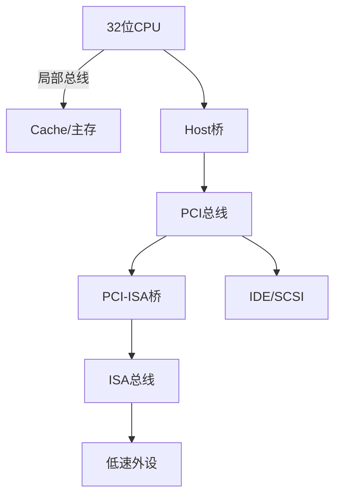

# 32位微型计算机总线结构

## 为什么需要 32 位总线

先想一想：从 16 位机升级到 32 位机，CPU 的数据通路变成了 32 位，地址空间扩到 4 GB——如果总线还停留在 16 位数据、20 位地址，会怎样？CPU 再快也"喂不饱"。所以 32 位微型计算机的总线结构，核心任务就是==配合 80386/80486/Pentium 等 32 位 CPU，提供 32 位数据宽度、32 位地址寻址和更高效的传输控制==。

> [!IMPORTANT]
> 32 位微机总线结构的关键特征：**数据总线 32 位、地址总线 32 位（可寻址 $2^{32}=4\,\text{GB}$）、支持突发（Burst）传输、总线与 CPU 时钟可异步**。

## 它是什么：典型结构

32 位微机普遍采用==多级总线结构==，把"快"和"慢"的设备分开挂，避免高速 CPU 被低速外设拖累：

- **局部总线（Local Bus）**：贴近 CPU，速度最快，连接主存与 Cache。
- **PCI 总线**：32 位（可扩 64 位）的高性能系统总线，是这一代的标志。
- **ISA 总线**：保留兼容老的 16 位扩展卡，挂低速设备。

> [!NOTE]
> 所谓"局部"是指总线物理上、电气上靠近 CPU，与 CPU 内部总线直接相连或经少量缓冲，故能获得接近 CPU 的速度。

## 和相近概念的区别

| 对比项 | 16 位微机总线 | 32 位微机总线 |
| --- | --- | --- |
| 数据总线宽度 | 16 位 | 32 位 |
| 地址总线 | 20/24 位 | 32 位 |
| 寻址空间 | 1 MB / 16 MB | $2^{32}$ B = 4 GB |
| 典型总线 | ISA | PCI + ISA 多级 |
| 传输方式 | 普通周期 | 支持突发传输 |
| 时钟关系 | 与 CPU 同步为主 | 可与 CPU 异步 |

> [!TIP]
> 记忆口诀：**"宽度翻倍、寻址 4G、多级分层、突发提速"**——四句抓住 32 位总线全部考点。

## 常见的坑

> [!WARNING]
> ① 不要把"32 位数据总线"误算成 4 B = 32 bit 之外的值；② 寻址空间按 $2^{32}$ **字节**算（按字节编址），不是 $2^{32}$ 个 32 位字；③ PCI 是 32 位总线，ISA 仍是 16 位，不要说"整机所有总线都是 32 位"。

## 一个算对的例子

**题目**：某 32 位微机地址总线为 32 位，数据总线为 32 位，求最大寻址空间和一次总线传输的最大数据量。

**解**：
- 按字节编址，寻址空间 $=2^{32}\,\text{B}=2^{2}\times 2^{30}\,\text{B}==4\,\text{GB}==$；
- 数据总线 32 位，一次传输 $32\div 8==4\,\text{B}==$（即 1 个双字）。

**验证**：若 PCI 工作在 33 MHz，峰值带宽 $=33\times10^{6}\times 4\,\text{B}=132\,\text{MB/s}$，这正是 PCI 32 位/33 MHz 的经典指标，与教材一致。✓

> [!CAUTION]
> 算带宽时别忘乘的是 **4 字节**（32 bit ÷ 8），写成 32 B/s 量级就错了。
