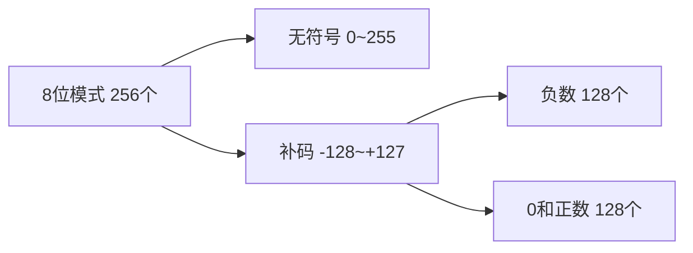

# 不同字长下原码、反码、补码的数值范围

## 它是什么

在微型计算机中，字长 $n$ 决定了一次能并行处理的二进制位数。对同一个 $n$ 位模式，解释方式不同，表示的“真值范围”就不同。南邮这门课里最常见的是两类：

- 无符号数：所有位都当数值位，没有符号位。
- 有符号数：用补码表示时，最高位是符号位，数值按“模 $2^n$”规则解释。

> [!IMPORTANT]
> 设机器数字长 $n$ 位：
> - 补码数真值范围：$-2^{n-1} \sim +2^{n-1}-1$
> - 无符号数范围：$0 \sim 2^{n}-1$
>
> ==核心结论==：补码负数比正数多一个，因为“0”只有一种补码形式。

## 为什么需要记住范围

CPU 做加减法、内存编址、端口地址、定时器初值都会受这个范围限制。如果结果超出范围，就会产生$-$溢出（对有符号）或$-$进位/回绕（对无符号）。比如 $n=8$ 时，补码最大正数是 $127$，再加 $1$ 就会变成 $-128$，不是 $128$。

你可能会问：为什么补码能表示 $-2^{n-1}$，却不能表示 $+2^{n-1}$？因为最高位是符号位，剩下 $n-1$ 位最多构成 $2^{n-1}$ 个负数编码，而正数从 $0$ 开始占用一个，所以正数最大只能到 $2^{n-1}-1$。

## 怎么做：套公式算范围

给定 $n$：

- 无符号最大值 = $2^n-1$
- 补码最小负数 = $-2^{n-1}$
- 补码最大正数 = $2^{n-1}-1$

例如题目：“$16$ 位二进制数所能表示的无符号数范围是____。”
这里 $n=16$，所以范围是：

$$0 \sim 2^{16}-1 = 0 \sim 65535$$

写成十六进制就是 $0000\text{H} \sim \text{FFFFH}$。

用结构图看一下 $n=8$ 时的编码分布：

## 相近概念区别与常见坑

原码、反码也会表示负数，但补码才是计算机里实际做运算的表示法。原码和反码里“$0$”有两种形式：$+0$ 和 $-0$；补码把 $-0$ 腾出来给了最小负数。

| $n=8$ 数值 | 原码 | 反码 | 补码 |
|---|---|---|---|
| $-1$ | `1000 0001` | `1111 1110` | `1111 1111` |
| $-128$ | 不能正常表示 | 不能正常表示 | `1000 0000` |

> [!WARNING]
> 常见坑：把 `-1` 的补码记成 `1000 0000`。
> `1000 0000` 在 8 位补码里是 ==$-128$==，不是 $-1$。
> $-1$ 的 8 位补码是 ==`1111 1111`==，也就是 `FFH`。

> [!TIP]
> 记忆技巧：$-1$ 的补码是“全 $1$”，因为从 `...1111` 加 $1$ 会回到 $0$；最小负数补码是“最高位 $1$，其余全 $0$”。

## 一个算对了的例子

取 $n=8$：

- 无符号数范围：$0 \sim 2^8-1 = 0 \sim 255$
- 补码数范围：$-2^{7} \sim 2^{7}-1 = -128 \sim +127$

再核对边界值：

- $+127$ 补码：`0111 1111`
- $-1$ 补码：`1111 1111`
- $-128$ 补码：`1000 0000`

> [!NOTE]
> 若看到“$-1$ 的原码是 `1000 0000`”这类说法，应判断是否为OCR/录入错误；标准 8 位原码里 `1000 0000` 通常对应“$-0$”，而 `1000 0001` 才是 $-1$ 的原码。
