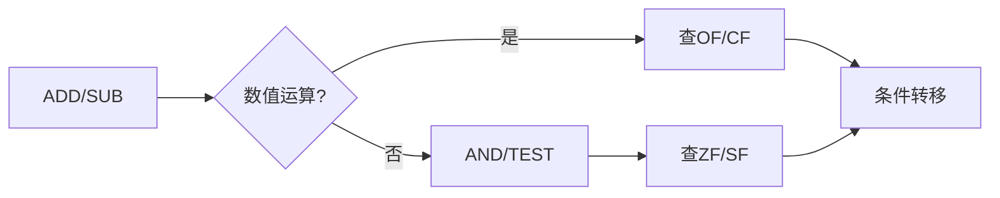

# 算术运算与逻辑运算指令（ADD、SUB、MUL、AND、OR、NOT等）

## 算术与逻辑运算指令的本质区别

在80x86汇编中，`ADD`/`SUB` 与 `AND`/`OR` 虽然都是双操作数指令，但它们对标志位的影响截然不同。你是否想过：为什么判断溢出用 `JO`，而检测某位是否为0却用 `TEST` + `JZ`？这背后是指令设计对“数值计算”与“位状态检测”两种场景的分离。

> [!IMPORTANT]
> ==算术指令关注数值正确性，逻辑指令关注位模式==。`ADD/SUB/CMP` 影响全部6个标志位；`AND/OR/XOR/TEST` 必定使 `OF=0, CF=0`，仅反映结果的符号、零和奇偶性。

## 算术运算指令要点

加法（`ADD/ADC/INC`）和减法（`SUB/SBB/DEC/CMP/NEG`）用于有符号或无符号数值运算。`CMP` 执行减法但==不保存结果==，仅更新标志位供后续条件转移使用。

[!WARNING]
`INC` 和 `DEC` ==不影响 CF 标志==！这是为了在多精度运算循环中保护进位链。若需同时更新CF，必须用 `ADD reg, 1` 或 `SUB reg, 1`。

乘法指令 `MUL src` 为无符号乘，源操作数==不能是立即数==。字节乘积存于 `AX`，字乘积存于 `DX:AX`。若高位非零，则 `CF=OF=1`。例如 `MUL 100` 是非法指令，必须先 `MOV BX, 100` 再 `MUL BX`。

## 逻辑运算与位操作技巧

逻辑指令的核心用途是==位屏蔽、位置位、位测试==。在接口技术中，常配合 `IN/OUT` 对端口寄存器进行精确控制。

| 指令 | 功能 | 典型应用场景 |
| :--- | :--- | :--- |
| `AND d,s` | 按位与，清零特定位 | 屏蔽中断位、提取低4位BCD |
| `OR d,s` | 按位或，置位特定位 | 开放中断、设置控制位 |
| `XOR d,d` | 自身异或 | ==寄存器快速清零==（比MOV快） |
| `TEST d,s` | 与运算但不写回 | 检测某位状态而不改变原值 |

[!TIP]
ASCII码转BCD码只需 `AND AL, 0FH`；屏蔽高四位用 `AND AL, CL`（CL预置掩码）。接收串口数据后务必用 `AND` 消除高位噪声。

## 补码运算与溢出判断实例

以课件例题“用补码计算 $19-96$”为例，演示如何手动验证硬件运算结果：

$$
[19]_{\text{补}} = 00010011B,\quad [-96]_{\text{补}} = 10100000B
$$

$$
[19-96]_{\text{补}} = 00010011B + 10100000B = 11001101B
$$

最高位进位 $C_{\text{标}}=0$，次高位向最高位进位为1，故 $O_{\text{标}} = C_{\text{in}} \oplus C_{\text{out}} = 1 \oplus 0 = 1$？==注意==：此处实际 $C_{\text{in}}=0$（第6→7位无进位），$C_{\text{out}}=0$，所以 $O_{\text{标}}=0$，==无溢出==。结果 $11001101B$ 对应真值 $-77$，正确。

[!CAUTION]
溢出标志 `OF` 仅对有符号数有意义！无符号数只看 `CF`。混淆二者是综合题高频失分点。

掌握这些指令的关键在于：==永远明确当前操作是有符号、无符号还是纯位操作==，再选择对应指令和标志位判断依据。
