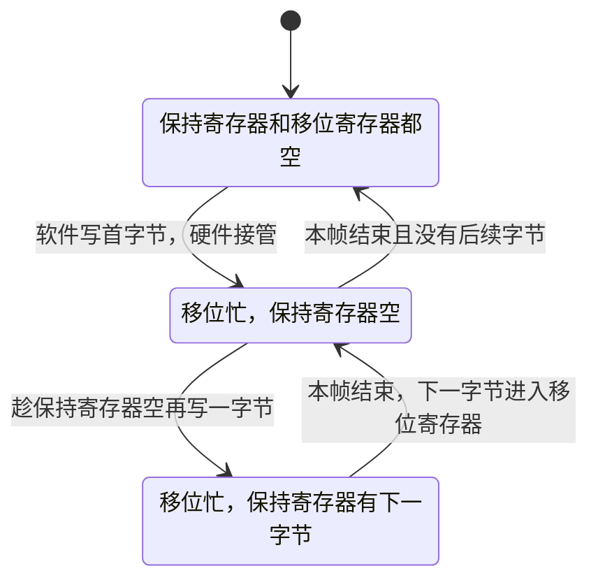

# 串行接口的发送状态：能送下一字节，不等于线路已空

处理器一次写入一个字节，线路却要按位发一段时间。如果写操作必须等整帧发完，处理器的服务延迟就直接变成线路上的空隙。给等待中的字节留一个位置，处理器便能在上一帧还没结束时把下一帧准备好。

以无 FIFO 的 8250 为例，==发送保持寄存器==（THR）接收软件写入，==发送移位寄存器==（TSR）逐位把字符发上线路。THR 空而 TSR 还忙时，可以给 THR 写下一字节；但若此时关闭发射器，当前帧可能被截断。线路状态寄存器（LSR）的两位恰好对应这两个问题：

| 题目问什么 | 应等待的状态 | 为什么 |
|---|---|---|
| 可以写下一字节吗？ | 位 5 为 1：THR 空 | 只需等待槽可用 |
| 可以关闭驱动或改速率吗？ | 停止提供新的字节，再等位 5、6 都为 1：THR、TSR 分别为空 | 还须等最后一帧发完 |
| 能不能读到接收字节？ | 位 0：接收数据就绪，并按需要处理错误状态 | 发送位不能回答接收问题 |

图省略了字节从保持到移位的短暂搬运；不承诺软件可观察到每个边界状态。带 FIFO 的变体应按具体手册解释标志，不要直接套用单字节等待槽的模型。

**补充例题。** 时钟为 1.8432 MHz，用 8250 配 38 400 波特、8N1，只发两个字节。假设第二字节已及时写入，硬件不插入额外空闲。何时交接到第二帧，何时才能按发送空闲收尾？

**参考解答。** 分频数是 $1\,843\,200/(16\times38\,400)=3$。一帧为 1 起始位、8 数据位、1 停止位，持续 $10/38\,400=1/3840~\mathrm{s}$，约 $260.4~\mu\mathrm s$。第二帧接着发，约 $520.8~\mu\mathrm s$ 时结束。进入第二帧后，第二字节已经移入 TSR，位 5 又能表示可写；第二帧期间位 6 仍为 0，必须等它发完。实际程序先停止新的写入，再同时检查这两个状态位；不是硬等一个计算时间。

> [!WARNING]
> 发送寄存器已空只是本端状态，不能证明对端正确接收。要求「已交付」时，要另查协议的确认条件。

寄存器定义依 [National Semiconductor INS8250/INS8250-B 数据手册](https://datasheets.pl/elementy_czynne/IC/INS/INS8250.pdf) 的线路状态寄存器说明，图和算例均为独立构造。
