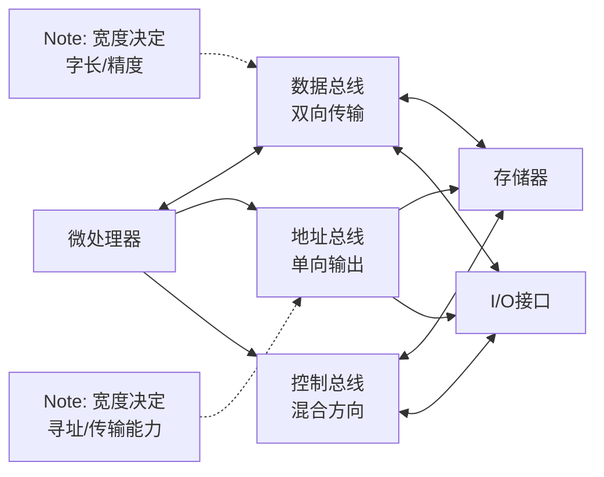

# 微型计算机的硬件基本结构

## 微型计算机硬件基本结构

微型计算机系统的核心在于各部件如何协同工作。其硬件结构主要由 **微处理器（CPU）**、**存储器**、**I/O 接口** 和 **系统总线** 四大部分组成。理解这一结构的关键，在于掌握信息流动的“高速公路”——系统总线。

> [!IMPORTANT]
> 核心结论：微处理器与存储器、I/O 接口之间的信息传送，完全依赖于 **==三总线结构==**，即数据总线、地址总线和控制总线。

### 三总线的功能与区别

为了厘清三者职责，我们可以思考：如果 CPU 想要从内存读取一个数据，它需要知道什么？首先需要知道数据的“位置”（地址），然后发出“读取”指令（控制），最后数据才会传回来（数据）。

| 总线名称 | 信号方向 | 主要功能 | 关键特性 |
| :--- | :--- | :--- | :--- |
| **数据总线 (DB)** | 双向 | 传输指令、数据、状态信息 | 位数决定机器字长（如 8位、16位） |
| **地址总线 (AB)** | 单向 (CPU→外) | 指定存储单元或 I/O 端口地址 | 位数决定最大寻址空间 ($2^n$) |
| **控制总线 (CB)** | 混合 | 传输时序、命令、状态信号 | 包括读/写、中断请求、复位等 |

> [!TIP]
> 记忆技巧：**地**址找门牌（单向指路），**数**据搬货物（双向搬运），**控**制发号令（协调动作）。

### 常见误区与考点辨析

在复习中，学生常混淆总线的方向性和具体组成。

> [!WARNING]
> 易错坑：地址总线通常是**单向**的，由 CPU 发出；而数据总线是**双向**的。不要误认为所有总线都是双向的。

此外，需注意 **I/O 接口的编址方式**。PC 系列机通常采用 **端口独立编址**，这意味着 I/O 端口有独立的地址空间，不与存储器地址混用，需使用专门的 I/O 指令（如 `IN`/`OUT`）进行访问。

### 典型例题解析

回顾课件中的经典填空题：
*“微处理器与 I/O 接口及存储器进行信息传送是通过三总线来完成，该三总线为 \_\_\_\_、\_\_\_\_ 和地址总线。”*

**解题思路**：
题目已给出“地址总线”，根据三总线定义，剩余的两个必然是负责数据传输的 **数据总线** 和负责协调工作的 **控制总线**。

**正确答案**：数据总线、控制总线。

> [!NOTE]
> 延伸思考：若地址总线宽度为 20 位，则 CPU 最大可寻址空间为 $2^{20} = 1\text{MB}$。这是南邮考试中常见的计算点，务必熟练掌握 $2^n$ 的换算。
