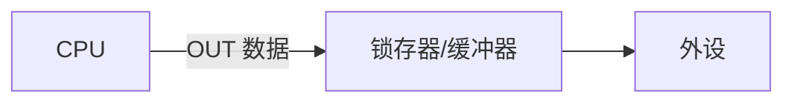
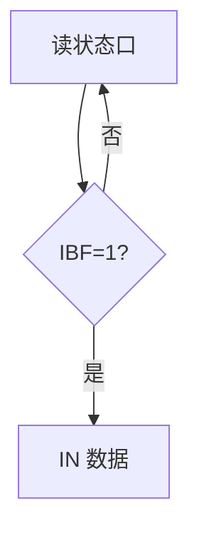
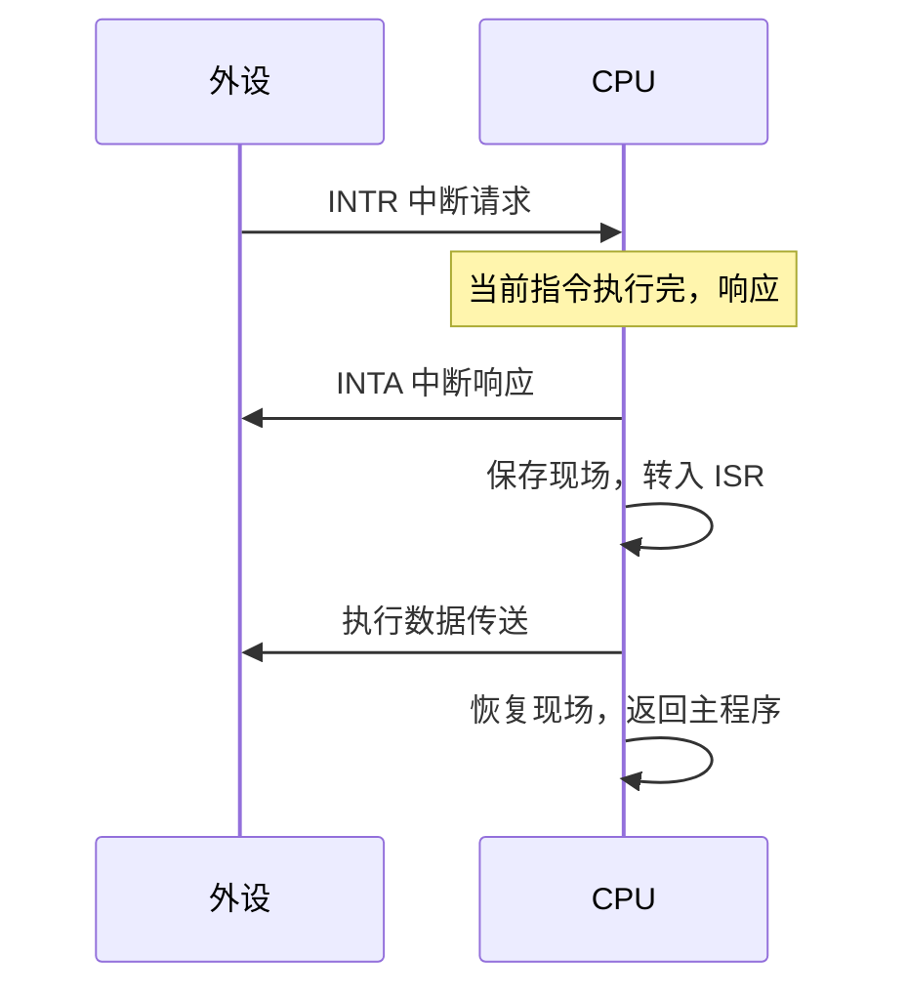
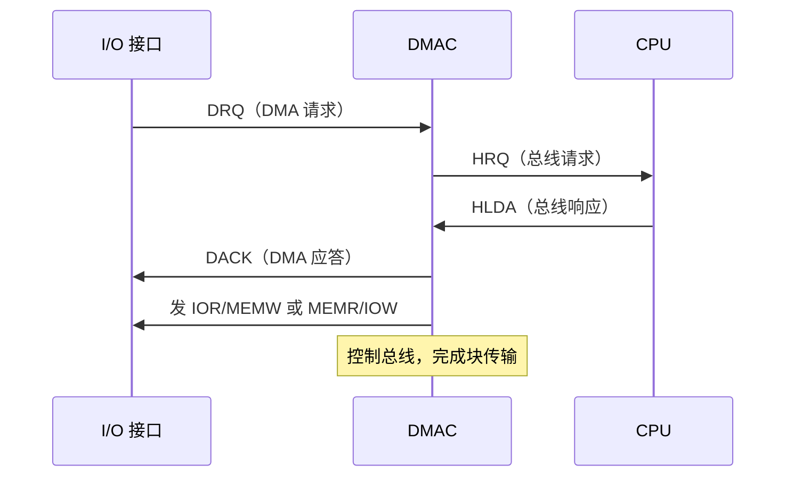

# 微机系统与I/O端口的信息交换方式（无条件、查询、中断、DMA）

## 四种信息交换方式：从“傻等”到“放手”

微机系统要与外设交换信息，首先要想清楚一个问题：**CPU 怎么知道外设准备好了？** 围绕这个问题，产生了四种基本方式。

### 无条件传送：假设对方永远就绪

CPU 不检查外设状态，直接执行 `IN` / `OUT` 指令读写数据。

**适用条件**：外设的状态是确定可知的。例如读取一组拨码开关、驱动 LED 数码管——它们的“就绪”不随时间变化。

> [!WARNING]
> 无条件传送必须保证每次传送时外设都处于就绪状态。如果外设速度跟不上（如打印机正在打印），数据就会丢失或出错。课件里的“传送不能太频繁”就是这个意思。

一个典型例子是 8255A 工作在**方式 0**时，A 口作为输出口直接驱动 LED，CPU 无需查询任何状态位，直接 `OUT` 即可。

---

### 查询方式：先问“好了吗”，再传数据

CPU 在传送前**先读外设的状态寄存器**，判断就绪标志（如输入缓冲器满 `IBF`、输出缓冲器空 `OBF`）是否有效，就绪才传送，否则继续查询。

**查询式输入核心流程：**

**查询式输出核心流程**：先查 `OBF=1`（表示输出缓冲器已空），再 `OUT` 数据。

> [!TIP]
> 8255A 方式 1 下，查询输入查的是 `IBF`，查询输出查的是 `OBF`。两者别记反：**输入看“满”，输出看“空”**。

> [!WARNING]
> 查询方式的代价是 CPU 在“空转”——如果外设 10ms 后才就绪，CPU 就白白查询 10ms。这**降低了 CPU 效率**，且**不具备实时性**。

---

### 中断控制方式：外设主动“敲门”

查询方式的痛点是 CPU 太被动。中断方式把主动权交给外设：**外设准备好后，主动向 CPU 发出中断请求**。

关键点：CPU 响应中断的前提是**当前指令执行完毕**，然后保存现场（寄存器压栈），执行中断服务程序，最后恢复现场、返回。

> [!IMPORTANT]
> 中断方式下，CPU 与外设可以**并行工作**——外设准备数据的同时，CPU 在做别的计算。这提高了效率，也**具备实时响应能力**。

中断方式的**缺点**是每次传送一字节都要经历“保存现场 → 服务 → 恢复现场”的完整流程，有额外开销。

> [!NOTE]
> 在 PC 机中，`STI` / `CLI` 指令只对 **INTR 可屏蔽中断**有效，对 NMI 和内部中断无效。

---

### DMA 方式：CPU 彻底放手

中断方式仍是 **CPU 用软件完成传送**。当高速外设（如硬盘）需要批量传输数据时，中断方式太慢。DMA 的核心思想：**用硬件（DMAC）接管总线，数据直达内存，不经过 CPU**。

**DMA 传送过程：**

几个重点：

- **DMA 读**：RAM → I/O（DMAC 发 `MEMR` + `IOW`）
- **DMA 写**：I/O → RAM（DMAC 发 `IOR` + `MEMW`）
- **AEN=1** 表示 DMAC 已接管系统三总线。
- 一片 8237A 有 **4 个 DMA 通道**，一次传送最大 **64KB**，PC 机级联两片得到 7 个可用通道。

> [!IMPORTANT]
> DMA 响应时间比中断更短：中断要等**当前指令执行完**，DMA 只需等**当前总线周期结束**。因为总线周期比指令短得多，DMA 的响应更快。

---

### 四方式对比

| 方式 | 数据传送单位 | 谁来控制 | CPU 效率 | 实时性 | 典型应用 |
|------|------------|---------|---------|--------|---------|
| 无条件 | 单字节 | CPU | 最高（无开销） | 无 | LED、开关 |
| 查询 | 单字节 | CPU | 低（空转） | 差 | 简单 I/O |
| 中断 | 单字节 | CPU（软件） | 较高 | 好 | 键盘、串口 |
| DMA | 数据块 | DMAC（硬件） | 最高 | 最好 | 硬盘、高速采集 |

> [!CAUTION]
> 常见混淆点：**中断也有“向量”和“请求信号”**，但中断传送的数据是 CPU 通过 `IN`/`OUT` 完成的；DMA 传送的数据根本不经过 CPU，由 DMAC 直接在 I/O 与内存之间搬移。

**算得上的例子**：实模式下，中断类型码 `1CH` 的中断向量存放在 `4×1CH = 70H` 开始的 4 个单元（`0000:0070H` ~ `0073H`）。若这 4 个单元内容依次为 `00H, 38H, 30H, 50H`，则中断服务程序入口地址的段地址为 `5030H`，偏移地址为 `3800H`。
