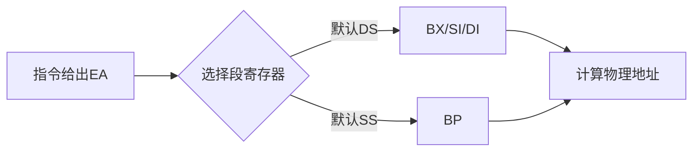

# 80486/8086的寻址方式（立即、寄存器、直接、间接、变址等）

---
title: 80486/8086的寻址方式
requires: [微型计算机接口技术/基本结构寄存器]
---

CPU执行一条指令时，怎么知道操作数藏在哪里？是在指令代码里直接写着，还是躲在某个寄存器中，又或者存在内存的某个角落？这就是==寻址方式==要解决的问题。

80486（兼容8086）共有3类7种寻址方式：立即、寄存器、以及5种存储器寻址。

## 立即与寄存器寻址

- **立即寻址**：操作数直接写在指令代码中，称为“立即数”。例如 `MOV AL, -1`，源操作数 `-1` 就是立即寻址。
- **寄存器寻址**：操作数在CPU内部寄存器中。例如 `MOV DX, BX`，源和目的都是寄存器寻址。

> [!TIP]
> 这两种方式不需要访问内存取操作数，速度最快。

## 存储器寻址

当操作数在内存中时，CPU必须计算出它的==有效地址（EA）==，再结合段寄存器算出物理地址（PA）。

$$物理地址 = 段寄存器内容 \times 16 + EA$$

根据EA的计算规则，分为以下5种：

| 寻址方式 | 有效地址 $EA$ 计算公式 | 示例 |
| :--- | :--- | :--- |
| **直接寻址** | 指令中直接给出偏移量 | `ADD AX, DS:[1000H]` |
| **寄存器间接寻址** | `[BX]`, `[BP]`, `[SI]`, `[DI]` | `MOV DX, [BX]` |
| **基址寻址** | `[BX+位移量]`, `[BP+位移量]` | `MOV AX, [BX+6]` |
| **变址寻址** | `[SI+位移量]`, `[DI+位移量]` | `DEC BYTE PTR[SI+1200H]` |
| **基址+变址寻址** | `[BX+SI]`, `[BX+DI]`, `[BP+SI]`, `[BP+DI]`（可加位移量） | `MOV AX, [BX+SI+6]` |

> [!IMPORTANT]
> 基址寄存器只能是 ==BX 或 BP==；变址寄存器只能是 ==SI 或 DI==。两者不能混用（如 `[BX+BP]` 是非法的），且同类不能叠加（如 `[SI+DI]` 非法）。

## 与相近概念的区别：I/O端口寻址

在《微型计算机接口技术》中，读写外设端口也用 `IN`/`OUT` 指令，但它的寻址与内存寻址不同：
- **直接寻址 I/O**：端口地址为8位立即数（$00\text{H} \sim \text{FFH}$），如 `OUT 3F8H, AL`（注：实际汇编语法中超过8位需用DX）。
- **DX间接寻址 I/O**：端口地址大于8位（最大 $\text{FFFFH}$）时，必须先将端口地址放入DX，如 `OUT DX, AL`。

> [!WARNING]
> 内存间接寻址可用 `[BX]`/`[SI]` 等，但 ==I/O间接寻址只能用 DX==，不能用其他寄存器！

## 常见的坑

> [!CAUTION]
> 当目标操作数是间址、变址、基址等内存操作数，而源操作数是立即数时，汇编器不知道你要操作几个字节，==必须用 `PTR` 说明类型==（如 `BYTE PTR` 或 `WORD PTR`）。单操作数指令（如 `INC [BX]`）同理。

## 真题实战演练

**题目**：设 $\text{BX}=1200\text{H}$，$\text{SI}=0002\text{H}$，$\text{DS}=3000\text{H}$，内存单元 $(31200\text{H})=50\text{H}$，$(31201\text{H})=02\text{H}$，$(31202\text{H})=\text{F7H}$，$(31203\text{H})=90\text{H}$。求指令单独执行后的结果。

**1. `DEC BYTE PTR[SI+1200H]`**
- **寻址方式**：$EA = \text{SI} + 1200\text{H}$，属于==变址寻址==。
- **物理地址**：$PA = 3000\text{H} \times 16 + 0002\text{H} + 1200\text{H} = 30000\text{H} + 1202\text{H} = 31202\text{H}$。
- **执行过程**：对 $31202\text{H}$ 处的字节减1。原值为 $\text{F7H}$，$\text{F7H} - 1 = \text{F6H}$。
- **结论**：$(31202\text{H}) = \text{F6H}$。

**2. `MOV AX, WORD PTR [BX+SI]`**
- **寻址方式**：$EA = \text{BX} + \text{SI}$，属于==基址+变址寻址==。
- **物理地址**：$PA = 30000\text{H} + 1200\text{H} + 0002\text{H} = 31202\text{H}$。
- **执行过程**：读取一个字（2字节），低地址存低字节。即 $\text{AL}=(31202\text{H})=\text{F7H}$，$\text{AH}=(31203\text{H})=90\text{H}$。
- **结论**：$\text{AX} = 90\text{F7H}$。
