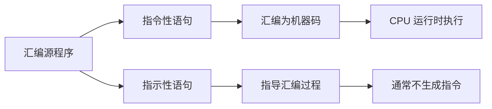

# 源程序中的语句类型（指令性语句与指示性语句）

## 两类语句：写给 CPU，还是写给汇编程序

一个完整的汇编源程序包含两类语句：==指令性语句（符号指令）和指示性语句（伪指令）==。判断它们的关键不是“有没有操作码”，而是==这条语句由谁执行、在什么阶段起作用==。



| 对比项 | 指令性语句（符号指令） | 指示性语句（伪指令） |
|---|---|---|
| 主要作用 | 描述 CPU 要完成的操作 | 说明数据、段、符号及程序组织方式 |
| 处理者 | 汇编后由 CPU 执行 | 主要由汇编程序在汇编时处理 |
| 是否生成机器指令 | 一般生成对应的机器指令 | 通常不生成供 CPU 执行的机器指令 |
| 典型例子 | `MOV`、`ADD`、`INT` | `DB`、`SEGMENT`、`ENDS`、`ASSUME`、`END` |

## 指令性语句：程序运行时做什么

指令性语句就是符号指令，例如：

```assembly
MOV AX, DATA
MOV DS, AX
MOV AH, 4CH
INT 21H
```

这些语句经汇编后形成目标程序中的机器指令。程序运行时，CPU 逐条执行，完成数据传送、算术运算、转移控制或中断调用等操作。

因此，看到 `MOV AH, 4CH`，应理解为：**运行到这里时，CPU 把立即数 `4CH` 送入 `AH`**，而不是汇编程序在汇编阶段替程序调用 DOS 功能。

## 指示性语句：目标程序怎样组织

伪指令用于向汇编程序提供信息。例如：

```assembly
DATA SEGMENT
BUF DB 12H, 34H
DATA ENDS

CODE SEGMENT
    ASSUME CS:CODE, DS:DATA
CODE ENDS
END START
```

其中：

- `SEGMENT`、`ENDS`：界定段的开始和结束，段名必须对应；
- `ASSUME`：说明段寄存器与各逻辑段的对应关系；
- `DB`：定义字节数据，并为数据分配存储空间、设置初值；
- `END START`：表示源程序结束，并指出启动标号为 `START`。

> [!IMPORTANT]
> 伪指令并非“不起作用”。它通常不形成 CPU 执行的机器指令，但会影响==存储分配、段组织、符号定义和目标程序生成==。

## 一个完整例子

```assembly
DATA SEGMENT
NUM DB 5
DATA ENDS

CODE SEGMENT
    ASSUME CS:CODE, DS:DATA
START:
    MOV AX, DATA
    MOV DS, AX
    MOV AL, NUM
    ADD AL, 3
    MOV AH, 4CH
    INT 21H
CODE ENDS
END START
```

`NUM DB 5` 是伪指令，在数据段中预留一个字节并装入初值 `05H`；`MOV AL, NUM` 是指令性语句，运行时把该字节送入 `AL`，所以 `AL=05H`。随后执行 `ADD AL, 3`，得到：

$$AL=05H+03H=08H$$

最后通过 `AH=4CH`、`INT 21H` 返回 DOS。这个例子中，`DB` 负责==准备数据==，`MOV`、`ADD` 负责==处理数据==。

> [!WARNING]
> 不要把 `DB` 生成的数据字节与 CPU 指令混为一谈；也不要认为 `ASSUME DS:DATA` 会自动给 `DS` 赋值。上例仍需执行 `MOV AX, DATA` 和 `MOV DS, AX`。

> [!TIP]
> 分类时先问一句：==它是在告诉 CPU“运行时做什么”，还是在告诉汇编程序“汇编时怎么安排”？==前者是指令性语句，后者是指示性语句。
