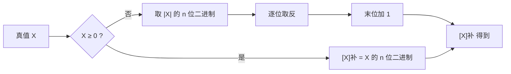

# 真值数与补码的相互转换及补码计算

## 真值数与补码

### 为什么需要补码

计算机只能用固定位数的 0 和 1 表示数，直接面临两个问题：负数怎么表示？减法怎么变成加法来做？

如果把最高位当作符号位（0 正 1 负），其余位照抄数值，得到的是原码。但原码做加法会出错——比如 $(+1) + (-1)$ 按原码相加结果并不是 0。于是引入了补码：==用补码后，减法可以统一成加法==，CPU 只需一套加法器就能完成加减运算。

### 真值转补码：三步走

给定一个真值 $X$，字长 $n$ 位，求 $[X]_\text{补}$：

- 若 $X \ge 0$：补码 = 原码。直接写成 $n$ 位二进制，高位补 0。
- 若 $X < 0$：补码 = $2^n + X$（即模加上该负数）。实际操作可以走"三步"：
  1. 取 $|X|$ 的 $n$ 位二进制（数值部分）
  2. 逐位取反
  3. 末位加 1

> [!TIP]
> 口诀：==“正数不变，负数取反加一”==。注意符号位也参与取反。

**例**：字长 8 位，求 $[-6]_\text{补}$。

- $[-6]$ 为负：$|{-6}| = 6 = 0000\,0110\text{B}$
- 取反：$1111\,1001\text{B}$
- 加 1：$1111\,1010\text{B} = \text{FAH}$。

所以 $[-6]_\text{补} = (\text{FA})_{16}$。

### 补码转真值：正负分两路

已知 $[X]_\text{补}$（$n$ 位），求真值 $X$：

- 若最高位为 0（正数）：真值 = 补码本身对应的值。
- 若最高位为 1（负数）：取反加一，得到绝对值，再添负号。

> [!WARNING]
> 补码的符号位不是摆设——它和数值位一样参与“取反加一”操作。==把符号位单独摘出来再取反加一是典型错误。==

**例**：$[X]_\text{补} = \text{E8H}$，字长 8 位，求 $X$。

- $\text{E8H} = 1110\,1000\text{B}$，最高位为 1，是负数。
- 取反：$0001\,0111\text{B}$
- 加 1：$0001\,1000\text{B} = 24$
- 真值：$-24$。用十六进制表示：$X$ 的真值为 $(-18)_{16}$。

### 补码的真值范围

设字长 $n$ 位，补码能表示的范围是：

$$
-2^{n-1} \sim +2^{n-1}-1
$$

> [!IMPORTANT]
> 补码范围**不对称**：负数比正数多一个。8 位补码范围是 $-128 \sim +127$。$-128$ 在 8 位下没有对应的原码，它的补码是 $1000\,0000\text{B}$。

无符号数则很简单：$0 \sim 2^n - 1$。

### 补码计算与溢出判断

补码加减统一为加法后，需要关注**溢出**。

有两个标志位要会判断：

- $C_\text{标}$（进位标志）：最高位向更高位的进位（等于次高位向最高位的进位？不，是**最高位向外的进位**）。
- $O_\text{标}$（溢出标志）：$O_\text{标} = C_{n-1} \oplus C_{n-2}$，即**符号位进位的输入和输出的异或**。

简便判据：==两个同号数相加，若结果的符号与加数相反，则 $O_\text{标}=1$。==

**例**：字长 8 位，计算 $-66-99$。

$$
\begin{aligned}
[-66]_\text{补} &= 1011\,1110\text{B} \\
[-99]_\text{补} &= 1001\,1101\text{B} \\
\text{相加：}\quad 1011\,1110 \\
+1001\,1101 \\
\hline
(1)\,0101\,1011
\end{aligned}
$$

最高位有进位，$C_\text{标}=1$。计算 $O_\text{标}$：两负数相加（同号），结果 $0101\,1011$ 的符号为 0（正），符号相反，$O_\text{标}=1$。==$O_\text{标}=1$ 说明结果溢出，$-66-99 \ne +91$，计算错误。==

### 补码与原码、反码的关系

下面用表格对比三者的区别（以 8 位、$X=-6$ 为例）：

| 表示法 | 二进制 | 十六进制 |
|--------|--------|----------|
| 原码   | $1000\,0110$ | $86H$ |
| 反码   | $1111\,1001$ | $F9H$ |
| 补码   | $1111\,1010$ | $FAH$ |

> [!CAUTION]
> 正数的原码、反码、补码完全相同。只有负数才需要区分三种编码。做题时先看清题目要求的是哪种码。

### 转换流程可视化



```mermaid
flowchart LR
  A["[X]补"] --> B{"符号位 = 0 ?"}
  B -->|是| C["真值 = 补码对应正数"]
  B -->|否| D["逐位取反 + 1"]
  D --> E["得到 |X|"]
  E --> F["真值 = -|X|"]
