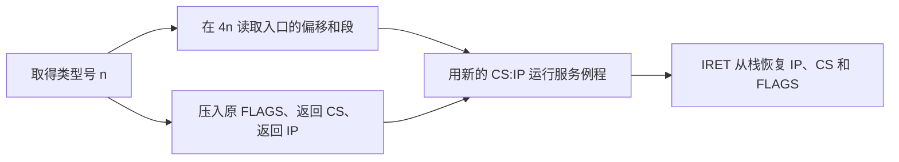

# 8086 实模式中断向量：表项、服务入口与栈帧

如果只有一个固定服务入口，入口代码还要再问每个可能设备是谁发的请求。让请求提供一个小编号，CPU 就可以直接从表里取得不同入口，而不必让不同的设备知道例程代码放在哪里。可变的代码地址由向量表承担；可恢复的返回地址由栈承担。把两者放到同一处，第二个嵌套中断就可能覆盖第一个返回位置。

| 手里有的量 | 怎样用 | 它不是什么 |
|---|---|---|
| 类型号 $n$，0 至 255 | 原始 8086 从物理地址 $4n$ 读四字节 | 不是例程代码地址 |
| 表项中 IP、CS 两个 16 位字 | 解释为服务入口 CS:IP；每个字段小端排列 | 不是被打断代码的地址 |
| 栈顶起的 IP、CS、FLAGS 三个字 | 16 位 IRET 用来恢复执行及原标志 | 不是要写进向量表的新内容 |

**补充例题。** 在 8086 实模式里，65H 型中断的表项按内存地址升序为 $67\mathrm{H},45\mathrm{H},23\mathrm{H},01\mathrm{H}$。用户代码执行软件中断后应返回到 1000H:0033H。例程进场前 SP=0100H，没有边界回绕。问表项起址、执行入口和例程最初可见的栈内容。

**参考解答。** 65H 乘 4 得 0194H。先将低两个字节合成 IP=4567H，再合成 CS=0123H；入口是 0123H:4567H，物理地址 $01230\mathrm{H}+4567\mathrm{H}=5797\mathrm{H}$。栈每压一个字减 2，入场后 SP=00FAH。从 SS:00FAH 到 SS:00FEH 的三个字分别是 0033H、1000H 和原 FLAGS。若例程还压了通用寄存器，IRET 前必须先把这些额外的字弹掉。

> [!TIP]
> ==先判断题目要的是表项位置、服务去向还是中断返回位置==。用 $4n$ 只能定位表项；返回 IP 是另存的上下文，不能从服务向量算出来。INT3、INTO 和硬件请求并不共享发生条件；这里共享的是获得类型号之后的 16 位实模式进入与返回结构。

此处限于原始 8086 的实模式；后续型号的保护模式用描述符、权限检查和可能的栈切换，不能搬用此图的表项大小。参照 [Intel《8086 Family User’s Manual》第二章](https://bitsavers.org/components/intel/8086/9800722-03_The_8086_Family_Users_Manual_Oct79.pdf)。
