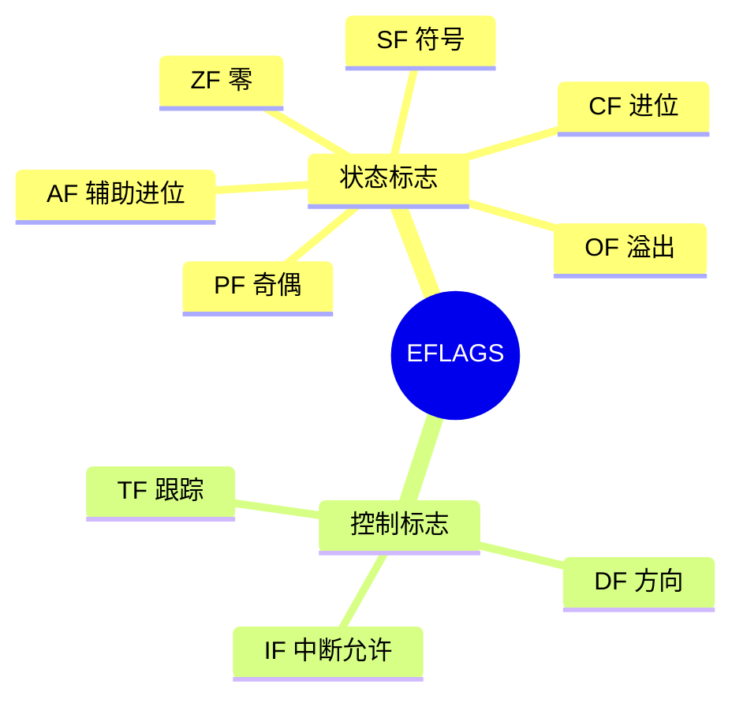

# 标志寄存器中的状态标志位与控制标志位

---
requires: [补码运算, 微型计算机接口技术/基本结构寄存器]
---

CPU 做完一次加减法后，怎么知道结果对不对、有没有超出范围？答案就藏在标志寄存器 EFLAGS 里。80486 的 EFLAGS 包含 ==15 位标志==，分为**状态标志**和**控制标志**两类。

## 状态标志：运算结果的“体检报告”

状态标志由算术/逻辑指令自动设置，共 6 个，反映运算结果的特征：

| 标志 | 含义 | 置 1 条件 |
|---|---|---|
| CF（进位） | 无符号数溢出 | 最高位产生进位或借位 |
| OF（溢出） | 带符号数溢出 | 次高位向最高位有进位且最高位向外无进位，或反之 |
| ZF（零） | 结果为零 | 运算结果为全 0 |
| SF（符号） | 结果正负 | 与结果最高位相同 |
| PF（奇偶） | 低 8 位奇偶性 | 结果低 8 位含偶数个 1 |
| AF（辅助进位） | BCD 调整用 | D3 向 D4 产生进位或借位 |

> [!TIP]
> 判断溢出看谁？==无符号数看 CF，带符号数看 OF==。这是条件转移指令选择 `JA/JB`（测 CF/ZF）还是 `JG/JL`（测 OF/SF/ZF）的根本依据。

## 控制标志：CPU 行为的“开关”

控制标志不由运算结果改变，而需专用指令手动设置，共 3 个：

| 标志 | 作用 |
|---|---|
| DF（方向） | 串操作地址增减：DF=1 递减，DF=0 递增 |
| IF（中断允许） | IF=1 允许响应可屏蔽中断（INTR），IF=0 屏蔽 |
| TF（跟踪） | TF=1 CPU 进入单步工作方式，用于调试 |

> [!IMPORTANT]
> CPU 响应可屏蔽硬件中断必须同时满足三个条件：INTR 引脚有请求、当前指令执行完毕、==IF=1（开中断状态）==。非屏蔽中断（NMI）则不受 IF 控制。

## 相近概念辨析

- **CF vs OF**：CF 是最高有效位向外的进位/借位，管无符号数；OF 是次高位向最高位的进位与最高位向外的进位做异或，管带符号数。两者可能同时为 0 或同时为 1，互不矛盾。
- **状态标志 vs 控制标志**：状态标志是“被动记录”，随运算结果自动翻转；控制标志是“主动配置”，靠 `STI`/`CLI`/`STD`/`CLD` 等指令修改。

> [!WARNING]
> 求 OF 时不要只看最高位！课件定义：==次高位向最高位进位时为 1==（严格说是次高位进位与最高位进位的异或）。只盯最高位会漏判正+正得负这类溢出。

## 算对了的例子

**例**：用补码运算 $19-96$，并判断结果是否溢出（给出 $C_{标}$ 和 $O_{标}$）。

**解**：先将减法转化为加法：

$$
[19-96]_{\text{补}} = [19]_{\text{补}} + [-96]_{\text{补}}
$$

在 8 位字长下：
$[19]_{\text{补}} = 00010011B$
$[-96]_{\text{补}} = 10100000B$（即 $96$ 取反加一）

列竖式相加：

$$
\begin{array}{r}
00010011 \\
+\quad 10100000 \\
\hline
10110011
\end{array}
$$

验证：根据 $[[X]_{补}]_{补}=[X]_{原}$，对 $10110011B$ 再求补得 $11001101B$，即 $-77$，结果正确。

判断标志位：
- **CF**：最高位（D7）相加 $0+1=1$，未向外产生进位，故 $C_{标}=0$。
- **OF**：次高位（D6）向最高位（D7）无进位，最高位向外也无进位，两者异或为 0，故 $O_{标}=0$。

> [!NOTE]
> 因为 $O_{标}=0$，说明带符号数运算无溢出，结果正确。若 $O_{标}=1$，即使二进制加法本身没报错，带符号数的语义也已经错了。
