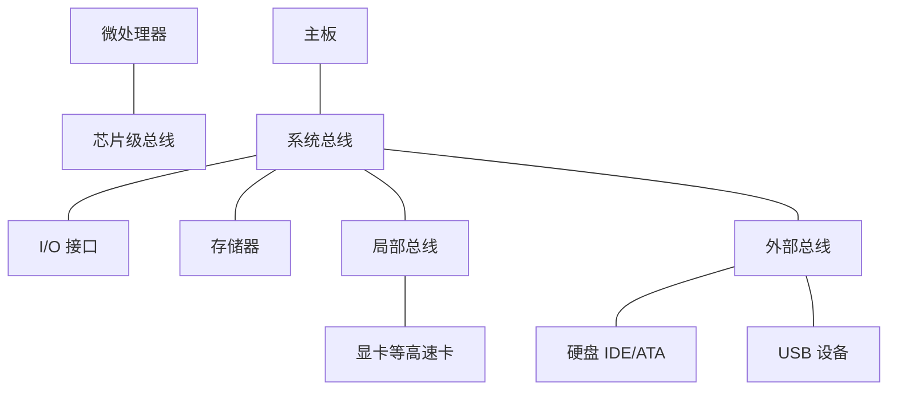

# 总线的基本概念与分类（内部总线、系统总线、外部总线）

## 总线是什么

想一想：CPU 要取指令、要读写内存、还要跟键盘硬盘打交道，如果两两之间都拉一根专线，连线会爆炸式增长。怎么办？==让大家都挂到一组"公共通道"上，分时复用==，这就是**总线（Bus）**——一组能为多个部件分时共享的公共信息传输线。

微型计算机（MC）由微处理器（MP）、存储器、I/O 设备和系统总线组成，系统总线正是实现 CPU、I/O 设备和存储器相互连接的纽带。

## 两种分类视角

**按传输信息性质分**（针对系统总线内部）：

| 总线 | 英文 | 方向 | 功能 |
|---|---|---|---|
| 地址总线 | AB | CPU → 外设/内存（单向） | 指明操作位置，$n$ 位地址线寻址 $2^n$ 字节 |
| 数据总线 | DB | 双向 | 传输数据，位宽 = 字长 |
| 控制总线 | CB | 双向（每根单向） | 发读写、中断、时序等控制信号 |

> [!TIP]
> 考题"三总线为____、____和地址总线"，答案就是**数据总线、控制总线**——记住"地址、数据、控制"三件套。

**按连接对象与系统层次分**：

- **芯片级总线**：微处理器内部 ALU、CU、寄存器阵列之间的连线；
- **系统总线**：CPU、存储器、I/O 接口之间的连线；
- **局部总线**：CPU 与高速外设（如显卡）间的专用高速通道；
- **外部总线**：主机与外设之间的总线，如 **IDE（ATA）**——由 Compaq 与 Western Digital 设计，把硬盘控制器与盘体集成，减少电缆数目、增强传输可靠性、安装更方便。

> [!WARNING]
> "内部总线"一词有歧义：有的教材指**芯片级**（CPU 内部），有的指**系统总线**（主机内部）。答题时看清题干分类标准，别混用。

## 算对了的例子

> 例：某总线位宽 16 位，工作频率 33 MHz，求带宽。

$$
\text{总线带宽}=\frac{\text{总线位宽}}{8}\times\text{工作频率}
=\frac{16}{8}\times 33\ \text{MB/s}=66\ \text{MB/s}
$$

位宽换成字节（÷8），再乘频率，单位即 MB/s——这就是"总线性能指标"的标准算法。
