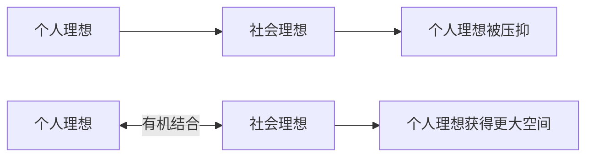

# 坚持个人理想与社会理想的有机结合（统一）

## 坚持个人理想与社会理想的有机结合

先想一个问题：你的个人理想（比如考研上岸、进大厂、考公成功）是不是完全靠你自己一个人就能实现？

显然不能。你想考研，需要国家有研究生招生制度；你想进大厂，需要行业有健康发展的环境；你想考公，需要社会治理体系正常运转。==个人理想的实现，从来离不开社会提供的条件和舞台。==

### 个人理想与社会理想是什么关系

个人理想是你对自身未来发展的向往与追求；社会理想是全体社会成员共同追求的目标，在当代中国，就是==坚持和发展中国特色社会主义，实现中华民族伟大复兴==。

两者的关系可以用一句话概括：**个人理想以社会理想为指引，社会理想是个人理想的凝练和升华。**

用课程的说法展开，有三个层次：

| 维度 | 核心意思 |
|---|---|
| 个人理想以社会理想为指引 | 社会理想规定、指引着个人理想的方向。脱离社会需要的个人理想，往往走不远。 |
| 社会理想是个人理想的汇聚和升华 | 社会理想不是凭空产生的，它建立在一个个个人理想的共同追求之上，又高于个人理想。 |
| “得其大者可以兼其小” | 把个人理想融入社会理想之中，个人理想反而能获得更广阔的实现空间。 |

下面这张图把“单向服从”和“有机结合”两种理解做了对比：

> [!WARNING]
> 常见的错误理解是：把“个人理想服从社会理想”理解为“放弃个人理想”。
> 教材强调的不是“放弃”，而是“结合”——==在为实现社会理想而奋斗的过程中实现个人理想==，而不是用社会理想消灭个人理想。

### 为什么需要把两者统一起来

先看反面：如果一个人只盯着自己的小目标，完全不关心社会需要，短期内也许能获利，但一旦社会环境变化（政策调整、行业转型、时代转向），个人理想就容易失去支撑。

再看正面：焦裕禄的个人理想是“治好兰考的沙碱地”，袁隆平的个人理想是“让所有人远离饥饿”，黄文秀的个人理想是“让百坭村的乡亲脱贫”。这些人的个人理想并没有因为融入社会理想而消失，反而在服务社会的过程中获得了最充分的实现。

原因在于：==个人幸福与社会幸福是辩证统一的==。社会整体向前发展，个人获得幸福的可能性和空间才会扩大；反过来，每个人都努力追求和创造幸福，社会才能整体进步。两者不是零和博弈，而是相互成就。

### 怎么做：三个操作要点

**第一，找准方向——从社会需要中定位个人目标。**

不是先问“我想干什么”，而是先问“社会需要什么，我能干什么”。当代中国最大的现实是坚持和发展中国特色社会主义、实现中华民族伟大复兴，这是全体中国人民共同的社会理想。个人理想只有同国家前途、民族命运相结合，同社会需要和人民利益相一致，才可能变为现实。

**第二，调整预期——理想和现实是对立统一的。**

理想是“应然”，现实是“实然”，两者之间必然存在矛盾和落差。这恰恰是正常的，不是理想的失败。==现实中包含着理想的因素，孕育着理想的发展；理想中也包含着现实，包含着理想转化为现实的条件==。理解了这层关系，就不会因为一时挫折而否定理想本身，也不会用空想否定现实。

**第三，持续行动——艰苦奋斗是实现理想的重要条件。**

个人理想与社会理想的统一不是在头脑里完成的，而是在行动中完成的。大学生正处于“立志”的关键期，要==立鸿鹄志，做奋斗者；心怀“国之大者”，敢于担当；自觉躬身实践，知行合一==。

> [!TIP]
> 简答题记忆线索：**“指引—升华—现实”**
> - 个人理想以社会理想为**指引**
> - 社会理想是个人理想的**凝练和升华**
> - 个人理想只有同国家前途、民族命运**相结合**才可能变为现实

### 一个“算对了”的表述示范

如果考试问你“如何实现个人理想与社会理想的统一”，可以这样组织答案：

> 首先，个人理想以社会理想为指引，社会理想规定、指引着个人理想的方向，大学生应当把个人奋斗目标与国家、民族的奋斗目标相统一。其次，社会理想是对个人理想的凝练和升华，社会理想的确立和实现依赖于每个人的共同努力，个人要自觉把个人理想融入社会理想之中。最后，个人理想只有同国家的前途、民族的命运相结合，个人的向往和追求只有同社会的需要和人民的利益相一致，才可能变为现实。因此，大学生要在为实现社会理想而奋斗的过程中实现个人理想，珍惜韶华、奋发有为，不能脱离当代中国的社会现实。

> [!NOTE]
> 容易混淆的概念辨析：这里的“统一”是**有机结合**，不是片面强调某一方面。既不是“社会理想至上、个人理想无关紧要”，也不是“个人理想优先、社会理想只是背景板”。教材的提法是：==在为实现社会理想而奋斗的过程中实现个人理想==——两个理想在同一个过程中同时实现，而不是先后实现、二者选一。
