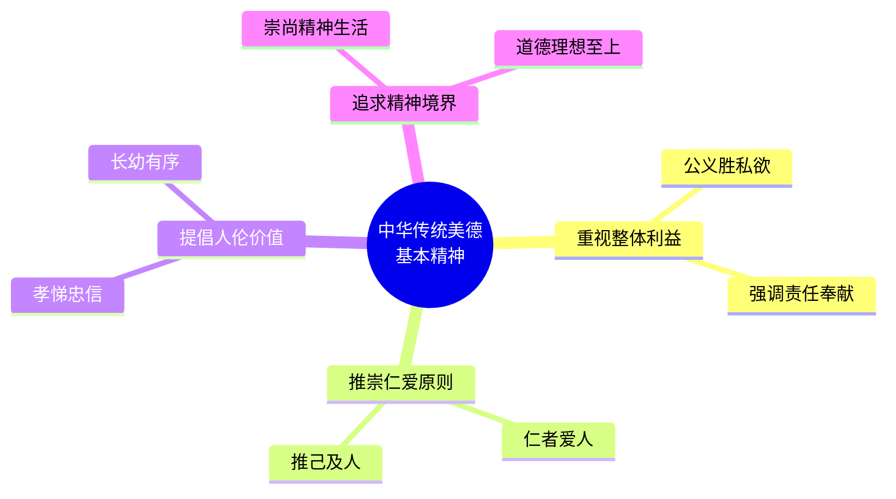

# 中华传统美德的基本精神及其当代价值

# 中华传统美德的基本精神及其当代价值

## 它是什么：核心精神图谱

中华传统美德是中华文化精髓，其基本精神可概括为四个维度。理解这一知识点，关键在于把握“公私关系”与“精神追求”这两个主轴。

> [!IMPORTANT]
> ==“公义胜私欲”== 是中国传统道德关于公私关系的根本要求。其中，“公义”指公共利益与正义，“私欲”指个人私利。它强调在冲突时，应以集体利益为重，克制个人欲望。

## 为什么需要：当代价值转化

传统美德并非故纸堆，而是社会主义核心价值观的重要源泉。其当代价值主要体现在：
1.  **精神标识**：崇尚精神是中华民族的重要精神标识，主张在物质满足后追求崇高境界。
2.  **道德滋养**：为社会主义道德建设提供丰厚资源，如“全心全意为人民服务”是对传统“为民”思想的升华。
3.  **人格塑造**：通过“修身养性”，将社会规范内化为个人品质，促进人格完善。

## 怎么做：创造性转化与创新性发展

对待传统美德，不能全盘照搬，也不能历史虚无主义。正确路径是 **P99** 提到的“创造性转化和创新性发展”。

| 维度 | 错误做法 | 正确做法（两创） |
| :--- | :--- | :--- |
| **态度** | 盲目复古或全盘否定 | 辩证取舍，古为今用 |
| **内容** | 剔除封建等级糟粕 | 继承仁爱、诚信等精华 |
| **形式** | 僵化说教 | 结合现代生活，融入法治 |

> [!TIP]
> 记忆口诀：**一根本**（公义胜私欲），**四精神**（重整体、推仁爱、讲人伦、求境界），**两转化**（创造性、创新性）。

## 常见误区与辨析

*   **误区1**：认为传统美德只讲牺牲，不讲个人利益。
    *   **辨析**：传统美德强调“先公后私”，并非完全抹杀个人正当利益，而是在冲突时优先保障集体。这与社会主义集体主义的“先公后私”层次相呼应。
*   **误区2**：混淆“传统美德”与“革命道德”。
    *   **辨析**：传统美德源于古代农耕文明；革命道德源于中国共产党领导的革命实践，红线是 ==全心全意为人民服务==。二者一脉相承但时代背景不同。

## 算对了的例子：简答题实战

**题目**：简述“公义胜私欲”的基本含义。

**参考解答逻辑**：
1.  **定义概念**：“公义”即公共利益、正义；“私欲”即个人私利、欲望。
2.  **阐述关系**：在处理公私关系时，强调以公共利益为重，克制个人私欲。
3.  **定性总结**：这是中国传统道德的根本要求，体现了早期的集体主义精神萌芽。

> [!WARNING]
> 答题时勿漏掉“根本要求”这一关键词，这是得分点。同时注意区分：传统美德是“源头”，社会主义道德是“核心”，革命道德是“红色基因”。
