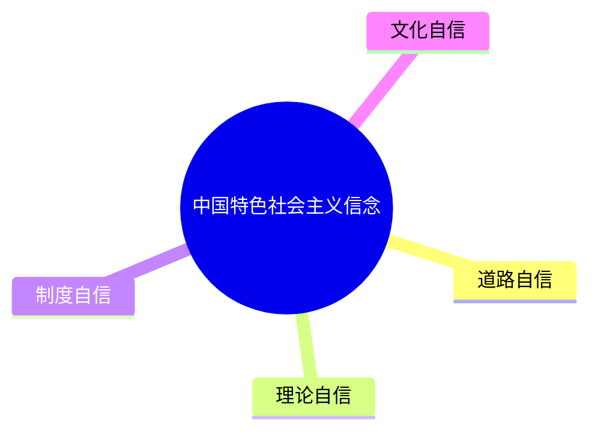
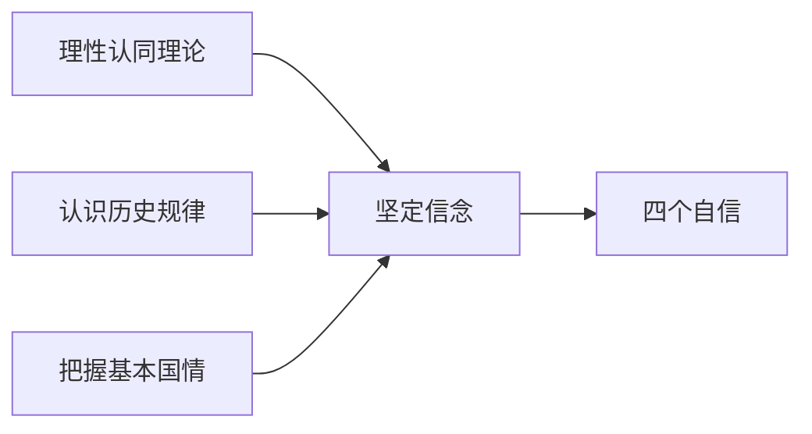

# 增强对中国特色社会主义的信念

## 这是什么

"增强对中国特色社会主义的信念"是理想信念教育的落脚点：把个人的远大理想和中国特色社会主义的共同理想统一起来。核心要求可以概括为一句话——==把理想信念建立在"理性认同 + 历史规律 + 基本国情"三个基点上==。

它的具体抓手就是四个自信：==道路自信、理论自信、制度自信、文化自信==。

## 为什么要增强

理想信念是精神之"钙"，缺钙就会得"软骨病"。对中国特色社会主义没有信念，个人理想就容易迷失方向。反过来，==社会主义制度的确立，开启了我国在社会主义道路上实现中华民族伟大复兴的历史征程==（选择题常考这一句）。

## 怎么做：三个"建立在"

| 基点 | 含义 | 记忆关键词 |
| --- | --- | --- |
| 对科学理论的理性认同 | 马克思主义及其中国化时代化成果 | 理论 |
| 对历史规律的正确认识 | 社会主义必然代替资本主义 | 历史 |
| 对基本国情的准确把握 | 我国仍处于社会主义初级阶段 | 国情 |

> [!TIP]
> 三基点口诀："理论、历史、国情"。四自信口诀："道理之文"（道路、理论、制度、文化）。

## 和相近概念的区别

| 概念 | 内容 | 归属 |
| --- | --- | --- |
| 远大理想 | 实现共产主义 | 最高理想 |
| 共同理想 | 建设中国特色社会主义 | 现阶段各族人民的共同理想 |
| 个人理想 | 职业、生活、道德等 | 个人层面 |

> [!IMPORTANT]
> 共同理想是远大理想的 ==必经阶段==，远大理想是共同理想的 ==最终方向==，二者辩证统一。

## 常见的坑

> [!WARNING]
> 看到"金钱万能""个人本身就是目的""生死有命"这类表述，都属于==非科学信念==；只有"社会主义必然代替资本主义，全世界最终实现共产主义"才是科学信念。

> [!CAUTION]
> 把"社会主义制度"和"改革开放政策"混为一谈是易错点：前者才开启了民族复兴的历史征程。

## 做对一道题

选择题：（　）在我国的确立，开启了我国在社会主义道路上实现中华民族伟大复兴的历史征程。
A. 四项基本原则　B. 改革开放政策　C. 社会主义制度　D. 人民民主专政

**解析**：社会主义制度确立才使中国进入社会主义道路，为民族复兴奠定制度基础，故 ==C==。四项基本原则是立国之本，改革开放是强国之路，人民民主专政是国体，都不是题干所指。
