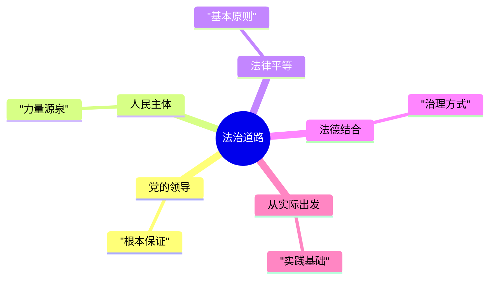

# 坚持走中国特色社会主义法治道路

## 什么是中国特色社会主义法治道路

坚持走中国特色社会主义法治道路，是全面依法治国的==唯一正确道路==。它不是对西方法治模式的简单移植，而是由我国国体（人民民主专政）和政体（人民代表大会制度）决定的必然选择。这条道路的核心要义，就是坚持党的领导、坚持中国特色社会主义制度、贯彻中国特色社会主义法治理论。

> [!IMPORTANT]
> 简答高频考点：如何坚持？必须遵循“五个原则”。

这五个原则构成了一个有机整体，缺一不可：

## 为什么必须坚持这五个原则

如果只讲法治不讲政治方向，法治就会迷失；如果只讲条文不讲人民立场，法治就会失去根基。试问：谁来保证法治不偏离社会主义方向？谁来确保法律真正反映人民意志？答案只能是==中国共产党的领导==。党的领导是人民当家作主的根本保证，也是社会主义法治最根本的保证。同时，我国宪法确立了党的领导和人民民主专政原则，决定了我们的法治道路必须扎根中国大地，而非照搬他国模式。

> [!TIP]
> 记忆口诀：“党民法德实”——党的领导、人民主体、法律平等、法德结合、从实际出发。

## 怎么做：原则落地与体系支撑

坚持法治道路不能停留在口号上，必须落实到建设中国特色社会主义法治体系中。该体系包含五个子系统：完备的法律规范体系、高效的法治实施体系、严密的法治监督体系、有力的法治保障体系以及完善的党内法规体系。其中，==依法治国和以德治国相结合==是关键抓手。法治是治国理政的基本方式，德治是重要支撑，二者如车之两轮、鸟之两翼。立法、执法、司法都要体现社会主义核心价值观，用法治手段整治失德行为，实现“法安天下，德润人心”。

| 维度 | 依法治国 | 以德治国 |
| :--- | :--- | :--- |
| 作用方式 | 强制规范、外在约束 | 教化引导、内在自律 |
| 功能定位 | 治国基本方式 | 治国重要支撑 |
| 结合路径 | 道德入法、依法惩恶 | 以法载德、崇德向善 |

## 易混辨析与常见误区

> [!WARNING]
> 切勿将“坚持党的领导”与“法律面前人人平等”对立起来。党的领导是法治的政治前提，平等是法治的运行原则，二者统一于社会主义法治实践。

另一个高频误区是混淆“法治道路”与“法治体系”。道路解决的是“往哪走”的方向问题，体系解决的是“怎么走”的载体问题。简答题若问“如何坚持走法治道路”，答“五个原则”；若问“法治体系内容”，则答“五个体系”。此外，“从中国实际出发”不等于排斥外来经验，而是强调以我为主、为我所用，反对全盘西化。

> [!NOTE]
> 真题示例：简答13“如何坚持走中国特色社会主义法治道路？”标准答案即上述五个原则，每个原则需简要展开说明其内涵与必要性，不可仅列标题。
