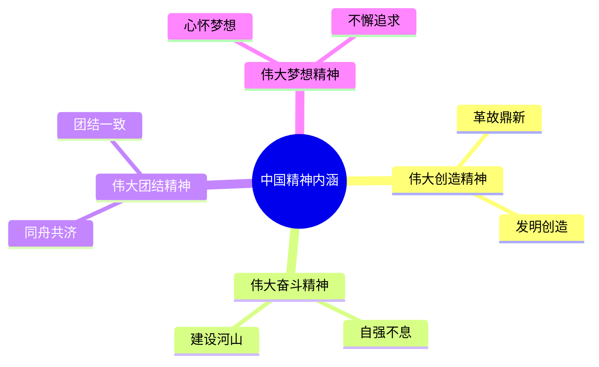

# 中国精神的丰富内涵（四个伟大：伟大创造、伟大奋斗、伟大团结、伟大梦想精神）

## 什么是中国精神的丰富内涵

当我们谈论“中国精神”时，除了记住“民族精神+时代精神”这一基本构成外，还需要掌握对其内涵的==系统阐释==。教材P72明确指出，伟大创造精神、伟大奋斗精神、伟大团结精神、伟大梦想精神（简称“四个伟大精神”）是对中国精神丰富内涵的集中概括。这四个维度并非孤立存在，而是共同支撑起中华民族的精神大厦。

> [!IMPORTANT]
> “四个伟大精神”是==对中国精神内涵的系统阐释==，答题时切勿将其与“以爱国主义为核心的民族精神”或“以改革创新为核心的时代精神”混淆，前者是内涵展开，后者是基本内容构成。

## 四个维度的核心要义

如何准确区分并记忆这四种精神？我们可以从中国人民的历史实践逻辑出发进行理解：

- **伟大创造精神**：体现在中华民族在历史长河中产生的无数发明创造与思想成果，是推动文明进步的动力源泉。
- **伟大奋斗精神**：对应课件中“中国人民始终自强不息，开发和建设祖国的大好河山”，强调实干与拼搏。
- **伟大团结精神**：对应“中国人民始终团结一致，同舟共济”，强调集体主义与凝聚力。
- **伟大梦想精神**：对应“中国人民始终心怀梦想、不懈追求”，体现了对美好未来的执着向往。

> [!TIP]
> 记忆口诀：“创奋团梦”。联想逻辑：先有“创造”能力，靠“奋斗”实践，凭“团结”聚力，向“梦想”前行。简答题作答时，务必结合课件原话展开，如提到奋斗精神必须写出“自强不息”“开发大好河山”。

## 易混概念辨析与避坑指南

复习本章时，最容易踩的坑是将不同层级的概念张冠李戴。请通过下表厘清关系：

| 概念层级 | 核心表述 | 易错点警示 |
| :--- | :--- | :--- |
| 中国精神基本内容 | 民族精神 + 时代精神 | 勿将“四个伟大”等同于基本内容 |
| 民族精神核心 | 爱国主义 | 勿将“改革创新”作为民族精神核心 |
| 时代精神核心 | 改革创新 | 勿将“爱国主义”作为时代精神核心 |
| 中国精神内涵阐释 | 四个伟大精神 | 勿遗漏任一维度或替换关键词 |

> [!WARNING]
> 常见误区：在论述“弘扬中国精神”时，只答“四个伟大”而忽略“兴国强国之魂”的定位；或在回答“时代精神核心”时误写为“伟大创造精神”。==时代精神的核心始终是改革创新==，“四个伟大”是内涵阐释而非核心定义。

## 真题应用示例

若考题要求“简述中国精神的丰富内涵”，规范作答应包含以下要点：

1.  总述：伟大创造、奋斗、团结、梦想精神是对中国精神内涵的系统阐释。
2.  分述：分别阐述四种精神的课件原文要点（如奋斗精神需写明“自强不息、开发建设大好河山”）。
3.  升华：点明四者统一于实现中华民族伟大复兴的实践中，是兴国强国之魂。

> [!NOTE]
> 此知识点常与“崇尚精神的优秀传统”“做改革创新的践行者”等考点联动考查。理解“四个伟大”不仅是背诵任务，更是为了在论述题中构建完整的精神谱系框架，避免答案碎片化。
