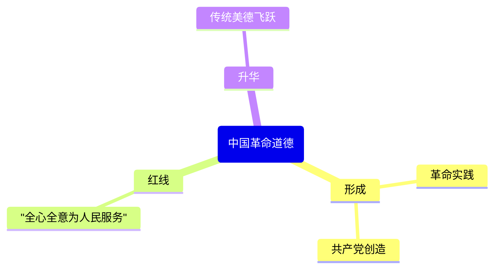
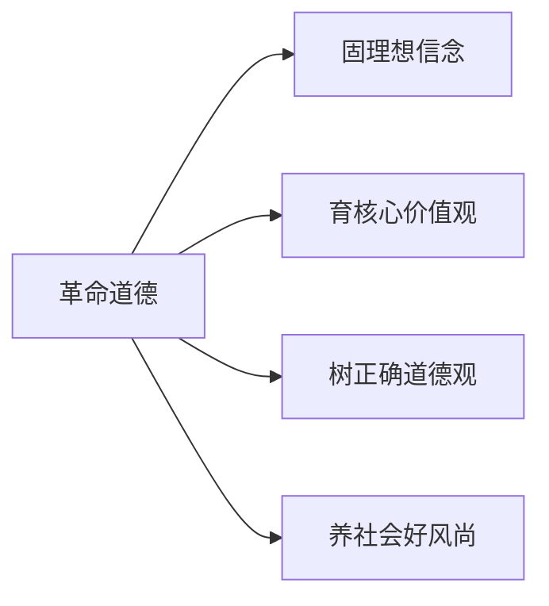

# 中国革命道德的形成、主要内容与当代价值（四个有利于）

## 它是什么

中国革命道德，是 ==中国共产党人在革命实践中创造的道德财富==，是中华传统美德的升华和质的飞跃。它发端于五四运动后，形成于新民主主义革命时期，在社会主义革命、建设、改革中延续发展。

先想一个问题：旧式农民起义和资产阶级革命也有牺牲精神，为什么共产党人的道德被单独叫作“革命道德”？关键就在于它有一条贯穿始终的线——==全心全意为人民服务==，这是中国共产党人的伟大创造，也是社会主义道德核心“为人民服务”的历史源头。

## 主要内容

标准答案按课件是五条：

| 序号 | 主要内容 |
|---|---|
| 1 | 为实现社会主义和共产主义理想而奋斗 |
| 2 | 全心全意为人民服务（红线） |
| 3 | 始终把革命利益放在首位 |
| 4 | 树立社会新风，建立新型人际关系 |
| 5 | 修身自律，保持节操 |

[!TIP]
记忆口诀：“理想—服务—利益—新风—节操”，服务是中间那根==红线==，串起全部内容。

## 当代价值（四个有利于）

这是简答高频题，必须原句背：

1. 有利于加强和巩固社会主义和共产主义的理想信念。
2. 有利于培养和践行社会主义核心价值观。
3. 有利于引导人们树立正确的道德观。
4. 有利于培养良好的社会道德风尚。

## 相近概念区别与常见的坑

[!WARNING]
易错坑一：把“贯穿中国革命道德始终的一根红线”答成“集体主义”。错！集体主义是==社会主义道德的原则==，红线是==全心全意为人民服务==。

[!NOTE]
易错坑二：问“当代价值”时只写“为人民服务”那一句话。错！当代价值必须是==四个有利于==，只写红线属于答非所问。

再问一步：为什么不能把“革命道德”和“社会主义道德”完全等同？革命道德是历史形态，社会主义道德是现实形态；革命道德为后者提供了==核心与原则的早期范本==，但外延不同。

## 算对了的例子

真题：简述中国革命道德的当代价值。

正确作答：当代价值有四点——有利于加强和巩固社会主义和共产主义的理想信念；有利于培养和践行社会主义核心价值观；有利于引导人们树立正确的道德观；有利于培养良好的社会道德风尚。若题目要求连带写主要内容，则补入五条内容，并点明红线为全心全意为人民服务。这样答即覆盖考纲 P159-163 全部采分点。
