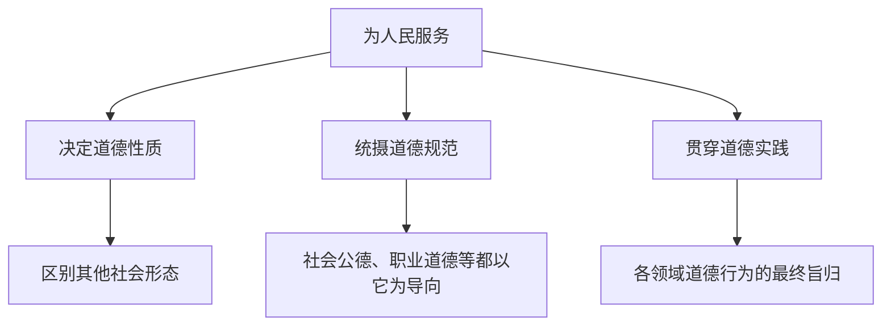

# 坚持以为人民服务为核心（社会主义道德的核心）

## 为什么道德要有一个“核心”

任何道德体系都需要回答一个问题：判断善恶的最终标准是什么？封建社会的道德以维护宗法等级为核心，资本主义社会的道德在实践上往往围绕个人利益展开。社会主义道德要在本质上区别于它们，就必须提出不同的核心。

这里可以先想一个问题：如果一个行为让多数人受益，但损害了某个无辜个体的基本权利，它算不算道德？如果另一个行为让个别人获得巨大利益，却牺牲了大多数人的利益，它又算不算道德？两种问法的共同指向是——道德究竟服务于谁。社会主义道德的回答很明确：==服务于人民==。

## 为人民服务作为核心的含义

> [!IMPORTANT]
> 社会主义道德的核心是**为人民服务**，这是社会主义道德区别和优越于其他社会形态道德的显著标志。（P107 / P148）

“为人民服务”不是一句空洞口号，它规定了道德评价的根本方向：

| 道德形态 | 服务对象 | 道德评价的核心依据 |
|---|---|---|
| 封建社会道德 | 宗法等级秩序 | 是否维护尊卑贵贱 |
| 资本主义社会道德 | 个人权利与资本逻辑 | 是否保障个人自由与财产 |
| **社会主义道德** | ==最广大人民== | 是否符合人民的根本利益 |

理解这一核心，需要注意两个层次：

**第一，“人民”不是抽象的集合。** 在社会生活中，“人民”就是身边的同学、同事、社区居民、服务对象，也是整个社会中的广大劳动者和建设者。为人民服务既体现在国家治理和公共决策中，也体现在日常的助人为乐、爱岗敬业、诚实守信中。

**第二，“服务”不等于简单的奉献或牺牲。** 为人民服务的本质要求是把人民的利益放在首位，在个人利益与人民利益一致时积极作为，在发生冲突时自觉调节个人利益。它和集体主义原则内在统一：集体主义原则要求国家利益、社会整体利益高于个人利益，而这个“整体利益”的主体正是人民。

## 为什么说它是“根本要求”而不只是道德要求之一

可以从三个层面理解“核心”的含义：

**它决定道德的性质。** 一个道德体系是不是社会主义的，关键看它为谁服务。如果脱离了为人民服务这个核心，即使保留了“集体主义”“奉献”等名词，其实际内容也会走样。

**它统摄各领域的道德规范。** 社会公德中的文明礼貌、职业道德中的爱岗敬业、家庭美德中的尊老爱幼、个人品德中的诚实守信，追到底都是在具体场景中实现“为人民服务”。比如一个工程师认真把代码写对、把设备调稳，受益的是使用产品和服务的群众，这就是为人民服务的具体形态。

**它贯穿道德实践的过程。** 从道德认知到道德行为，每一步都可以用“是否有利于人民”来检验。道德情感（对人民利益的关切）、道德意志（在困难中坚持为民）、道德行为（实际维护人民利益）共同构成完整的实践链条。

## 和历史演进的关系

> [!NOTE]
> “全心全意为人民服务”是中国革命道德贯穿始终的一根红线。（P102）

为人民服务并不是社会主义阶段突然冒出来的要求。在中国革命道德中，“全心全意为人民服务”已经是共产党人和革命者的根本宗旨。社会主义道德继承并发展了这一传统，把它确立为整个社会道德体系的核心。

这也解释了试题中常见的对应关系：

- 中国革命道德的**红线** → 全心全意为人民服务（P102）
- 社会主义道德的**核心** → 为人民服务（P107）
- 社会主义道德的**原则** → 集体主义（P109）
- 社会主义道德**区别和优越于其他社会形态道德的显著标志** → 为人民服务（P109/P148）

## 常见的坑

> [!WARNING]
> “核心”和“原则”不要混淆。考题里常把二者互换位置：社会主义道德的**核心**是“为人民服务”，**原则**是“集体主义”。如果问“社会主义道德的核心”，不能答“集体主义”。

> [!CAUTION]
> “为人民服务”不能简单等同于“为每一个人服务”。社会主义道德中的“人民”是一个整体性、历史性的范畴，不是无差别地迁就每个人的任何要求。个别损害公共利益、违反法律和道德规范的行为，绝不能以“为人民服务”的名义获得正当性。

> [!TIP]
> 记“显著标志”可以抓一个关键词——**区别**。社会主义道德凭什么说自己和别的道德不一样？就看它为谁服务。所以“区别和优越于其他社会形态道德的显著标志”指向“为人民服务”。

## 一个对得上的例子

南京邮电大学以信息技术为特色。一个信息类专业的学生在课程设计中做了一个校园失物招领小程序：丢失物品的同学可以在平台发布信息，捡到物品的同学可以登记招领，系统自动匹配并向双方推送线索。这个过程中，开发者运用了专业知识（数据库、前端、后端逻辑），但更关键的是他选择做一个服务同学、方便群众的项目，而不是做一个只满足个人兴趣或仅仅为了加分的项目。

在这个例子里：

- **专业知识和技能** → 职业生活中“是否成功”的一个条件
- **为人民服务的道德自觉** → 决定这个项目“为了谁”的价值方向

这正体现了教材的表述：职业生活是否顺利，既取决于专业知识和技能，更取决于职业道德素养。“为人民服务”作为核心，就落实在每一次职业选择、每一项具体工作中。

---

**一句话总结：** ==为人民服务是社会主义道德的核心，它决定了社会主义道德的性质和方向，是社会主义道德区别于其他社会形态道德的显著标志；在具体实践中，它落实为社会公德、职业道德、家庭美德和个人品德的共同旨归。==
