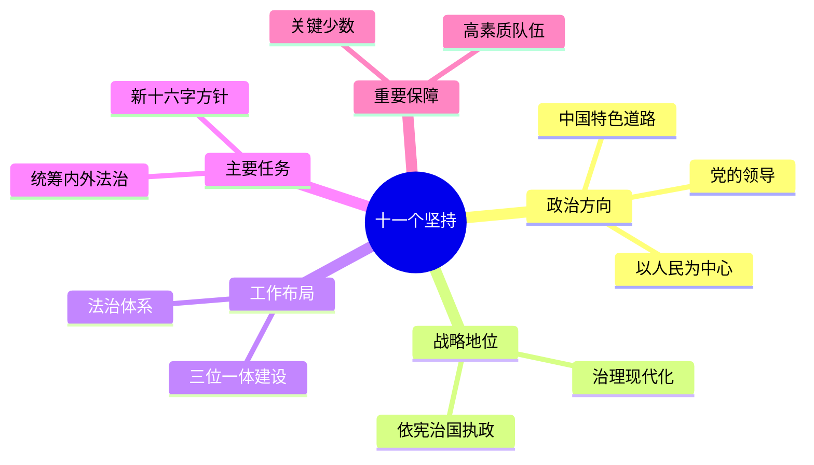

# 习近平法治思想的主要内容（十一个坚持）

## 什么是“十一个坚持”

2020年11月中央全面依法治国工作会议首次将习近平法治思想确立为全面依法治国的指导思想。其核心要义被系统概括为“十一个坚持”，这并非简单的条目罗列，而是涵盖==政治方向、战略地位、工作布局、主要任务、重大关系、重要保障==六大维度的有机整体。它深刻回答了新时代为什么实行全面依法治国、怎样实行全面依法治国等一系列重大问题，是马克思主义法治理论中国化的最新成果。

## 为什么必须掌握这一体系

面对庞杂的法治理论，你是否觉得难以抓住主线？“十一个坚持”正是破解这一困惑的总钥匙。它不仅指明了中国特色社会主义法治的前进方向，更提供了认识论和方法论。例如，在处理改革与法治的关系时，它强调“在法治下推进改革，在改革中完善法治”；在统筹国内与国际时，明确“统筹推进国内法治和涉外法治”。掌握这一体系，才能准确理解后续章节中立法、执法、司法、守法各环节的内在逻辑，避免碎片化记忆。

## 如何构建结构化认知

死记硬背十一条内容极易混淆，建议按“六位一体”逻辑框架进行归类记忆：

> [!IMPORTANT]
> ==“十一个坚持”是简答题22的标准答案==，答题时需完整列出条目，不可仅写维度名称。同时需关联简答21，明确其提出场合为“2020年11月中央全面依法治国工作会议”。

## 易混概念辨析与避坑指南

复习时常将“十一个坚持”与其他法治原则混淆，需特别注意以下区别：

| 对比项 | “十一个坚持” | 中国特色社会主义法治道路原则 |
| :--- | :--- | :--- |
| **定位** | 习近平法治思想的核心要义 | 走法治道路必须遵循的具体原则 |
| **数量** | 11条 | 5条（党的领导、人民主体、法律面前人人平等、依法治国和以德治国相结合、从中国实际出发） |
| **考查方式** | 简答/论述题核心采分点 | 多选或辨析题干扰项 |

> [!WARNING]
> 切勿将“坚持依法治国和以德治国相结合”误当作“十一个坚持”之一。该表述属于“法治道路五原则”及“重大关系”范畴，是对“十一个坚持”中相关内容的具体展开，而非独立条目。

## 真题应用示例

以简答22“习近平法治思想的核心要义包括哪些？”为例，规范作答应直接罗列“十一个坚持”原文：①坚持党对全面依法治国的领导；②坚持以人民为中心；③坚持中国特色社会主义法治道路；④坚持依宪治国、依宪执政；⑤坚持在法治轨道上推进国家治理体系和治理能力现代化；⑥坚持建设中国特色社会主义法治体系；⑦坚持依法治国、依法执政、依法行政共同推进，法治国家、法治政府、法治社会一体建设；⑧坚持全面推进科学立法、严格执法、公正司法、全民守法；⑨坚持统筹推进国内法治和涉外法治；⑩坚持建设德才兼备的高素质法治工作队伍；⑪坚持抓住领导干部这个“关键少数”。

> [!TIP]
> 记忆口诀：“党民路宪治，体建共推守，内外队少”。对应11条首字关键词，可快速还原完整表述，确保考场不漏项、不串项。
