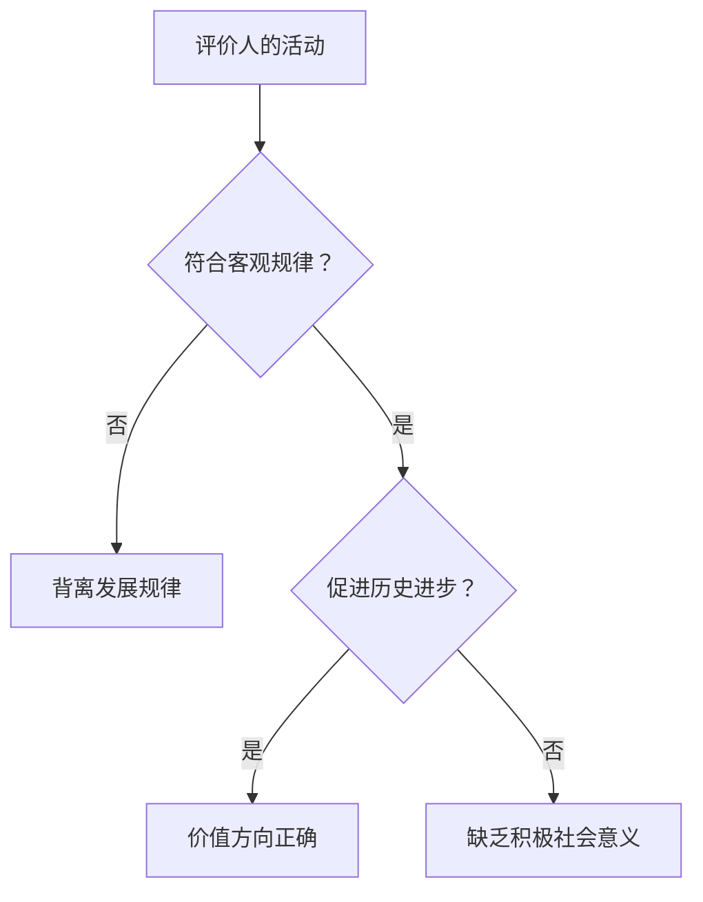

# 人生价值评价的根本尺度与普遍标准

## 什么是人生价值评价

人生价值评价，是指依据一定标准，对个人的人生活动及其意义作出判断。评价一个人的人生价值，不能只看职位、收入、名气，也不能只看其获得了多少，而要考察其活动是否具有社会意义。

> [!IMPORTANT]
> 人生价值评价有两个相互衔接的尺度：==根本尺度==回答“这种价值是否正确、是否有益于社会进步”，==普遍标准==回答“社会通常用什么行为标准衡量贡献”。

## 根本尺度：是否促进社会进步

人生价值评价的根本尺度，是看一个人的人生活动==是否符合社会发展的客观规律，是否通过实践促进了历史的进步==。

其中包含两个判断：

1. **符合客观规律**：尊重自然、社会和人生发展的基本规律，不能以破坏规律换取短期利益。
2. **促进历史进步**：通过实践创造社会财富、改善人民生活、推动制度文明或社会生产力发展。

这一尺度体现了人生价值评价的**社会性、历史性和方向性**。同一件事在不同历史条件下，其价值判断可能不同；但能够尊重规律、推动社会进步的活动，始终具有积极意义。

### 普遍标准：劳动与贡献

人生价值评价的普遍标准，是==劳动以及通过劳动对社会和他人作出的贡献==。这里的社会评价主要看一个人是否通过诚实劳动服务社会、造福他人，而不是简单比较劳动成果的数量。

| 尺度 | 回答的问题 | 主要内容 |
|---|---|---|
| 根本尺度 | 活动的发展方向是否正确 | 是否符合客观规律、促进历史进步 |
| 普遍标准 | 社会通常怎样衡量个人贡献 | 是否通过劳动对社会和他人作出贡献 |

两者不是彼此分离的。**根本尺度确立价值方向，普遍标准体现社会贡献的基本形式。**符合社会发展趋势的劳动与贡献，才是具有积极意义的人生价值；背离社会进步方向的“贡献”，即使形式上数量很大，也不能因此获得肯定。

## 评价时还要把握什么

评价人生价值，应坚持==能力有大小与贡献须尽力==相统一。评价不是只看结果大小，也要看个人是否在现有条件下充分发挥了主观能动性，为社会和他人作出了与自身能力相适应的贡献。

同时，要正确处理物质贡献与精神贡献的关系。作出的贡献既可以表现为创造物质财富、提供社会服务，也可以表现为坚守理想信念、维护公共利益、促进社会文明风尚等，二者都是社会贡献。

> [!TIP]
> 记忆口诀：==方向看规律与进步，标准看劳动与贡献。==

> [!WARNING]
> 不能把“劳动量最大”或“赚钱最多”直接等同于人生价值最高；也不能把“没有作出明显成果”简单认定为没有价值。贡献需要考虑社会需要、实际条件以及个人是否尽力。

## 算对了的例子

小王利用所学专业知识，参与校园旧设备改造，在保证安全的前提下减少浪费，并把自己记录的操作流程分享给同学，帮助其他班级提高效率。

判断其人生价值时，不能只说“他技术好、获得了掌声”，而应按上述尺度分析：他的活动尊重技术应用和安全使用设备的规律，节约资源、改善校园环境，因而促进社会进步；同时，他通过劳动和技术实践为学校、同学作出了实际贡献。因此，这一活动符合人生价值评价的根本尺度，也符合劳动与贡献的普遍标准。

> [!NOTE]
> “人生价值”与“人生价值评价标准”不要混淆：前者是人的生命及其实际活动对社会和个人所具有的作用和意义；后者是人们据以判断这种意义是否符合社会进步方向、是否形成劳动贡献的尺度。
