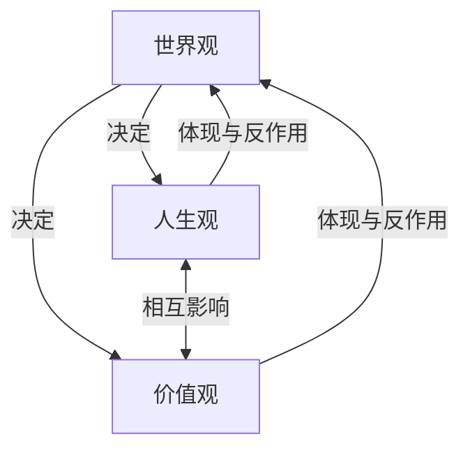

# 人生观与世界观、价值观的辩证关系

> [!IMPORTANT]
> 世界观、人生观、价值观三者并非孤立存在，而是==辩证统一、相互制约、相互促进==的有机整体。

## 它是什么

先思考一个问题：当你对“世界从何而来”有了根本看法时，这种看法会不会影响你决定“这辈子该怎么活”？

- **世界观**：人们对生活在其中的世界以及人与世界的关系的总体看法和根本观点（即对整个世界的最根本看法和观点的总和）。
- **人生观**：人们在实践中形成的对人生目的和人生意义的根本看法和态度，主要内容包括人生目的、人生态度、人生价值。其中，==人生目的是人生观的核心==。
- **价值观**：人们关于什么是价值、怎样评判价值、如何创造价值等问题的根本观点。

三者的辩证关系可以用下图直观表示：

> [!NOTE]
> 理想是人们的政治立场和世界观在人生奋斗目标上的体现，是人们的世界观、人生观和价值观在奋斗目标上的集中体现。

## 为什么需要理清这三者

如果分不清它们的层次，就容易在现实中迷失方向。例如，错误的人生观（拜金主义、享乐主义、极端个人主义）往往根源于扭曲的世界观和价值观。只有以为人民服务为核心内容的人生观，才是科学高尚的人生观。理清三者关系，才能用科学高尚的人生观武装自己，端正人生态度，坚决抵制腐朽思想的侵蚀。

## 怎么做：把握内在逻辑

1. **世界观决定人生观与价值观**。有什么样的世界观，就会有什么样的人生观和价值观。世界观是基础。
2. **人生观与价值观是世界观的体现**。人生观决定着人的实践活动的目标、人生道路的方向和对待生活的态度；人们的世界观总是通过观察和处理具体事物时所持有的态度和采取的方法表现出来。
3. **在实践中统一**。人生观是在客观的不断变化的社会关系中实践人生，通过现实的生活逐渐地感悟而形成的。

> [!TIP]
> 记忆口诀：**“三观一体，世为根基；人生核心，目的第一；理想集中，三者体现。”**

## 和相近概念的区别

| 比较维度 | 世界观 | 人生观 | 价值观 |
| :--- | :--- | :--- | :--- |
| **回答的问题** | 世界是什么、人与世界的关系 | 人为什么活着、怎样活着 | 什么有价值、如何评判价值 |
| **地位** | 总开关、根本基础 | 世界观在人生问题上的应用 | 评价事物的尺度 |
| **核心要素** | 总体看法和根本观点 | ==人生目的==、人生态度、人生价值 | 价值取向与标准 |

## 常见的坑

> [!WARNING]
> 极易混淆因果方向！考试中常出现“有什么样的人生就有什么样的世界观”这类表述，这是**错误**的。正确的逻辑是“有什么样的世界观就有什么样的人生观”。

> [!CAUTION]
> 不要把“道德观”或“法制观”混入“三观”的范畴。提到“理想”的定义时，集中体现的只能是“世界观、人生观、价值观”，不包含其他选项。

## 真题实战解析

**【多选题】** 理想是人们在实践中形成的具有现实可能性的对未来的向往和追求，是人们的（ ）在奋斗目标上的集中体现。
A. 道德观  B. 人生观  C. 价值观  D. 世界观  E. 法制观

**解析步骤**：
1. 定位知识点：理想的含义。
2. 提取教材原文：“是人们的世界观、人生观和价值观在奋斗目标上的集中体现”。
3. 排除干扰项：A（道德观）和 E（法制观）不属于此处的规范表述。
4. 得出答案：==BCD==。
