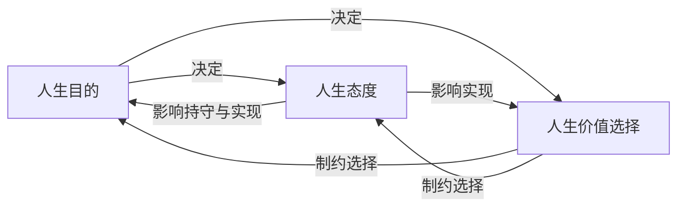

# 人生观的主要内容（人生目的、人生态度、人生价值）

人生观是人们对人生目的、人生态度、人生价值等问题的总观点和总看法。理解这三方面，关键是先弄清它们各自回答什么问题，以及三者怎样相互作用。

## 三方面分别回答什么

| 内容 | 含义 | 回答的问题 | 核心地位 |
|---|---|---|---|
| 人生目的 | 人们在社会实践中关于自身行为的根本指向和人生追求 | 人为什么活着 | ==人生观的核心== |
| 人生态度 | 人们通过生活实践形成的对人生问题的一种相对稳定的心理倾向和精神状态 | 人应当如何活着 | 人生观的表现和反映 |
| 人生价值 | 人的生命及其实践活动对于社会和个人所具有的作用和意义 | 什么样的人生才有价值 | 包含自我价值和社会价值 |

其中，人生目的不是一般的短期目标。考研、就业、掌握一项技能可以是具体目标，而人生目的指向更根本的问题：这些努力最终为了什么、希望成为怎样的人、为谁作出贡献。

人生态度也不能简单等同于一时的心情。考试失利后短暂失落，并不意味着人生态度消极；真正需要观察的是，一个人面对困难时能否长期保持认真务实、乐观向上、积极进取的精神状态。

人生价值则包含两个方面：人生的自我价值，主要体现为个体活动对自身生存和发展的意义；人生的社会价值，主要体现为个体活动对社会和他人的意义。二者相互区别，又密切联系、相互依存。

## 三者怎样构成有机整体

可以沿着“目的—态度—价值”来理解：一个人确立了服务人民、奉献社会的人生目的，就更容易在困难中保持积极进取的态度，并通过实践创造社会价值；反过来，对人生价值的不同理解，也会影响目的和态度的选择。

> [!IMPORTANT]
> 人生目的决定人生道路、人生态度和人生价值选择；人生态度影响人生目的的持守和人生价值的实现；人生价值制约人们对人生目的和人生态度的选择。三者相互影响、紧密关联。

## 怎样落实到大学生活

树立积极进取的人生态度，不是要求永远顺利、永远没有压力，而是正确认识并处理生活中的困难和问题，做到人生须认真、人生当务实、人生应乐观、人生要进取。例如，面对专业学习困难，既不自暴自弃，也不盲目乐观，而是分析基础、调整方法、参加实践并持续改进。

评价和实现人生价值时，还要把个人努力放到社会实践中考察。评价人生价值的根本尺度，是看一个人的实践活动是否符合社会发展的客观规律，是否促进了历史的进步；衡量人生价值，最重要的是看个人是否用自己的劳动和聪明才智为国家和社会真诚奉献，为人民群众尽心尽力服务。大学生应从社会客观条件和个体自身条件出发，不断增强实现人生价值的能力和本领，把“小我”融入祖国和人民之“大我”。

> [!WARNING]
> 常见误区有三个：把人生目的答成“人生态度”；把人生价值只理解为个人成功、收入或社会认可；把自我价值与社会价值说成彼此对立。个人合理发展并不被否定，但不能脱离社会贡献孤立评价人生价值。

## 例题示范

**题目：简述人生观的主要内容。**

**规范作答：**人生观的主要内容包括人生目的、人生态度和人生价值。人生目的回答人为什么活着，是人生观的核心；人生态度回答人应当如何活着，是人们通过生活实践形成的对人生问题的一种相对稳定的心理倾向和精神状态；人生价值回答什么样的人生才有价值，是人的生命及其实践活动对于社会和个人所具有的作用和意义。三者相互影响、紧密关联，共同构成人生观的有机整体。

> [!TIP]
> 记忆主线是“为何活—怎样活—何为值”。简答题先列三项，再写各自回答的问题，最后补一句三者关系，比只写三个名词更完整。
