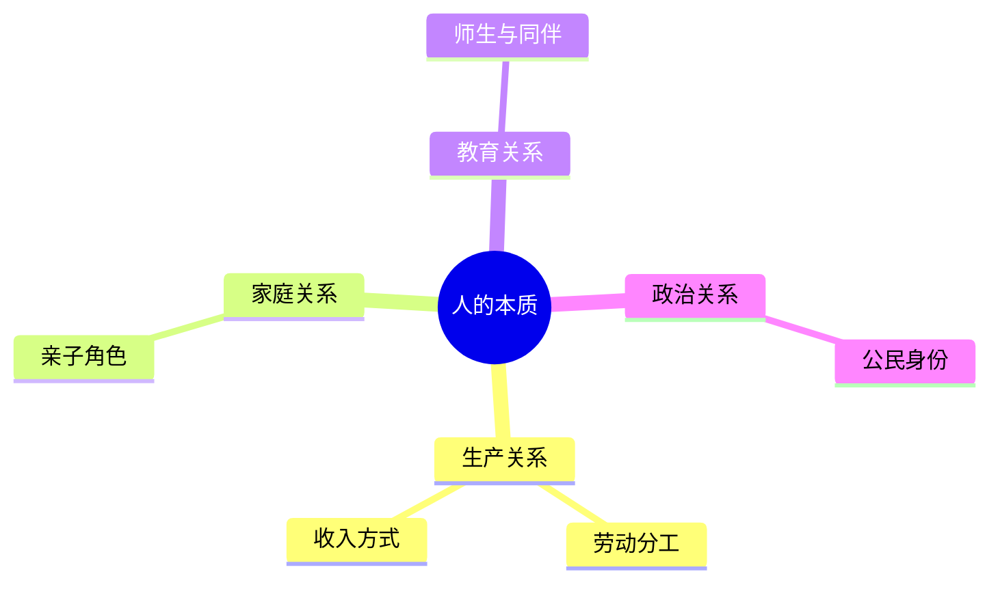
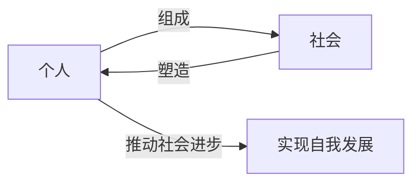

# 正确认识人的本质（马克思关于人的本质的论断）

## 正确认识人的本质

你可能会问：我当然是“我”，我的性格、爱好、能力不是明摆着吗？为什么还要讨论“人的本质”？

这里有一个关键区分：==人性和人的本质不是一回事==。人性可以指食欲、情感、理性等每个人身上都有的抽象属性，但马克思追问的是：这些属性从哪来？什么决定了“我”成为此刻的“我”？

### 马克思的论断在反驳什么

在马克思之前，有两种流行看法：

| 观点 | 代表思路 | 问题 |
|---|---|---|
| 宗教神学 | 人的本质由上帝赋予，固定不变 | 无法解释不同时代、不同社会中人的巨大差异 |
| 抽象人性论 | 人天生就有某种“类本质”，如理性、自私 | 把人的属性从具体生活中抽离，变成空话 |

马克思用一句话拆解了这些思路：

> “人的本质不是单个人所固有的抽象物，在其现实性上，它是一切社会关系的总和。”

这句话的落点有两个：

1. **不是“固有的抽象物”**——你不能脱离具体生活去谈一个“永恒的人性”。
2. **是“社会关系的总和”**——你之所以是你，是由你所在的生产关系、家庭关系、教育关系、交往关系等共同塑造的。

### 为什么“总和”二字不能丢

注意马克思说的是==“总和”==，不是某一种关系。一个人同时处于多重社会关系中：

把这些关系叠加起来，才构成一个具体的人。只挑其中一种（比如只看家庭出身，或只看职业），就是把“总和”偷换成了“单一因素”。

> [!WARNING]
> 常见答题偏差：把“人的本质是一切社会关系的总和”简单理解为“人离不开社会”。表述没错，但缺少分析力度——考点在于“总和”对“抽象物”的替换，不能只答“社会性”。

### 个人与社会：硬币的两面

社会关系不是悬在半空的东西，它由一个个具体的人的活动构成。由此引出**个人与社会的辩证关系**：

- 社会由人组成，==离开人就没有社会==；
- 人是社会的人，==离开社会人也无法生活==；
- 最根本的是个人利益与社会利益的关系——人的社会性决定了**只有在推动社会进步的过程中，才能实现自我发展**。

> [!IMPORTANT]
> 核心结论：个人与社会是==对立统一==关系，相互依存、相互制约、相互促进。把个人完全凌驾于社会之上，或把社会完全压制个人，都是错误的。

### 一个典型题怎么答

**简答题：如何理解“人的本质是一切社会关系的总和”？**

答题可以分三层展开：

1. **否定层面**：马克思反对把人的本质理解为单个人固有的抽象物——你无法脱离社会关系谈“人天生如何”。
2. **肯定层面**：人的本质在其现实性上是一切社会关系的总和。社会关系包括生产关系、家庭关系、教育关系等，它们共同塑造具体的人。
3. **现实延伸**：因此认识人、评判人生价值不能脱离社会关系；个人也只有在推动社会进步中才能实现自我发展。

> [!TIP]
> 记忆抓手：**“不是抽象物，而是总和；不是单一关系，而是多重叠加；不是孤立个人，而是对立统一。”**

### 常见的坑

- 把“人的本质是社会性”直接当成完整答案——漏了“总和”和“反抽象”这两个关键点。
- 引用马克思的话后不做解析，直接跳到大学生的做法——论述断裂，缺少“为什么”的环节。
- 把“社会关系”等同于“人际关系”——前者是结构性、历史性的，后者只是表面交往，不能混用。
