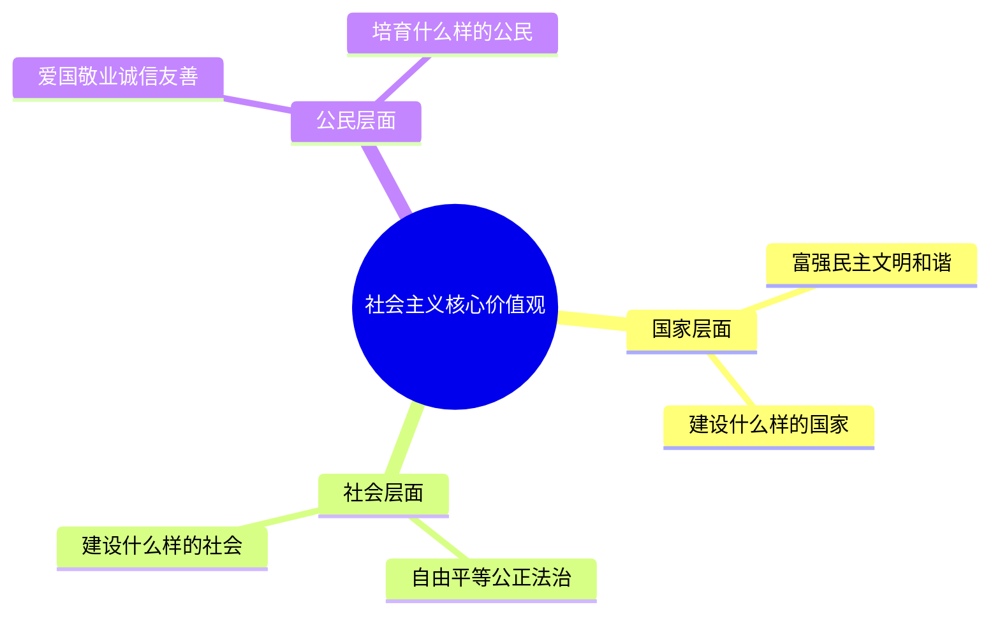

# 价值观与社会主义核心价值观的含义

## 价值观与核心价值观的含义

价值观是人们对事物意义和价值的反映与判断，而==核心价值观==则是一个社会思想观念体系中处于主导地位的价值标准，体现着社会制度的本质属性和发展方向。

> [!IMPORTANT]
> **核心定义**：社会主义核心价值观是社会主义核心价值体系的==内核==，是其高度凝练和集中表达。

为了厘清其基本内容，我们可以从国家、社会、公民三个层面来理解它回答的重大问题：

## 为什么需要确立“最大公约数”？

人类社会发展的历史表明，对一个民族、一个国家来说，最持久、最深层的力量是全社会共同认可的==核心价值观==。

> [!NOTE]
> **理解“最大公约数”**：确立反映全国各族人民共同认可的价值观，关乎国家前途命运和人民幸福安康。
> 1. 凝聚共识：有效整合社会意识，增强民族凝聚力。
> 2. 稳定基石：没有共同价值观，社会易陷入混乱。
> 3. 精神指引：是实现中华民族伟大复兴的价值支撑。

## 社会主义核心价值观的显著特征

社会主义核心价值观之所以具有强大的道义力量，是因为它居于人类社会价值制高点，具有以下显著特征：

| 特征 | 内涵解析 |
| :--- | :--- |
| **先进性** | 代表人类社会发展进步的方向，是社会主义所坚持的价值理念。 |
| **人民性** | ==根本特性==。坚持人民主体地位，反映最广大人民的根本利益。 |
| **真实性** | 人民当家作主的社会主义制度为其实现提供了根本制度保障。 |

> [!TIP]
> **文化自信的内核**：中国特色社会主义道路、理论、制度和文化自信，其价值内核是坚定的==核心价值观自信==。

## 与社会主义核心价值体系的区别

这是考试中极易混淆的点，需明确二者关系：

*   **联系**：二者方向一致，核心价值观是核心价值体系的==内核==；核心价值体系是核心价值观的==基础 and 载体==。
*   **区别**：
    *   **核心价值体系**：侧重理论体系的完整性（包含马克思主义指导思想、共同理想、民族/时代精神、荣辱观四个方面）。
    *   **核心价值观**：侧重价值理念的==凝练和表达==（即“三个倡导”24个字）。

## 常见误区与真题示例

> [!WARNING]
> **易错坑**：不要将“文化软实力”等同于核心价值观。
> **正解**：核心价值观是文化软实力的==灵魂==和重点；文化软实力的竞争，本质上是不同文化所代表的==核心价值观的竞争==。

**真题演练：**
人类社会发展的历史表明，对一个民族、一个国家来说，最持久、最深层的力量是全社会共同认可的（ ）。
A. 文化
B. 中国梦
C. 核心价值观
D. 社会主义核心价值观

**解析**：虽然 C 和 D 很接近，但在我国语境下，特指且最准确的答案是 **D. 社会主义核心价值观**。它不仅是通用的核心价值观，更是契合我国社会主义制度本质要求的具体形态。

## 如何践行？

作为大学生，践行核心价值观并非空洞口号，而是要做到==勤学、修德、明辨、笃实==。要将核心价值观的要求变为日常行为准则，内化为精神追求，外化为自觉行动，做到知行统一。
