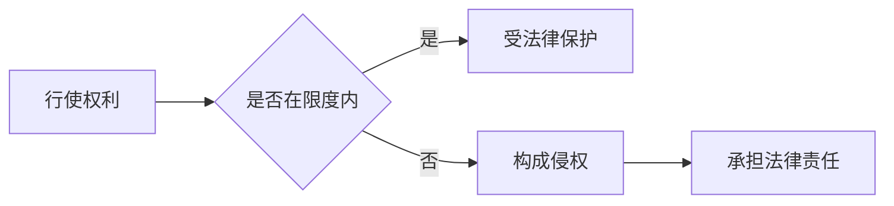

# 依法行使权力和履行义务（权利行使的目的、限度和方式；权力行使的方式）

## 依法行使权利与履行义务

先从一个常见误解说起：很多同学以为“守法”就是“不违法”，只要不做法律禁止的事就够了。但回到《思想道德与法治》第六章的语境，==守法的完整含义是：既包括履行义务，也包括行使权利==。只强调义务、忽视权利，或者只讲权利、不讲义务，都不是真正的法治素养。

> [!IMPORTANT]
> 法律遵守（守法）是指国家机关、社会组织和公民个人依照法律规定，行使权利（权力）和履行义务（职责）的活动。守法是法律实施和实现的基本途径。

---

### 权利行使的目的

行使权利不是“我想怎样就怎样”。法律赋予公民权利，有其立法意图和社会功能。一个人行使权利时，==不仅在形式上要合法，在实质上也要符合立法目的==，不得违反宪法法律确定的基本原则。

举例来说，债权人向债务人要债是正当行使债权，但如果以“要债”为名实施威胁、拘禁、暴力催收，形式上看似在“行使权利”，实质上已经偏离了权利行使的目的，超出了法律保护的范围。

### 权利行使的限度与方式

任何权利的行使都不是绝对的。我国宪法明确规定：公民在行使自由和权利的时候，==不得损害国家的、社会的、集体的利益和其他公民的合法的自由和权利==。如果因行使自己权利而损害了他人合法利益，超出了法律许可的范围和界限，就不再是“行使权利”，而是侵权，会受到法律追究。

> [!WARNING]
> 权利行使的边界不是“有没有明文禁止”，而是“有没有损害国家、社会、集体利益或他人合法权益”。即使法律条文没有明确禁止某一具体行为，只要其后果超出了权利行使的正当边界，同样可能被认定为滥用权利。

权利行使的方式分为三种：==口头方式、书面方式、行为方式==。比如合同订立可以口头约定，也可以书面签订；债权人为主张权利，可以直接向债务人提出（口头），可以发送催款函（书面），也可以通过诉讼等行为方式实现。

---

### 义务履行的两种方式

法律义务的履行方式可以概括为两类：

| 方式 | 含义 | 示例 |
|------|------|------|
| **作为** | 积极作出一定行为 | 纳税人依法缴纳税款；父母抚养未成年子女 |
| **不作为** | 消极地不作出一定行为 | 不得侵犯他人隐私；不得偷税漏税 |

以个人所得税为例：在中国境内有住所，或者无住所而在境内居住满一年的个人，从中国境内和境外取得的所得，依法缴纳个人所得税——这就是一项典型的**作为义务**，需要纳税人主动申报、积极缴纳。

> [!TIP]
> 记忆口诀：**“该做的必须做（作为），不该做的不能做（不作为）”**。判断一道题考的是哪种方式，就看法条是要求“做某事”还是“不做某事”。

---

### 常见的坑

**坑一：把“行使权利”和“履行义务”割裂开。** 有人认为行使权利对自己有利，履行义务对自己不利。但实际上，==法律权利和法律义务是相一致的==：别人履行义务，你的权利才有保障；你履行义务，别人的权利才能实现。法治社会里，权利和义务互为条件。

**坑二：把“权利可以放弃”误解为“义务也可以放弃”。** 公民的许多权利可以放弃（如债权人不主张债权），但==法定义务不能随意放弃==。父母不能“放弃”抚养子女的义务，纳税人不能“放弃”纳税义务。

**坑三：认为只要“结果没造成明显损害”就不算违法。** 权利行使的限度判断，不仅要看结果，还要看方式。例如催债时虽未造成人身伤害，但采取骚扰、恐吓等手段，同样超出正当限度。

---

### 一个算对了的例子

债权人甲借给债务人乙 10 万元，约定一年后归还。到期后乙未按约定清偿。经协商无效，甲可以怎么做？

- **行使权利的方式**：甲可以选择口头方式（电话催告）、书面方式（发送催款函）或行为方式（提起诉讼）。
- **权利行使的限度**：甲不能采取扣押乙的财产、限制乙的人身自由等手段“自力救济”，这些行为超出了法律允许的范围。
- **正确路径**：甲可以通过==调解、仲裁或诉讼==等法定途径解决纠纷，这才是依法行使权利的体现。

这个例子说明：依法行使权利，既要选对**方式**，也要守住**限度**，更要服务于权利的**正当目的**。

---

### 养成守法习惯

守法习惯的养成，需要两个层次：

- **增强规则意识**：无论大事小事，都按规则办事。排队不加塞、考试不作弊、上网不传播谣言，都是规则意识的具体体现。
- **守住法律底线**：法律是行为的底线，不是“参考线”。任何情况下都不能以“别人也这样”“没人发现”为借口突破底线。

> [!NOTE]
> 法治素养不只是“懂法条”，而是学习法律知识、理解法律本质、运用法治思维、依法维护权利与依法履行义务的综合素质与能力。对大学生而言，核心是要做到：==依法办事，一是依法享有并行使权利，二是依法承担并履行义务==。
