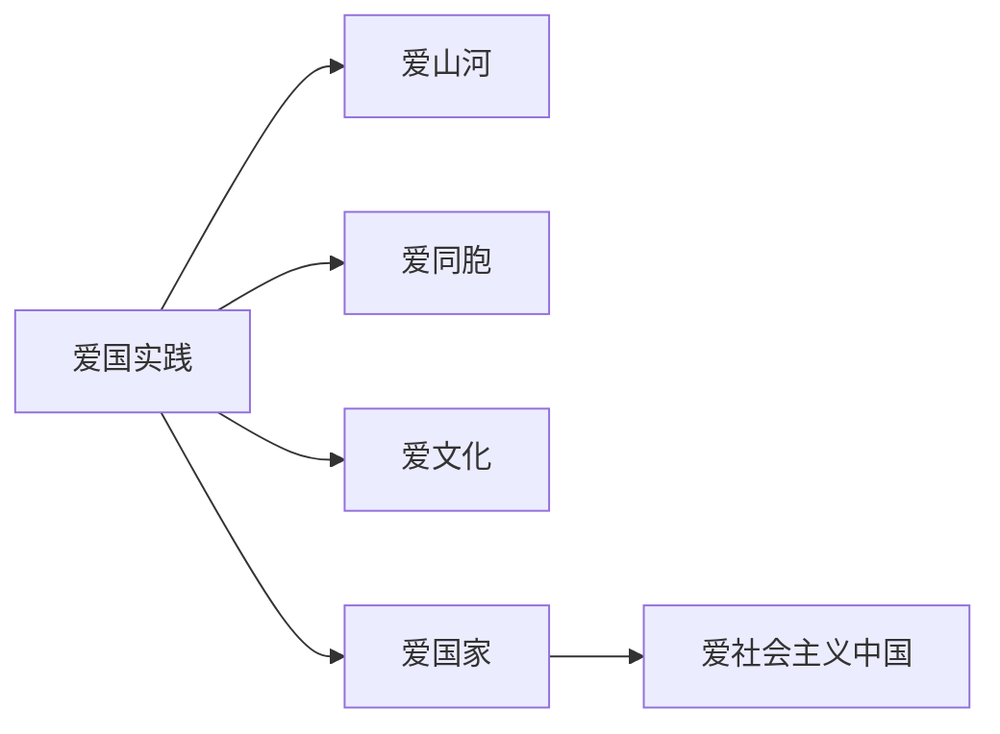

# 做新时代的忠诚爱国者的实践要求

做新时代的忠诚爱国者的实践要求

在学习之前，先想一个问题：如果只把“爱国”当成一句口号，那么当个人利益和国家需要发生冲突时，你会怎么选？这道题其实在问：爱国在行动上到底有哪些必须做到的具体要求？

## 它是什么

做新时代的忠诚爱国者的实践要求，就是教材里“如何做忠诚的爱国者”那一节给出的行动清单。它不是抽象感情，而是可检查的行为规范。结合前面“当代中国爱国主义首先体现在对社会主义中国的热爱上”，新时代爱国者的落脚点非常明确：热爱社会主义中国，并以此为行动起点。

> [!IMPORTANT]
> 核心结论是：==新时代爱国主义首先体现在对社会主义中国的热爱上==，这是政治要求，也是实践要求的根本前提。

## 为什么需要它

爱国主义是中华民族精神的核心。光有“归属感、认同感、尊严感与荣誉感”不够，还要落到行为上。尤其在实现中华民族伟大复兴的中国梦这一新时代爱国主义鲜明主题下，不实践就会变成空谈。

## 怎么做

教材给出四条实践路径，我们可以用一张图串起来：

更具体的行为要求如下：

- 维护和推进祖国统一：坚持一个中国原则，反对分裂。
- 促进民族团结：尊重各民族，反对民族分裂。
- 增强国家安全意识：树立总体国家安全观。
- 以实际行动报国：把个人理想融入中国梦。

> [!TIP]
> 记忆口诀可记为：==统一、团结、安全、报国==，四词对应四大实践方向。

## 和相近概念的区别

很多同学把“爱国主义的基本内涵”和“实践要求”混在一起。看下面这张表：

| 比较项 | 基本内涵 | 实践要求 |
|---|---|---|
| 回答什么 | 爱国“是什么” | 爱国“怎么做” |
| 内容 | 山河、同胞、文化、国家 | 统一、团结、安全、报国 |
| 性质 | 情感与政治要求统一 | 行为规范 |

内涵里“爱自己的国家”是政治要求；实践要求则是把这份爱变成日常动作。

## 常见的坑

> [!WARNING]
> 最常见的坑是：只写“爱国”却不写“社会主义中国”。漏掉它，这道题就拿不到完整分。另一个坑是把“基本内涵”四条直接抄成“实践要求”四条，两者维度不同。

还有一个边界条件：选择题里问“新时代爱国主义调节什么关系”，它调节的是个人与祖国的依存关系，不是普通法律关系。

## 一个算对了的例子

简答 9 “如何做忠诚的爱国者？”的标准作答结构：

1. 先点明：坚持爱国爱党爱社会主义相统一，==首先体现在对社会主义中国的热爱上==。
2. 再写四条：维护和推进祖国统一；促进民族团结；增强国家安全意识；以振兴中华为己任。
3. 收尾：投身中华民族伟大复兴的中国梦实践。

这样写覆盖了“怎么做”的全部得分点，也避开了只抄内涵的坑。
