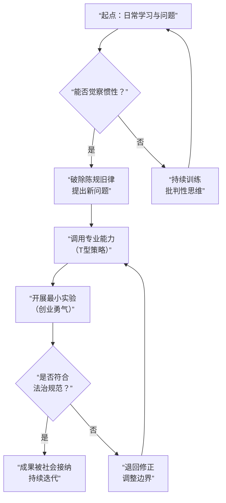

# 做改革创新的生力军（如何培养创新思维与能力）

同学们好，今天我们把这个知识点内化成自己的东西：你怎样才能成为改革创新的“生力军”，而不仅仅是一个旁观者。

我们先从一个最诚实的问题开始——

### 为什么“想创新”和“真创新”之间总有距离？

可能因为你敏锐地发现了一个痛点，也可能纯粹因为你对现状“不服气”。但在课堂上热血澎湃，一回宿舍就惯性刷手机，这正是很多人遇到的第一个现实阻力。所以，从“想创新”到“真创新”，不是靠顿悟，而是靠一套可以被训练出来的思维习惯和行动框架。

### 你首先需要一个“突破惯性”的意识开关

做改革创新的生力军，第一层要求就是**树立改革创新的自觉意识**。它不是什么天赋，而是每天都可以练习的选择：

> 遇到任何被说成“一直就是这样”的流程、观点和结论，先在心里追问一句：“如果换一种做法会怎样？现在的方案真的是最优解吗？”

这就是在破除对陈规的迷信，也是在训练你用批判性思维去发现真问题。没有这一步，后面所有的工具方法都找不到发力点。

不过，光有意识还不够。假如下一步缺乏抓手，很快就会退回原状。

### 能力本领才是把想法落地的底气

这一步在课本里叫**增强改革创新的能力本领**，也就是你需要两样硬通货：**扎实的专业知识**和**过硬的实践技能**。

可以理解为一种 **“T 型”策略**：

-   那一“竖”：你必须深耕某个专业领域，掌握系统的理论框架。没有深度，创新就只能是灵光一闪的点子，很难变成有壁垒的解决方案。
-   那一“横”：同时你要刻意培养跨学科的通识和动手技能，比如数据处理、设计思维、法律常识。因为现实里的棘手难题，从不按学院划分边界来出现。

这里有一个常见误区，觉得专业知识就是背下来的公式和代码片段。其实，专业知识的更高阶形态，是你能够用它来解释现实、预测走向、改造现状。如果做不到这三点，知识就还只是存储，没有成为你的能力本领。

既然有了专业能力，为什么还是有人在创新最后一公里“熄火”？因为从想法到行动，中间隔着一片最大的心理障碍区——对失败的恐惧。

### 创业（事业开拓）的勇气：把实验跑完

课本强调“培养创业的勇气和能力”，并非要求人人去注册公司。它的本质是一种**开拓事业的行动精神**：在资源不完美、答案不清晰时，依然敢于迈出第一步，并且有能力把想法做成一个最小可行版本去验证。

这种勇气，可以从小处开始：

-   小到在实验室里主动提出一个与众不同的假设，并设计实验去验证它；
-   在一个课程设计中，主动承担协调角色，把团队的想法真正推进到交付物；
-   或者是把你写的笔记、代码、模型发布到开源社区，接受真实用户的反馈。

你必须跑通几次“从0到1”的完整闭环，才能真正沉淀出驾驭不确定性的创新技能。

### 关键的边界线：创新不能越过法治的轨道

这是最容易被热血冲淡的一条纪律。改革创新一定不是任性蛮干，而要在法治框架内完成。对你们来说，现在就要开始训练两种**用法能力**：

1.  **保护自己的创新成果**：了解知识产权、著作权、专利的基本规则，知道从哪里为自己的代码、设计、论文主张权利；
2.  **确保自己的行动合法合规**：无论是数据爬取、用户调研，还是产品上线，先用法治思维评估边界在哪里，使自己始终“在法治之下想问题、办事情”。

守法习惯不是创新的刹车，而是防止你翻车的护栏。只有在这一轨道上，你的创新才能被社会接纳和长久积累。

### 一幅路线图：如何一步步成为生力军

你不需要等到毕业那天才成为生力军。下一次小组作业，你是习惯性套用上届模板，还是重新定义问题，哪怕只是改进一个很小的流程？你对这个问题的选择，就是你离“生力军”的真实距离。

上面那个反复验证的闭环，就是“在实践中创造有价值的人生”的具体样子：从社会客观条件和自身条件出发，不断在解决实际问题中增长才干，提高实践能力与创新能力。这一点没有捷径，但每一步都算数。
