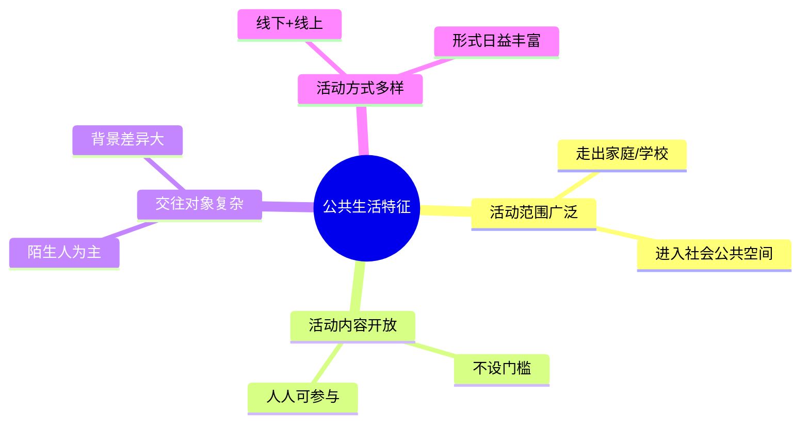
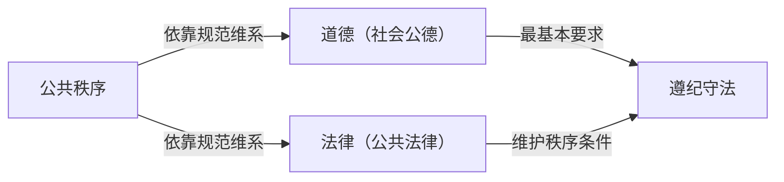

# 公共生活需要公共秩序

## 为什么公共生活需要公共秩序

先想象两个场景：

- 早高峰的地铁站，所有人都不排队、不先下后上，结果车门一开所有人同时往里挤，谁也上不去、谁也下不来。
- 图书馆里有人大声打电话、有人外放刷短视频，结果没有人能在里面安心看书。

**公共生活**是我们在公共空间里与陌生人共同进行的活动，而**公共秩序**就是让这些活动能够正常进行的那套“看不见的规则”。它由规范（道德、法律、纪律等）来制约和保障，表现为一种有序化状态，比如交通秩序、教学秩序、网络秩序等。

==有序的公共生活是社会生产活动的重要基础，是提高社会成员生活质量的基本保障，更是社会文明的重要标志。==

我们可以从三个层次来理解公共秩序为什么“非有不可”。

### 一、它是什么——公共生活的特征决定了必须有秩序

公共生活有四个鲜明特征，正是这些特征使秩序成为刚需：

当交往对象彼此陌生、利益诉求各不相同，又没有秩序来调节，冲突就不可避免。所以说：==公共生活领域越扩大，对公共秩序的要求就越高。==

### 二、为什么需要——公共秩序的三大重要性

> [!IMPORTANT]
> 公共秩序的三大重要性（考试常考的“为什么”三段论）

**基础功能：**
> 有序的公共生活是社会生产活动的重要基础。

工厂需要工作秩序来组织生产，城市需要交通秩序来保障物流——没有公共秩序，社会经济活动就会陷入混乱，生产无法正常进行。

**保障功能：**
> 良好公共秩序是提高社会成员生活质量的基本保障。

我们每个人都在公共场所活动，安全的出行环境、安静的休息空间、清洁的公共区域，这些都需要秩序来维持。一个人的“生活质量”并不仅仅取决于自家的装修档次，更取决于走出家门那一刻所面对的环境。

**标志功能：**
> 有序的公共生活是社会文明的重要标志。

一个社会的文明程度，不是看它建了多少摩天大楼，而是看公共场所里人们是否自觉排队、是否保持安静、是否遵守规则。公共秩序是一个国家现代化程度的“晴雨表”。

### 三、怎么做——维护公共秩序要从遵守规范开始

维护公共秩序，落实到每个人的日常行为中，主要依靠**社会公德**的践行。结合考试中反复出现的题目：

> 乘车、登机、坐船时主动购票自觉排队；出行时遵守交通规则不闯红灯；在图书馆影剧院不抽烟不喧哗吵闹——这些都属于 **社会公德**（A）。

社会公德中最基本的要求是**遵纪守法**，它同时也是维护公共秩序的重要条件。这不是选择题里那一两个选项的偶然对应，而是一个根本逻辑：==社会公德→遵纪守法→公共秩序得以维系==。

### 容易混淆的辨析

- 公共秩序 ≠ 公共法律：法律是维护秩序的**手段之一**，道德同样重要。
- 社会公德 ≠ 职业道德：题干若出现“图书馆”“交通”“排队”等公共场所情境，指向的是社会公德；若题干出现“爱岗敬业”“诚实守信”等职业情境，才指向职业道德。

### 一道“算对了”的思路示例

以简答题“为什么说公共生活需要公共秩序”为例，标准答法应该抓住三个关键词：

1. **基础**——有序公共生活是社会生产活动的重要基础
2. **保障**——良好公共秩序是提高社会成员生活质量的基本保障
3. **标志**——有序公共生活是社会文明的重要标志

判断是否“答对了”，就是看你有没有把这三个层次完整展开，并且和公共生活的四个特征建立联系：正是因为活动范围广泛、对象复杂、内容开放、方式多样，才使得这三个层次的需求变得如此迫切。

> [!TIP]
> 记忆口诀：“基保标” —— 基础、保障、标志。看到“公共秩序重要性”直接对应这三个词展开。
