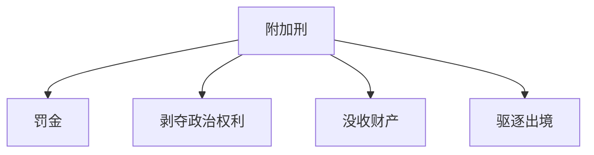

# 我国刑法规定的刑罚种类和制度（主刑与附加刑）

## 刑罚是什么

一个人实施了刑法禁止的行为，构成了犯罪，接下来要面对的是什么？就是刑罚。刑罚是刑法规定的、由人民法院依法对犯罪人适用的最严厉的法律制裁。它不仅是国家对犯罪行为的否定评价，更是用强制力剥夺或限制犯罪人某些权益的制度化手段。

> [!IMPORTANT]
> ==刑罚是最严厉的法律制裁==，它直接涉及人的自由、财产、政治权利乃至生命。正因如此，刑罚只能由人民法院依法适用，其他任何机关、团体和个人都无权适用。

## 主刑与附加刑

我国刑法将刑罚分为两大类：**主刑**和**附加刑**。主刑只能独立适用，一个罪只能判一个主刑；附加刑既可以独立适用，也可以附加在主刑上一起用。

### 主刑

主刑是刑罚体系的核心，按严厉程度从轻到重排列：

| 主刑 | 期限 | 关键特征 |
|------|------|----------|
| **管制** | 3个月～2年，数罪并罚≤3年 | ==不关押==，依法实行社区矫正，限制部分自由 |
| **拘役** | 1个月～6个月，数罪并罚≤1年 | 短期剥夺自由，就近关押，每月可回家1～2天 |
| **有期徒刑** | 6个月～15年，数罪并罚≤25年（总和＜35年时≤20年） | 在监狱关押，==最常用==的主刑 |
| **无期徒刑** | 终身 | 剥夺终身自由，但服刑中可依法减刑、假释 |
| **死刑** | — | ==剥夺生命==，只适用于罪行极其严重的犯罪人 |

> [!WARNING]
> 管制和拘役很容易混淆。关键区别：**管制不关押**，犯罪人仍可正常生活工作，只是受到一定限制；**拘役是关押**，剥夺人身自由，只是刑期短、就近执行。

### 附加刑

附加刑补充主刑适用，也可以独立适用。

| 附加刑 | 内容 | 适用注意 |
|--------|------|----------|
| **罚金** | 强制向国家缴纳一定数额金钱 | 与罚款不同——罚金是刑罚，罚款是行政处罚 |
| **剥夺政治权利** | 剥夺选举权与被选举权、言论出版集会结社游行示威自由、担任国家机关职务等权利 | 危害国家安全、被判处死刑或无期徒刑的犯罪人==必须附加== |
| **没收财产** | 将犯罪人个人所有财产的一部分或全部无偿收归国有 | 只能没收==个人合法财产==，不能没收家属的财产 |
| **驱逐出境** | 强迫犯罪的外国人离开中国国境 | 只能对==犯罪的外国人==适用 |

> [!TIP]
> 记忆口诀：主刑五等，从轻到重——“管拘有无死”；附加刑四种——“罚剥没驱”。主刑的“管”不关押，“拘”短期关；“有期”最常用，“无期”终身关，“死刑”最严厉。

## 主刑和附加刑能一起用吗

可以。附加刑的核心特点就是“附加”——一个犯罪人可以同时被判有期徒刑（主刑）和罚金（附加刑），两个一起执行。但附加刑也可以“单飞”：比如犯罪情节较轻，不需要判主刑，法院可以只判处罚金。

> [!NOTE]
> **刑罚制度**还包括量刑制度和行刑制度。常见的有：
> - **自首**：犯罪后自动投案并如实供述，可从轻或减轻处罚。
> - **立功**：揭发他人犯罪或提供重要线索等，可从轻或减轻处罚。
> - **缓刑**：对判处拘役、3年以下有期徒刑的犯罪人，附条件不执行原判刑罚。
> - **减刑、假释**：在服刑期间对表现良好者的奖励性制度。

## 一个算对了的例子

甲因诈骗罪被判处有期徒刑5年，并处罚金10万元；同时因罪行涉及国家安全，附加剥夺政治权利2年。

- **主刑**：有期徒刑5年（独立适用，一个罪一个主刑）
- **附加刑**：罚金10万元 + 剥夺政治权利2年（两个附加刑同时附加于主刑）

这里罚金是财产刑，剥夺政治权利是资格刑，两者性质不同，可以并用。甲服完5年有期徒刑后，剥夺政治权利的2年从刑满释放之日起算。
