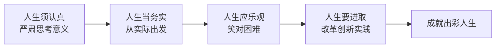

# 在实践中创造有意义的人生（成就出彩人生）

## 成就出彩人生：在实践中创造有意义的人生

### 它是什么

“在实践中创造有意义的人生”要回答一个根本问题：来到大学、走向社会，==怎样才算没有白活==。教材把这个问题的落脚点放在“成就出彩人生”（P25、P38‑39），它不是要求每个人都要惊天动地，而是强调：==

> **人生的意义不是“想”出来的，而是在与时代同向、与人民同行的实践中“做”出来的。**

一个常见的误解是把“有意义”等同于“挣大钱”或“过得舒服”。教材的观点更深刻：意义来自**对他人、对社会、对历史的贡献**。课件把“树立正确的幸福观”也编入与此相关的考题（P20），已经暗示了——真正的幸福不是单纯的感官快乐或物质占有，而是人在奋斗和奉献中获得的精神满足。

### 为什么需要“实践”才是桥梁

先把几个知识点串起来理解：

- 知识点 5：人生价值评价的根本尺度，是看一个人的活动是否符合社会发展规律、是否通过实践促进了历史进步。
- 知识点 6：只有实践才是通往理想彼岸的桥梁。
- 简答 4：人的价值包含**自我价值**（社会对个人需要的满足）与**社会价值**（个人对社会的贡献），两者互为前提：你越能在实践中为他人和社会创造价值，就越能获得自身发展的资源和舞台，从而成就更好的自己。

如果把“有意义的理想人生”看作彼岸，实践就是唯一的桥。光读书、光思考不会自动产生价值，只有把想法付诸行动，把知识用于解决问题，==价值才从潜在变为现实==。

### 怎么做：四条行动路径

结合简答题“大学生如何树立积极进取的人生态度”及教材 P38‑39 的要点，可以概括为四个层次：

> [!IMPORTANT]
> 积极进取的人生态度要求做到四个“人生”：**认真、务实、乐观、进取**。一个人连认真对待人生都做不到，就谈不上后面的一切。

#### 第一，人生须认真
要严肃思考“我这一生要承担什么责任，留下什么价值”，而不是随波逐流。例如，读大学不是“混个文凭”，而是想清楚自己要成为什么样的人，并主动扛起学习与成长的责任。

#### 第二，人生当务实
理想必须和现实对接。空谈“我要改变世界”却没有行动，只会变成眼高手低。务实意味着从自己的专业出发，从小事做起，用科学的态度分析社会需求，用踏实的劳动创造价值。

#### 第三，人生应乐观
实践中必然有挫折，乐观不是盲目笑，而是认识到困难是成长的契机。乐观的人能从失败中汲取力量，而不是被失败定义。

#### 第四，人生要进取
进取的人生态度以改革创新为核心。新时代的大学生不能当“舒适区”里的旁观者，而要主动投身创新创造，在解决真问题中彰显价值。

### 和相近概念的区别

| 概念 | 常见误解 | 正确理解 |
|------|----------|----------|
| 幸福观（P20） | 幸福 = 物质享乐 + 没有压力 | 幸福是奋斗中的精神满足，是物质生活与精神生活的统一 |
| 有意义的人生 | 意义 = 个人成就、知名、财富 | 意义的根本尺度是==社会价值==，即是否促进了历史进步 |
| 自我价值 | 自己过得好就有自我价值 | 自我价值需要通过服务社会才能获得更丰厚的实现基础 |

> [!WARNING]
> 功利思维是学生最常见的坑：刻意追求“对我有没有用”，反而会与真正有意义的事擦肩而过。如果你只问“这件事能不能给我学分/加分/证书”，就容易被短期利益遮蔽长期价值。

> [!CAUTION]
> 实践不是盲目“忙起来”。只做体力活却没有反思、没有方向，只是消耗；必须在实践中校准理想，让行动朝着促进历史进步的方向走。

### 一个“算对了”的例子

小陈是一名大一通信工程学生。大二起，他注意到家乡偏远地区的孩子们缺乏科普资源。他没有停留在“我想帮他们”的感慨上，而是：

1. **认真**：思考自己大学四年的责任——不仅学好专业，更要让技术红利惠及更多人。
2. **务实**：和几个同学用课余时间把通信原理做成十几集简短的动画科普课，并通过公益组织对接乡村学校。
3. **乐观**：第一次录课效果很差，孩子们觉得听不懂。他们没有放弃，而是重新迭代，把专业知识翻译成更通俗的语言。
4. **进取**：项目后来发展成一项校级志愿服务品牌，毕业时小陈不但收获了扎实的专业能力，更在服务社会的过程中找到了自己真正想从事的事业方向。

**这个例子“计算”出了什么？**  
小陈的个人成长（自我价值）在服务乡村儿童的过程中加速实现，而服务对象实实在在地获得了优质科普资源（社会价值），两者互相促进，正是==成就出彩人生==的典型样本。

> [!TIP]
> 考试遇到“如何在实践中成就出彩人生”这类的简答题或论述题，答题框架可直接采用：**“总—分—总”结构**：
> ① 先点明实践是连接理想与现实的桥梁，人生价值根本在于社会贡献；  
> ② 再展开四个人生态度（认真、务实、乐观、进取），并分别结合大学生实例；  
> ③ 最后回归新时代历史责任，强调与人民同行、与时代同向的实践方能成就出彩人生。

人生的出彩，从来不是一个人孤独地站在灯光下，而是一个人在照亮别人的过程中看见了自己生命的光。
